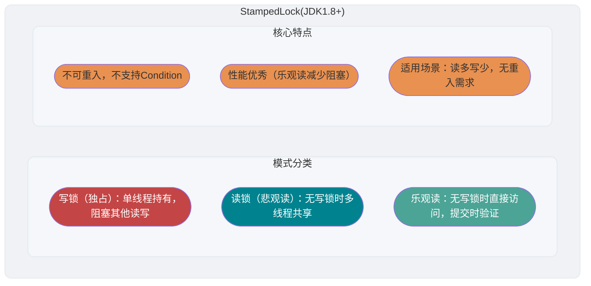

<!-- @include: @article-header.snippet.md -->

## ⭐️ JMM 相关的问题比较多，也比较重要，于是我单独抽了一篇文章来总结 JMM 相关的知识点和问题：[JMM 详解](https://javaguide.cn/java/concurrent/jmm.html)。

## ⭐️ volatile Keyword

### 如何保证 Variable 的 Visibility？

在 Java 中，`volatile` Keyword 可以保证 Variable 的 Visibility。对某个 `volatile` Variable 的写入 happens-before 于后续对同一 Variable 的读取，因此读 Thread 能够看到该写入以及写入前按 happens-before 传递过来的结果。这是 JMM 规定的语义，不等同于要求每次访问都绕过 CPU Cache、直接读写物理 Main Memory。


`volatile` Keyword 并非 Java 语言特有，但不同语言中的语义并不相同。Java 的 `volatile` 由 JMM 定义 Visibility 和 Ordering 保证，不能解释为“禁用 CPU Cache”。

`volatile` Keyword 能保证数据的 Visibility，但不能保证数据的 Atomicity。`synchronized` Keyword 两者都能保证。

### 如何禁止 Instruction Reordering？

**在 Java 中，`volatile` Keyword 除了可以保证 Variable 的 Visibility，还有一个重要的作用就是防止 Java Virtual Machine (JVM) 的 Instruction Reordering。** 如果我们将 Variable 声明为 **`volatile`**，在对这个 Variable 进行读 Write Operation 的时候，会通过插入特定的 **Memory Barrier** 的方式来禁止 Instruction Reordering。

在 Java 中，`Unsafe` Class 提供了三个开箱即用的 Memory Barrier 相关的 Method，屏蔽了 Operating System 底层的差异：

```java
public native void loadFence();
public native void storeFence();
public native void fullFence();
```

理论上来说，你通过这个三个 Method 也可以实现和 `volatile` 禁止 Reordering 一样的效果，只是会麻烦一些。

#### 4 种 Memory Barrier Type

在讲解 JVM 实现时，常用下面 4 Class Memory Barrier 来描述需要约束的 Reordering 关系。它们是便于理解的实现层模型，并不是 JLS 对 JVM 必须逐条插入哪些具体屏障 Instruction 的规定：

| 屏障 Type | Instruction 示例 | 说明 |
| -------------- | ---------------------------- | ---------------------------------------------------------------------------------------------------------------------------------------------------------------------------------------- |
| **LoadLoad** | `Load1; LoadLoad; Load2` | 保证 `Load1` 的读取操作在 `Load2` 及其后续读取操作之前完成 |
| **StoreStore** | `Store1; StoreStore; Store2` | 约束两个 Write Operation 的顺序，使 `Store1` 的效果不会晚于 `Store2` 对其他处理器可见 |
| **LoadStore** | `Load1; LoadStore; Store2` | 保证 `Load1` 的读取操作在 `Store2` 及其后续写入操作刷新到内存之前完成 |
| **StoreLoad** | `Store1; StoreLoad; Load2` | 保证 `Store1` 的写入操作对其他处理器可见，先于 `Load2` 及其后续读取操作。`StoreLoad` 屏障的 Overhead 是四种屏障中最大的，它同时具有其他三种屏障的效果，因此也称为 **全能屏障（Full Barrier）** |

#### volatile 读 Write Operation 的 Memory Barrier 插入策略

下面是一种便于理解 `volatile` 语义的保守屏障插入策略。实际 JVM 会根据目标处理器的 Memory Model 选择、合并或省略具体屏障，只要最终行为满足 JMM 即可：

**volatile Write Operation 的 Memory Barrier 插入策略：**

在每个 volatile Write Operation 的 **前面** 插入一个 `StoreStore` 屏障，在 **后面** 插入一个 `StoreLoad` 屏障。

```
StoreStore 屏障
volatile 写操作
StoreLoad 屏障
```

- 前面的 `StoreStore` 屏障：保证 `volatile` 写之前的普通写不会被 Reordering 到该 `volatile` 写之后。
- 后面的 `StoreLoad` 屏障：保证 volatile 写之后，其写入的值对后续的 volatile 读/Write Operation 可见。这是 Overhead 最大的屏障，但也是最关键的——它避免了 volatile 写与后面可能有的 volatile 读/Write Operation 发生 Reordering。

**volatile Read Operation 的 Memory Barrier 插入策略：**

在每个 volatile Read Operation 的 **后面** 插入一个 `LoadLoad` 屏障和一个 `LoadStore` 屏障。

```
volatile 读操作
LoadLoad 屏障
LoadStore 屏障
```

- `LoadLoad` 屏障：保证 volatile 读之后的普通 Read Operation 不会被 Reordering 到 volatile 读之前。
- `LoadStore` 屏障：保证 volatile 读之后的普通 Write Operation 不会被 Reordering 到 volatile 读之前。

这样一来，volatile 写-读的组合就建立了一个类似于 **Lock 的释放-获取** 的语义：**volatile Write Operation 之前的所有操作结果，对于后续对该 volatile Variable 的 Read Operation 之后的所有操作都是可见的。**

下面我以一个常见的面试题为例讲解一下 `volatile` Keyword 禁止 Instruction Reordering 的效果。

面试中面试官经常会说：“Singleton 了解吗？来给我手写一下！给我解释一下双重检验 Lock 方式实现 Singleton 的原理呗！”

**双重校验 Lock 实现 Object 单例（Thread-safe）**：

```java
public class Singleton {

    private volatile static Singleton uniqueInstance;

    private Singleton() {
    }

    public static Singleton getUniqueInstance() {
       //先判断对象是否已经实例过，没有实例化过才进入加锁代码
        if (uniqueInstance == null) {
            //类对象加锁
            synchronized (Singleton.class) {
                if (uniqueInstance == null) {
                    uniqueInstance = new Singleton();
                }
            }
        }
        return uniqueInstance;
    }
}
```

`uniqueInstance` 采用 `volatile` Keyword 修饰也是很有必要的， `uniqueInstance = new Singleton();` 这段代码其实是分为三步执行：

1. 为 `uniqueInstance` 分配内存空间
2. Initialization `uniqueInstance`
3. 将 `uniqueInstance` 指向分配的内存 Address

但是由于 JVM 具有 Instruction Reordering 的特性，执行顺序有可能变成 1->3->2。 Instruction Reordering 在 Single Thread 环境下不会出现问题，但是在 Multithreading 环境下会导致一个 Thread 获得还没有 Initialization 的 Instance。例如，Thread T1 执行了 1 和 3，此时 T2 调用 `getUniqueInstance`() 后发现 `uniqueInstance` 不为空，因此返回 `uniqueInstance`，但此时 `uniqueInstance` 还未被 Initialization。

#### 从 Memory Barrier 角度理解 DCL 必须使用 volatile

上面从 Instruction Reordering 的角度解释了 DCL 单例中 `uniqueInstance` 为什么需要 `volatile` 修饰。下面从 Memory Barrier 的角度进一步分析 `volatile` 是如何解决这个问题的。

`uniqueInstance = new Singleton();` 这行代码的三个步骤（分配内存、Initialization Object、赋值 Reference）中，如果不加 `volatile`，步骤 2 和步骤 3 可能会被 Reordering 为 1→3→2。加了 `volatile` 之后，由于 `uniqueInstance` 是 volatile Variable，对它的 Write Operation（步骤 3：将 Reference 赋值给 `uniqueInstance`）会按照前面介绍的 volatile 写的 Memory Barrier 插入策略来处理：

1. 在 volatile 写 **之前** 插入 `StoreStore` 屏障：保证步骤 1（分配内存）和步骤 2（Initialization Object）的 Write Operation 在步骤 3（赋值 Reference）之前完成，**禁止了步骤 2 和步骤 3 的 Reordering**。
2. 在 volatile 写 **之后** 插入 `StoreLoad` 屏障：约束该写与后续读写的 Reordering，并配合 `volatile` 读建立 JMM 要求的 Visibility。

这样，当 Thread T2 读取 `uniqueInstance` 时（volatile 读），如果发现 `uniqueInstance != null`，那么可以保证该 Object 一定已经被完全 Initialization 了。

### volatile 与 happens-before 的关系

JMM 中的 happens-before 原则是判断数据是否存在竞争、Thread 是否安全的重要依据。`volatile` Variable 的读 Write Operation 与 happens-before 原则有着密切的关系。

> 关于 happens-before 原则的详细介绍，可以参考 [JMM 详解](https://javaguide.cn/java/concurrent/jmm.html) 这篇文章。

happens-before 原则中与 `volatile` 直接相关的是 **volatile Variable 规则**：

> **对一个 volatile Variable 的 Write Operation happens-before 于后续对该 volatile Variable 的 Read Operation。**

也就是说，如果 Thread A 写入了一个 volatile Variable，Thread B 随后读取了同一个 volatile Variable，那么 Thread A 在写入 volatile Variable 之前所做的所有修改（包括对非 volatile Variable 的修改），对 Thread B 都是可见的。

这个规则配合 happens-before 的 **传递性规则**（如果 A happens-before B，B happens-before C，那么 A happens-before C），可以实现一种轻量级的 Thread 间通信。下面通过一个示例来说明：

```java
public class VolatileHappensBeforeDemo {
    private int a = 0;
    private int b = 0;
    private volatile boolean flag = false;

    // 线程 A 执行
    public void writer() {
        a = 1;           // 操作1：普通写
        b = 2;           // 操作2：普通写
        flag = true;     // 操作3：volatile 写
    }

    // 线程 B 执行
    public void reader() {
        if (flag) {      // 操作4：volatile 读
            int x = a;   // 操作5：普通读，x 一定等于 1
            int y = b;   // 操作6：普通读，y 一定等于 2
            System.out.println("x=" + x + ", y=" + y);
        }
    }
}
```

上面代码中，happens-before 关系链如下：

1. 操作 1、操作 2 happens-before 操作 3（**程序顺序规则**：同一 Thread 中，前面的操作 happens-before 后面的操作）
2. 操作 3 happens-before 操作 4（**volatile Variable 规则**：volatile 写 happens-before volatile 读）
3. 操作 4 happens-before 操作 5、操作 6（**程序顺序规则**）

根据 **传递性**：操作 1、操作 2 happens-before 操作 5、操作 6。

因此，当 Thread B 在操作 4 读取到 `flag == true` 时，Thread A 在操作 3 之前对 `a` 和 `b` 的修改对 Thread B 一定是可见的。这里的关键在于：**volatile Variable 的写-Read Operation，不仅保证了 volatile Variable 本身的 Visibility，还通过 happens-before 的传递性“顺带”保证了其前后普通 Variable 的 Visibility。**

这也解释了为什么在实际开发中，`volatile` 经常被用作 **状态标志位**（如上面例子中的 `flag`），它可以在不使用 Lock 的情况下，安全地在 Thread 间传递状态信息，同时保证相关数据的 Visibility。

### volatile 可以保证 Atomicity 么？

**`volatile` Keyword 能保证 Variable 的 Visibility，但不能保证对 Variable 的操作是 Atomicity 的。**

我们通过下面的代码即可证明：

```java
/**
 * 微信搜 JavaGuide 回复"面试突击"即可免费领取个人原创的 Java 面试手册
 *
 * @author Guide哥
 * @date 2022/08/03 13:40
 **/
public class VolatileAtomicityDemo {
    public volatile static int inc = 0;

    public void increase() {
        inc++;
    }

    public static void main(String[] args) throws InterruptedException {
        ExecutorService threadPool = Executors.newFixedThreadPool(5);
        VolatileAtomicityDemo volatileAtomicityDemo = new VolatileAtomicityDemo();
        for (int i = 0; i < 5; i++) {
            threadPool.execute(() -> {
                for (int j = 0; j < 500; j++) {
                    volatileAtomicityDemo.increase();
                }
            });
        }
        // 等待1.5秒，保证上面程序执行完成
        Thread.sleep(1500);
        System.out.println(inc);
        threadPool.shutdown();
    }
}
```

正常情况下，运行上面的代码理应输出 `2500`。但你真正运行了上面的代码之后，你会发现每次输出结果都小于 `2500`。

为什么会出现这种情况呢？不是说好了，`volatile` 可以保证 Variable 的 Visibility 嘛！

也就是说，如果 `volatile` 能保证 `inc++` 操作的 Atomicity 的话。每个 Thread 中对 `inc` Variable 自增完之后，其他 Thread 可以立即看到修改后的值。5 个 Thread 分别进行了 500 次操作，那么最终 inc 的值应该是 5\*500=2500。

很多人会误认为自增操作 `inc++` 是 Atomicity 的，实际上，`inc++` 其实是一个 Compound Operation，包括三步：

1. 读取 inc 的值。
2. 对 inc 加 1。
3. 将 inc 的值写回内存。

`volatile` 是无法保证这三个操作是具有 Atomicity 的，有可能导致下面这种情况出现：

1. Thread 1 对 `inc` 进行读取操作之后，还未对其进行修改。 Thread 2 又读取了 `inc` 的值并对其进行修改（+1），再将 `inc` 的值写回内存。
2. Thread 2 操作完毕后，Thread 1 对 `inc` 的值进行修改（+1），再将 `inc` 的值写回内存。

这也就导致两个 Thread 分别对 `inc` 进行了一次自增操作后，`inc` 实际上只增加了 1。

其实，如果想要保证上面的代码运行正确也非常简单，利用 `synchronized`、`Lock` 或者 `AtomicInteger` 都可以。

使用 `synchronized` 改进：

```java
public synchronized void increase() {
    inc++;
}
```

使用 `AtomicInteger` 改进：

```java
public AtomicInteger inc = new AtomicInteger();

public void increase() {
    inc.getAndIncrement();
}
```

使用 `ReentrantLock` 改进：

```java
Lock lock = new ReentrantLock();
public void increase() {
    lock.lock();
    try {
        inc++;
    } finally {
        lock.unlock();
    }
}
```

## ⭐️ Optimistic Lock 和 Pessimistic Lock

### 什么是 Pessimistic Lock？

Pessimistic Lock 总是假设最坏的情况，认为 Shared Resource 每次被访问的时候就会出现问题（比如 Shared 数据被修改），所以每次在获取资源操作的时候都会上 Lock，这样其他 Thread 想拿到这个资源就会 Blocking 直到 Lock 被上一个持有者释放。也就是说，**Shared Resource 每次只给一个 Thread 使用，其它 Thread Blocking，用完后再把资源转让给其它 Thread**。

像 Java 中 `synchronized` 和 `ReentrantLock` 等 Exclusive Lock 就是 Pessimistic Lock 思想的实现。

```java
public void performSynchronisedTask() {
    synchronized (this) {
        // 需要同步的操作
    }
}

private Lock lock = new ReentrantLock();
lock.lock();
try {
   // 需要同步的操作
} finally {
    lock.unlock();
}
```

High Concurrency 的场景下，激烈的 Lock Contention 会造成 Thread Blocking，大量 Blocking Thread 会导致系统的 Context Switch，增加系统的 Performance Overhead。并且，Pessimistic Lock 还可能会存在 Deadlock 问题，影响代码的正常运行。

### 什么是 Optimistic Lock？

Optimistic Lock 总是假设最好的情况，认为 Shared Resource 每次被访问的时候不会出现问题，Thread 可以不停地执行，无需 Locking 也无需等待，只是在提交修改的时候去验证对应的资源（也就是数据）是否被其它 Thread 修改了（具体方法可以使用 Version 机制或 Compare-And-Swap (CAS) Algorithm）。

在 Java 中 `java.util.concurrent.atomic` Package 下面的 Atomic Variable Class（比如 `AtomicInteger`、`LongAdder`）就是使用了 Optimistic Lock 的一种实现方式 **CAS** 实现的。


```java
// LongAdder 在高并发场景下会比 AtomicInteger 和 AtomicLong 的性能更好
// 代价就是会消耗更多的内存空间（空间换时间）
LongAdder sum = new LongAdder();
sum.increment();
```

High Concurrency 的场景下，Optimistic Lock 相比 Pessimistic Lock 来说，不存在 Lock Contention 造成 Thread Blocking，也不会有 Deadlock 的问题，在 Performance 上往往会更胜一筹。但是，如果冲突频繁发生（写占比非常多的情况），会频繁失败和 Retry，这样同样会非常影响 Performance，导致 CPU 飙升。

不过，大量失败 Retry 的问题也是可以解决的，像我们前面提到的 `LongAdder` 以空间换时间的方式就解决了这个问题。

理论上来说：

- Pessimistic Lock 通常多用于写比较多的情况（多写场景，竞争激烈），这样可以避免频繁失败和 Retry 影响 Performance，Pessimistic Lock 的 Overhead 是固定的。不过，如果 Optimistic Lock 解决了频繁失败和 Retry 这个问题的话（比如 `LongAdder`），也是可以考虑使用 Optimistic Lock 的，要视实际情况而定。
- Optimistic Lock 通常多用于写比较少的情况（多读场景，竞争较少），这样可以避免频繁 Locking 影响 Performance。不过，Optimistic Lock 主要针对的 Object 是单个 Shared Variable（参考 `java.util.concurrent.atomic` Package 下面的 Atomic Variable Class）。

### 如何实现 Optimistic Lock？

Optimistic Lock 一般会使用 Version 机制或 CAS Algorithm 实现，CAS Algorithm 相对来说更多一些，这里需要格外注意。

#### Version 机制

一般是在数据表中加上一个数据 Version `version` Field，表示数据被修改的次数。当数据被修改时，`version` 值会加一。当 Thread A 要更新数据值时，在读取数据的同时也会读取 `version` 值，在提交更新时，若刚才读取到的 version 值为当前 Database 中的 `version` 值相等时才更新，否则 Retry 更新操作，直到更新成功。

**举一个简单的例子**：假设 Database 中帐户信息表中有一个 version Field，当前值为 1；而当前帐户余额 Field（`balance`）为 \$100。

1. 操作员 A 此时将其读出（`version`=1），并从其帐户余额中扣除 $50（$100-\$50）。
2. 在操作员 A 操作的过程中，操作员 B 也读入此用户信息（`version`=1），并从其帐户余额中扣除 $20（$100-\$20）。
3. 操作员 A 完成了修改工作，将数据 Version（`version`=1），连同帐户扣除后余额（`balance`=\$50），提交至 Database 更新，此时由于提交数据版本等于 Database 记录当前版本，数据被更新，Database 记录 `version` 更新为 2。
4. 操作员 B 完成了操作，也将 Version（`version`=1）试图向 Database 提交数据（`balance`=\$80），但此时比对 Database 记录版本时发现，操作员 B 提交的数据 Version 为 1，Database 记录当前版本也为 2，不满足 “ 提交版本必须等于当前版本才能执行更新 ” 的 Optimistic Lock 策略，因此，操作员 B 的提交被驳回。

这样就避免了操作员 B 用基于 `version`=1 的旧数据修改的结果覆盖操作员 A 的操作结果的可能。

#### CAS Algorithm

CAS 的全称是 **Compare And Swap（比较与交换）**，用于实现 Optimistic Lock，被广泛应用于各大框架中。CAS 的思想很简单，就是用一个预期值和要更新的 Variable 值进行比较，两值相等才会进行更新。

CAS 是一个 Atomic Operation，底层依赖于一条 CPU 的 Atomic Instruction。

> **Atomic Operation** 即最小不可拆分的操作，也就是说操作一旦开始，就不能被打断，直到操作完成。

CAS 涉及到三个 Operand：

- **V**：要更新的 Variable 值(Var)
- **E**：预期值(Expected)
- **N**：拟写入的新值(New)

当且仅当 V 的值等于 E 时，CAS 通过 Atomic 方式用新值 N 来更新 V 的值。如果不等，说明已经有其它 Thread 更新了 V，则 Current Thread 放弃更新。

**举一个简单的例子**：Thread A 要修改 Variable i 的值为 6，i 原值为 1（V = 1，E=1，N=6，假设不存在 ABA 问题）。

1. i 与 1 进行比较，如果相等， 则说明没被其他 Thread 修改，可以被设置为 6。
2. i 与 1 进行比较，如果不相等，则说明被其他 Thread 修改，Current Thread 放弃更新，CAS 操作失败。

当多个 Thread 同时使用 CAS 操作一个 Variable 时，只有一个会胜出，并成功更新，其余均会失败，但失败的 Thread 并不会被挂起，仅是被告知失败，并且允许再次尝试，当然也允许失败的 Thread 放弃操作。

Java 代码可以通过 Atomic Class、`VarHandle` 等 API 表达 CAS 语义。HotSpot 通常会把相关调用识别为 JVM 内部 Function，再映射为目标处理器支持的 Atomic Instruction 或等价实现；这并不是 Java 规范固定要求的“Java Native Interface (JNI) 调用 C++ 内联汇编”。

`sun.misc` Package 下的 `Unsafe` Class 提供了 `compareAndSwapObject`、`compareAndSwapInt`、`compareAndSwapLong` Method 来实现的对 `Object`、`int`、`long` Type 的 CAS 操作

```java
/**
  *  CAS
  * @param o         包含要修改field的对象
  * @param offset    对象中某field的偏移量
  * @param expected  期望值
  * @param update    更新值
  * @return          true | false
  */
public final native boolean compareAndSwapObject(Object o, long offset,  Object expected, Object update);

public final native boolean compareAndSwapInt(Object o, long offset, int expected,int update);

public final native boolean compareAndSwapLong(Object o, long offset, long expected, long update);
```

关于 `Unsafe` Class 的详细介绍可以看这篇文章：[Java 魔法 Class Unsafe 详解 - JavaGuide - 2022](https://javaguide.cn/java/basis/unsafe.html)。

### Java 中 CAS 是如何实现的？

在 Java 中，实现 CAS（Compare-And-Swap, CAS）操作的一个关键 Class 是 `Unsafe`。

`Unsafe` Class 位于 `sun.misc` Package 下，是一个提供低级别、不安全操作的 Class。由于其强大的功能和潜在的危险性，它通常用于 JVM 内部或一些需要极 High Performance 和底层访问的库中，而不推荐普通开发者在应用程序中使用。关于 `Unsafe` Class 的详细介绍，可以阅读这篇文章：📌[Java 魔法 Class Unsafe 详解](https://javaguide.cn/java/basis/unsafe.html)。

`sun.misc` Package 下的 `Unsafe` Class 提供了 `compareAndSwapObject`、`compareAndSwapInt`、`compareAndSwapLong` Method 来实现的对 `Object`、`int`、`long` Type 的 CAS 操作：

```java
/**
 * 以原子方式更新对象字段的值。
 *
 * @param o        要操作的对象
 * @param offset   对象字段的内存偏移量
 * @param expected 期望的旧值
 * @param x        要设置的新值
 * @return 如果值被成功更新，则返回 true；否则返回 false
 */
boolean compareAndSwapObject(Object o, long offset, Object expected, Object x);

/**
 * 以原子方式更新 int 类型的对象字段的值。
 */
boolean compareAndSwapInt(Object o, long offset, int expected, int x);

/**
 * 以原子方式更新 long 类型的对象字段的值。
 */
boolean compareAndSwapLong(Object o, long offset, long expected, long x);
```

JDK 8 中 `Unsafe` 的这些 CAS Method 是 `native` Method。Java 代码通过它们表达 Atomic CAS 语义，HotSpot 通常会将相关调用作为 JVM 内部 Function 处理，并映射为目标处理器支持的 Atomic Instruction 或等价实现。具体实现依赖 JVM 和 CPU 架构，但不能简单概括为“通过 JNI 调用 C++ 内联汇编”。

`java.util.concurrent.atomic` Package 提供了一些用于 Atomic Operation 的 Class。这些 Class 利用底层的 Atomic Instruction，确保在 Multithreading 环境下的操作是 Thread-safe 的。


关于这些 Atomic Class 的介绍和使用，可以阅读这篇文章：[Atomic Class 总结](https://javaguide.cn/java/concurrent/atomic-classes.html)。

`AtomicInteger` 是 Java 的 Atomic Class 之一，主要用于对 `int` Type 的 Variable 进行 Atomic Operation，它利用 `Unsafe` Class 提供的低级别 Atomic Operation Method 实现 Lock-Free 的 Thread Safety。

下面，我们通过解读 `AtomicInteger` 的核心源码（JDK1.8），来说明 Java 如何使用 `Unsafe` Class 的 Method 来实现 Atomic Operation。

`AtomicInteger` 核心源码如下：

```java
// 获取 Unsafe 实例
private static final Unsafe unsafe = Unsafe.getUnsafe();
private static final long valueOffset;

static {
    try {
        // 获取“value”字段在AtomicInteger类中的内存偏移量
        valueOffset = unsafe.objectFieldOffset
            (AtomicInteger.class.getDeclaredField("value"));
    } catch (Exception ex) { throw new Error(ex); }
}
// 确保“value”字段的可见性
private volatile int value;

// 如果当前值等于预期值，则原子地将值设置为newValue
// 使用 Unsafe#compareAndSwapInt 方法进行CAS操作
public final boolean compareAndSet(int expect, int update) {
    return unsafe.compareAndSwapInt(this, valueOffset, expect, update);
}

// 原子地将当前值加 delta 并返回旧值
public final int getAndAdd(int delta) {
    return unsafe.getAndAddInt(this, valueOffset, delta);
}

// 原子地将当前值加 1 并返回加之前的值（旧值）
// 使用 Unsafe#getAndAddInt 方法进行CAS操作。
public final int getAndIncrement() {
    return unsafe.getAndAddInt(this, valueOffset, 1);
}

// 原子地将当前值减 1 并返回减之前的值（旧值）
public final int getAndDecrement() {
    return unsafe.getAndAddInt(this, valueOffset, -1);
}
```

`Unsafe#getAndAddInt` 源码：

```java
// 原子地获取并增加整数值
public final int getAndAddInt(Object o, long offset, int delta) {
    int v;
    do {
        // 以 volatile 方式获取对象 o 在内存偏移量 offset 处的整数值
        v = getIntVolatile(o, offset);
    } while (!compareAndSwapInt(o, offset, v, v + delta));
    // 返回旧值
    return v;
}
```

可以看到，`getAndAddInt` 使用了 `do-while` Loop：在 `compareAndSwapInt` 操作失败时，会不断 Retry 直到成功。也就是说，`getAndAddInt` Method 会通过 `compareAndSwapInt` Method 来尝试更新 `value` 的值，如果更新失败（当前值在此期间被其他 Thread 修改），它会重新获取当前值并再次尝试更新，直到操作成功。

由于 CAS 操作可能会因为 Concurrency 冲突而失败，因此通常会与 `while` Loop 搭配使用，在失败后不断 Retry，直到操作成功。这就是 **Spin Lock 机制**。

### CAS Algorithm 存在哪些问题？

ABA 问题是 CAS Algorithm 最常见的问题。

#### ABA 问题

如果一个 Variable V 初次读取的时候是 A 值，并且在准备赋值的时候检查到它仍然是 A 值，那我们就能说明它的值没有被其他 Thread 修改过了吗？很明显是不能的，因为在这段时间它的值可能被改为其他值，然后又改回 A，那 CAS 操作就会误认为它从来没有被修改过。这个问题被称为 CAS 操作的 **"ABA"问题。**

ABA 问题的解决思路是在 Variable 前面追加上**Version 或者 Timestamp**。JDK 1.5 以后的 `AtomicStampedReference` Class 就是用来解决 ABA 问题的，其中的 `compareAndSet()` Method 就是首先检查当前 Reference 是否等于预期 Reference，并且当前标志是否等于预期标志，如果全部相等，则以 Atomic 方式将该 Reference 和该标志的值设置为给定的更新值。

```java
public boolean compareAndSet(V   expectedReference,
                             V   newReference,
                             int expectedStamp,
                             int newStamp) {
    Pair<V> current = pair;
    return
        expectedReference == current.reference &&
        expectedStamp == current.stamp &&
        ((newReference == current.reference &&
          newStamp == current.stamp) ||
         casPair(current, Pair.of(newReference, newStamp)));
}
```

#### Loop 时间长 Overhead 大

CAS 经常会用到 Spin 操作来进行 Retry，也就是不成功就一直 Loop 执行直到成功。如果长时间不成功，会给 CPU 带来非常大的执行 Overhead。

如果 JVM 能够支持处理器提供的 `pause` Instruction，那么 Spin 操作的效率将有所提升。`pause` Instruction 有两个重要作用：

1. **延迟流水线执行 Instruction**：`pause` Instruction 可以延迟 Instruction 的执行，从而减少 CPU 的资源消耗。具体的延迟时间取决于处理器的实现版本，在某些处理器上，延迟时间可能为零。
2. **避免内存顺序冲突**：在退出 Loop 时，`pause` Instruction 可以避免由于内存顺序冲突而导致的 CPU 流水线被清空，从而提高 CPU 的执行效率。

#### 只能保证一个 Shared Variable 的 Atomic Operation

CAS 操作仅能对单个 Shared Variable 有效。当需要操作多个 Shared Variable 时，CAS 就显得无能为力。不过，从 JDK 1.5 开始，Java 提供了 `AtomicReference` Class，这使得我们能够保证 Reference Object 之间的 Atomicity。通过将多个 Variable Encapsulate 在一个 Object 中，我们可以使用 `AtomicReference` 来执行 CAS 操作。

除了 `AtomicReference` 这种方式之外，还可以利用 Locking 来保证。

### 总结

| **对比维度** | **Optimistic Lock (Optimistic Locking)** | **Pessimistic Lock (Pessimistic Locking)** |
| --------------- | ------------------------------------------- | -------------------------------------------------------------------- |
| **核心假设** | 假设冲突很少发生，提交时才验证。 | 假设冲突必然发生，读取时就 Locking。 |
| **常见实现** | **CAS (Compare And Swap)** 或 Version 机制。 | Java Monitor、`Lock` 或 Database Lock 等；具体实现可能包含 Spin、排队和挂起。 |
| **竞争时行为** | 更新失败后由业务逻辑决定 Retry、放弃或回退。 | 获取失败的 Thread 可能 Spin、排队或被挂起，取决于具体 Lock 实现。 |
| **Concurrency Overhead** | **CPU 消耗**（High Concurrency 写时频繁 Spin Retry）。 | **Context Switch Overhead**（Thread 挂起与唤醒）。 |
| **Deadlock 风险** | **无 Deadlock**（因为不涉及 Hold Lock 的等待）。 | **有 Deadlock 风险**（多个 Lock 相互等待）。 |
| **Database 实现** | `UPDATE ... SET version = version + 1` | `SELECT ... FOR UPDATE` |
| **Java 代表 Class** | `AtomicInteger`、`LongAdder`、`StampedLock` | `synchronized`、`ReentrantLock` |
| **适用场景** | **多读少写**、Concurrency 冲突概率低的业务。 | **多写少读**、数据一致性要求极高的核心业务。 |

## synchronized Keyword

### synchronized 是什么？有什么用？

`synchronized` 是 Java 中的一个 Keyword，翻译成中文是同步的意思，主要解决的是多个 Thread 之间访问资源的同步性，可以保证被它修饰的 Method 或者 Code Block 在任意时刻只能有一个 Thread 执行。

在 Java 早期版本中，`synchronized` 属于 **Heavyweight Lock**，效率低下。这是因为 Monitor Lock（monitor）是依赖于底层的 Operating System 的 `Mutex Lock` 来实现的，Java 的 Thread 是映射到 Operating System 的原生 Thread 之上的。如果要挂起或者唤醒一个 Thread，都需要 Operating System 帮忙完成，而 Operating System 实现 Thread 之间的切换时需要从 User Mode 转换到 Kernel Mode，这个状态之间的转换需要相对比较长的时间，时间成本相对较高。

不过，在 Java 6 之后， `synchronized` 引入了大量的优化如 Spin Lock、适应性 Spin Lock、Lock Elimination、Lock Coarsening、Biased Lock、Lightweight Lock 等技术来减少 Lock 操作的 Overhead，这些优化让 `synchronized` Lock 的效率提升了很多。因此， `synchronized` 还是可以在实际项目中使用的，像 JDK 源码、很多开源框架都大量使用了 `synchronized`。

关于 Biased Lock 多补充一点：由于 Biased Lock 增加了 JVM 的复杂性，同时也并没有为所有应用都带来 Performance 提升。因此，在 JDK15 中，Biased Lock 被默认关闭（仍然可以使用 `-XX:+UseBiasedLocking` 启用 Biased Lock），在 JDK18 中，Biased Lock 已经被彻底废弃（无法通过命令行打开）。

### 如何使用 synchronized？

`synchronized` Keyword 的使用方式主要有下面 3 种：

1. 修饰 Instance Method
2. 修饰 Static Method
3. 修饰 Code Block

**1、修饰 Instance Method**（Lock 当前 Object Instance）

给当前 Object Instance Locking，进入同步代码前要获得 **当前 Object Instance 的 Lock**。

```java
synchronized void method() {
    //业务代码
}
```

**2、修饰 Static Method**（Lock This Class）

给 This Class Locking，会作用于 Class 的所有 Object Instance，进入同步代码前要获得 **当前 class 的 Lock**。

这是因为静态成员不属于任何一个 Object Instance，归整个 Class 所有，不依赖于 Class 的特定 Instance，被 Class 的所有 Instance Shared。

```java
synchronized static void method() {
    //业务代码
}
```

静态 `synchronized` Method 和非静态 `synchronized` Method 之间的调用 Mutual Exclusion 么？ Non-exclusive！如果一个 Thread A 调用一个 Object Instance 的非静态 `synchronized` Method，而 Thread B 需要调用这个 Object Instance 所属 Class 的静态 `synchronized` Method，是允许的，不会发生 Mutual Exclusion 现象，因为访问静态 `synchronized` Method 占用的 Lock 是 This Class 的 Lock，而访问非静态 `synchronized` Method 占用的 Lock 是当前 Object Instance Lock。

**3、修饰 Code Block**（Lock 指定 Object/Class）

对括号里指定的 Object/Class Locking：

- `synchronized(object)` 表示进入 Synchronized Block 前要获得 **给定 Object 的 Lock**。
- `synchronized(类.class)` 表示进入 Synchronized Block 前要获得 **给定 Class 的 Lock**

```java
synchronized(this) {
    //业务代码
}
```

**总结：**

- `synchronized` Keyword 加到 `static` Static Method 和 `synchronized(class)` Code Block 上都是是给 Class 上 Lock；
- `synchronized` Keyword 加到 Instance Method 上是给 Object Instance 上 Lock；
- 尽量不要使用 `synchronized(String a)` 因为 JVM 中，String Constant Pool 具有缓存功能。

### Constructor 可以用 synchronized 修饰么？

Constructor 不能使用 synchronized Keyword 修饰。不过，可以在 Constructor 内部使用 synchronized Code Block。

另外，Constructor 本身是 Thread-safe 的，但如果在 Constructor 中涉及到 Shared Resource 的操作，就需要采取适当的同步措施来保证整个构造过程的 Thread-safe。

### ⭐️ synchronized 底层原理了解吗？

synchronized Keyword 底层原理属于 JVM 层面的东西。

#### synchronized 同步语句块的情况

```java
public class SynchronizedDemo {
    public void method() {
        synchronized (this) {
            System.out.println("synchronized 代码块");
        }
    }
}
```

通过 JDK 自带的 `javap` 命令查看 `SynchronizedDemo` Class 的相关 Bytecode 信息：首先切换到 Class 的对应目录执行 `javac SynchronizedDemo.java` 命令生成编译后的 .class 文件，然后执行 `javap -c -s -v -l SynchronizedDemo.class`。


从上面我们可以看出：**`synchronized` 同步语句块的实现使用的是 `monitorenter` 和 `monitorexit` Instruction，其中 `monitorenter` Instruction 指向 Synchronized Block 的开始位置，`monitorexit` Instruction 则指明 Synchronized Block 的结束位置。**

上面的 Bytecode 中包含一个 `monitorenter` Instruction 以及两个 `monitorexit` Instruction，这是为了保证 Lock 在 Synchronized Block 代码正常执行以及出现 Exception 的这两种情况下都能被正确释放。

当执行 `monitorenter` Instruction 时，Thread 试图 Acquire Lock 也就是获取 **Object Monitor `monitor`** 的持有权。

> 在 Java Virtual Machine(HotSpot)中，Monitor 是基于 C++实现的，由[ObjectMonitor](https://github.com/openjdk-mirror/jdk7u-hotspot/blob/50bdefc3afe944ca74c3093e7448d6b889cd20d1/src/share/vm/runtime/objectMonitor.cpp)实现的。每个 Object 中都内置了一个 `ObjectMonitor` Object。
>
> 另外，`wait/notify` 等 Method 也依赖于 `monitor` Object，这就是为什么只有在同步的块或者 Method 中才能调用 `wait/notify` 等 Method，否则会抛出 `java.lang.IllegalMonitorStateException` 的 Exception 的原因。

在执行 `monitorenter` 时，会尝试获取 Object 的 Lock，如果 Lock 的 Counter 为 0 则表示 Lock 可以被获取，获取后将 Lock Counter 设为 1 也就是加 1。


Object Lock 的拥有者 Thread 才可以执行 `monitorexit` Instruction 来 Release Lock。在执行 `monitorexit` Instruction 后，将 Lock Counter 设为 0，表明 Lock 被释放，其他 Thread 可以 Try Acquire。


如果获取 Object Lock 失败，那 Current Thread 就要 Blocking 等待，直到 Lock 被另外一个 Thread 释放为止。

#### synchronized 修饰 Method 的情况

```java
public class SynchronizedDemo2 {
    public synchronized void method() {
        System.out.println("synchronized 方法");
    }
}

```


`synchronized` 修饰的 Method 并没有 `monitorenter` Instruction 和 `monitorexit` Instruction，取而代之的是 `ACC_SYNCHRONIZED` 标识，该标识指明了该 Method 是一个 Synchronized Method。JVM 通过该 `ACC_SYNCHRONIZED` Access Flag 来辨别一个 Method 是否声明为 Synchronized Method，从而执行相应的同步调用。

如果是 Instance Method，JVM 会尝试获取 Object Instance 的 Lock。如果是 Static Method，JVM 会尝试获取当前 class 的 Lock。

#### 总结

`synchronized` 同步语句块的实现使用的是 `monitorenter` 和 `monitorexit` Instruction，其中 `monitorenter` Instruction 指向 Synchronized Block 的开始位置，`monitorexit` Instruction 则指明 Synchronized Block 的结束位置。

`synchronized` 修饰的 Method 并没有 `monitorenter` Instruction 和 `monitorexit` Instruction，取而代之的是 `ACC_SYNCHRONIZED` 标识，该标识指明了该 Method 是一个 Synchronized Method。

**不过，两者的本质都是对 Object Monitor monitor 的获取。**

相关推荐：[Java Lock 与 Thread 的那些事 - 有赞技术团队](https://tech.youzan.com/javasuo-yu-xian-cheng-de-na-xie-shi/)。

🧗🏻 进阶一下：学有余力的小伙伴可以抽时间详细研究一下 Object Monitor `monitor`。

### JDK1.6 之后的 synchronized 底层做了哪些优化？ Lock Inflation 原理了解吗？

在 Java 6 之后， `synchronized` 引入了大量的优化如 Spin Lock、适应性 Spin Lock、Lock Elimination、Lock Coarsening、Biased Lock、Lightweight Lock 等技术来减少 Lock 操作的 Overhead，这些优化让 `synchronized` Lock 的效率提升了很多（JDK18 中，Biased Lock 已经被彻底废弃，前面已经提到过了）。

Lock 主要存在四种状态，依次是：Lock-Free 状态、Biased Lock 状态、Lightweight Lock 状态、Heavyweight Lock 状态，他们会随着竞争的激烈而逐渐升级。注意 Lock 可以升级不可 Downgrade，这种策略是为了提高获得 Lock 和 Release Lock 的效率。

`synchronized` Lock Inflation 是一个比较复杂的过程，面试也很少问到，如果你想要详细了解的话，可以看看这篇文章：[浅析 synchronized Lock Inflation 的原理与实现](https://www.cnblogs.com/star95/p/17542850.html)。

### synchronized 的 Biased Lock 为什么被废弃了？

Open JDK 官方声明：[JEP 374: Deprecate and Disable Biased Locking](https://openjdk.org/jeps/374)

在 JDK15 中，Biased Lock 被默认关闭（仍然可以使用 `-XX:+UseBiasedLocking` 启用 Biased Lock），在 JDK18 中，Biased Lock 已经被彻底废弃（无法通过命令行打开）。

在官方声明中，主要原因有两个方面：

- **Performance 收益不明显：**

Biased Lock 是 HotSpot 虚拟机的一项优化技术，可以提升 Single Thread 对 Synchronized Block 的访问 Performance。

受益于 Biased Lock 的应用程序通常使用了早期的 Java Collection API，例如 HashTable、Vector，在这些 Collection Class 中通过 synchronized 来控制同步，这样在 Single Thread 频繁访问时，通过 Biased Lock 会减少同步 Overhead。

随着 JDK 的发展，出现了 ConcurrentHashMap High Performance 的 Collection Class，在 Collection Class 内部进行了许多 Performance Optimization，此时 Biased Lock 带来的 Performance 收益就不明显了。

Biased Lock 仅仅在 Single Thread 访问 Synchronized Block 的场景中可以获得 Performance 收益。

如果存在 Multithreading 竞争，就需要 **撤销 Biased Lock**，这个操作的 Performance Overhead 是比较昂贵的。 Biased Lock 的撤销需要等待进入到全局 Safepoint（safe point），该状态下所有 Thread 都是暂停的，此时去检查 Thread State 并进行 Biased Lock 的撤销。

- **JVM 内部代码维护成本太高：**

Biased Lock 将许多复杂代码引入到同步子系统，并且对其他的 HotSpot 组件也具有侵入性。这种复杂性为理解代码、系统重构带来了困难，因此， OpenJDK 官方希望禁用、废弃并删除 Biased Lock。

### ⭐️ synchronized 和 volatile 有什么区别？

`synchronized` Keyword 和 `volatile` Keyword 是两个互补的存在，而不是对立的存在！

- `volatile` Keyword 是 Thread Synchronization 的轻量级实现，所以 `volatile` Performance 肯定比 `synchronized` Keyword 要好。但是 `volatile` Keyword 只能用于 Variable 而 `synchronized` Keyword 可以修饰 Method 以及 Code Block。
- `volatile` Keyword 能保证数据的 Visibility，但不能保证数据的 Atomicity。`synchronized` Keyword 两者都能保证。
- `volatile` Keyword 主要用于解决 Variable 在多个 Thread 之间的 Visibility，而 `synchronized` Keyword 解决的是多个 Thread 之间访问资源的同步性。

#### volatile 与 synchronized 的 Performance 对比

上面提到 `volatile` 是 Thread Synchronization 的轻量级实现，Performance 比 `synchronized` 要好。下面从底层原理的角度分析为什么 `volatile` Performance 更好，以及在什么情况下应该选择哪个。

周志明在《深入理解 Java Virtual Machine》中指出：

> volatile Variable 的 Read Operation 的 Performance 消耗与普通 Variable 几乎没有什么差别，但是 Write Operation 则可能会慢上一些，因为它需要在本地代码中插入许多 Memory Barrier Instruction 来保证处理器不发生乱序执行。不过即便如此，大多数场景下 volatile 的总 Overhead 仍然要比 Lock 来得更低。

二者 Performance 差异的根本原因在于底层实现机制不同：

| 对比维度 | `volatile` | `synchronized` |
| ---------------- | -------------------------------------------------------------------------- | ------------------------------------------------------------------ |
| **实现层面** | 通过插入 Memory Barrier Instruction 实现，不涉及 Thread Blocking 和 Context Switch | 依赖 Operating System 的 Mutex（Mutex Lock），涉及 User Mode 与 Kernel Mode 的切换 |
| **Read Operation Overhead** | 与普通 Variable 几乎相同 | 需要获取 monitor Lock，即使无竞争也有一定 Overhead（Biased Lock/Lightweight Lock CAS） |
| **Write Operation Overhead** | 需要插入 `StoreStore` + `StoreLoad` Memory Barrier，有一定 Overhead 但不会导致 Thread Blocking | 需要获取和释放 monitor Lock，有竞争时会导致 Thread Blocking 和 Context Switch |
| **竞争时的表现** | 不会导致 Thread Blocking，始终是 Non-blocking 的 | Thread 竞争激烈时，会频繁发生 Blocking 和唤醒，Context Switch Overhead 大 |
| **功能范围** | 只能修饰 Variable，只保证 Visibility 和 Ordering | 可以修饰 Method 和 Code Block，同时保证 Visibility、Ordering 和 Atomicity |

**选择建议：**

- 如果只需要保证 Variable 的 Visibility（如状态标志位、DCL 单例中的 Instance Reference），优先使用 `volatile`，因为它的 Overhead 更小。
- 如果需要保证 Compound Operation 的 Atomicity（如 `i++`、先检查后执行等），则必须使用 `synchronized`、`Lock` 或 Atomic Class，`volatile` 无法胜任。

## ReentrantLock

### ReentrantLock 是什么？

`ReentrantLock` 实现了 `Lock` Interface，是一个 Reentrant 且 Exclusive 式的 Lock，和 `synchronized` Keyword 类似。不过，`ReentrantLock` 更灵活、更强大，增加了轮询、Timeout、Interrupt、Fair Lock 和 Nonfair Lock 等高级功能。

```java
public class ReentrantLock implements Lock, java.io.Serializable {}
```

`ReentrantLock` 里面有一个 Inner Class `Sync`，`Sync` Inheritance AbstractQueuedSynchronizer (AQS)（`AbstractQueuedSynchronizer`），添 Locking 和 Release Lock 的大部分操作实际上都是在 `Sync` 中实现的。`Sync` 有 Fair Lock `FairSync` 和 Nonfair Lock `NonfairSync` 两个 Subclass。


`ReentrantLock` 默认使用 Nonfair Lock，也可以通过 Constructor 来显式的指定使用 Fair Lock。

```java
// 传入一个 boolean 值，true 时为公平锁，false 时为非公平锁
public ReentrantLock(boolean fair) {
    sync = fair ? new FairSync() : new NonfairSync();
}
```

从上面的内容可以看出， `ReentrantLock` 的底层就是由 AQS 来实现的。关于 AQS 的相关内容推荐阅读 [AQS 详解](https://javaguide.cn/java/concurrent/aqs.html) 这篇文章。

### Fair Lock 和 Nonfair Lock 有什么区别？

- **Fair Lock** : 在存在竞争时，通常优先让等待时间最长的 Thread 获得 Lock，但不保证 Operating System 的 Thread Scheduling 严格按时间顺序进行；`ReentrantLock` 的无参 `tryLock()` 也不会遵守 Fair 设置。
- **Nonfair Lock**：Lock 被释放之后，后申请的 Thread 可能会先获取到 Lock，是随机或者按照其他优先级排序的。 Performance 更好，但可能会导致某些 Thread 永远无法获取到 Lock。

### ⭐️ synchronized 和 ReentrantLock 有什么区别？

#### 两者都是 Reentrant Lock

**Reentrant Lock** 也叫 Recursion Lock，指的是 Thread 可以再次获取自己的内部 Lock。比如一个 Thread 获得了某个 Object 的 Lock，此时这个 Object Lock 还没有释放，当其再次想要获取这个 Object 的 Lock 的时候还是可以获取的，如果是不 Reentrant Lock 的话，就会造成 Deadlock。

JDK 中常用的 Lock（如 synchronized、ReentrantLock、ReentrantReadWriteLock）是 Reentrant 的，但并不是所有 Lock 实现都支持 Reentrant，例如 StampedLock 就是不 Reentrant 的。

在下面的代码中，`method1()` 和 `method2()` 都被 `synchronized` Keyword 修饰，`method1()` 调用了 `method2()`。

```java
public class SynchronizedDemo {
    public synchronized void method1() {
        System.out.println("方法1");
        method2();
    }

    public synchronized void method2() {
        System.out.println("方法2");
    }
}
```

由于 `synchronized` Lock 是 Reentrant 的，同一个 Thread 在调用 `method1()` 时可以直接获得当前 Object 的 Lock，执行 `method2()` 的时候可以再次获取这个 Object 的 Lock，不会产生 Deadlock 问题。假如 `synchronized` 是不 Reentrant Lock 的话，由于该 Object 的 Lock 已被 Current Thread 所持有且无法释放，这就导致 Thread 在执行 `method2()` 时 Acquire Lock 失败，会出现 Deadlock 问题。

#### synchronized 依赖于 JVM 而 ReentrantLock 依赖于 API

`synchronized` 是依赖于 JVM 实现的，前面我们也讲到了 虚拟机团队在 JDK1.6 为 `synchronized` Keyword 进行了很多优化，但是这些优化都是在虚拟机层面实现的，并没有直接暴露给我们。

`ReentrantLock` 是 JDK 层面实现的（也就是 API 层面，需要 `lock()` 和 `unlock()` Method 配合 `try/finally` 语句块来完成），所以我们可以通过查看它的源代码，来看它是如何实现的。

#### ReentrantLock 比 synchronized 增加了一些高级功能

相比 `synchronized`，`ReentrantLock` 增加了一些高级功能。主要来说主要有三点：

- **等待 Interruptible** : `ReentrantLock` 提供了一种能够 Interrupt 等待 Lock 的 Thread 的机制，通过 `lock.lockInterruptibly()` 来实现这个机制。也就是说 Current Thread 在等待 Acquire Lock 的过程中，如果其他 Thread Interrupt Current Thread「 `interrupt()` 」，Current Thread 就会抛出 `InterruptedException` Exception，可以捕捉该 Exception 进行相应处理。
- **可配置 Fair 策略** : `ReentrantLock` 可以指定 Fair 或 Nonfair 策略，默认是 Nonfair 的，可通过 `ReentrantLock(boolean fair)` Constructor 配置。`synchronized` 不提供 Fairness 配置，也不承诺等待 Thread 按先后顺序获得 Monitor。
- **通知机制更强大**：`ReentrantLock` 通过绑定多个 `Condition` Object，可以实现分组唤醒和选择性通知。这解决了 `synchronized` 只能随机唤醒或全部唤醒的效率问题，为复杂的 Thread 协作场景提供了强大的支持。
- **支持 Timeout**：`ReentrantLock` 提供了 `tryLock(timeout)` 的 Method，可以指定等待 Acquire Lock 的最长等待时间，如果超过了等待时间，就会 Acquire Lock 失败，不会一直等待。

如果你想使用上述功能，那么选择 `ReentrantLock` 是一个不错的选择。

关于 `Condition` Interface 的补充：

> `Condition` 是 JDK1.5 之后才有的，它具有很好的灵活性，比如可以实现多路通知功能也就是在一个 `Lock` Object 中可以创建多个 `Condition` Instance（即 Object Monitor），**Thread Object 可以注册在指定的 `Condition` 中，从而可以有选择性的进行 Thread 通知，在调度 Thread 上更加灵活。 在使用 `notify()/notifyAll()` Method 进行通知时，被通知的 Thread 是由 JVM 选择的，用 `ReentrantLock` Class 结合 `Condition` Instance 可以实现“选择性通知”**，这个功能非常重要，而且是 `Condition` Interface 默认提供的。而 `synchronized` Keyword 就相当于整个 `Lock` Object 中只有一个 `Condition` Instance，所有的 Thread 都注册在它一个身上。如果执行 `notifyAll()` Method 的话就会通知所有处于等待状态的 Thread，这样会造成很大的效率问题。而 `Condition` Instance 的 `signalAll()` Method，只会唤醒注册在该 `Condition` Instance 中的所有等待 Thread。

关于 **等待 Interruptible** 的补充：

> `lockInterruptibly()` 会让 Acquire Lock 的 Thread 在 Blocking 等待的过程中可以响应 Interrupt，即 Current Thread 在 Acquire Lock 的时候，发现 Lock 被其他 Thread 持有，就会 Blocking 等待。
>
> 在 Blocking 等待的过程中，如果其他 Thread Interrupt Current Thread `interrupt()`，就会抛出 `InterruptedException` Exception，可以捕获该 Exception，做一些处理操作。
>
> 为了更好理解这个 Method，借用 Stack Overflow 上的一个案例，可以更好地理解 `lockInterruptibly()` 可以响应 Interrupt：
>
> ```JAVA
> public class MyReentrantLock {
>     Thread t = new Thread() {
>         @Override
>         public void run() {
>             ReentrantLock r = new ReentrantLock();
>             // 1.1、第一次尝试获取锁，可以获取成功
>             r.lock();
>
>             // 1.2、此时锁的重入次数为 1
>             System.out.println("lock() : lock count :" + r.getHoldCount());
>
>             // 2、中断当前线程，通过 Thread.currentThread().isInterrupted() 可以看到当前线程的中断状态为 true
>             interrupt();
>             System.out.println("Current thread is interrupted");
>
>             // 3.1、尝试获取锁，可以成功获取
>             r.tryLock();
>             // 3.2、此时锁的重入次数为 2
>             System.out.println("tryLock() on interrupted thread lock count :" + r.getHoldCount());
>             try {
>                 // 4、打印线程的中断状态为 true，那么调用 lockInterruptibly() 方法就会抛出 InterruptedException 异常
>                 System.out.println("Current Thread isInterrupted:" + Thread.currentThread().isInterrupted());
>                 r.lockInterruptibly();
>                 System.out.println("lockInterruptibly() --NOt executable statement" + r.getHoldCount());
>             } catch (InterruptedException e) {
>                 r.lock();
>                 System.out.println("Error");
>             } finally {
>                 r.unlock();
>             }
>
>             // 5、打印锁的重入次数，可以发现 lockInterruptibly() 方法并没有成功获取到锁
>             System.out.println("lockInterruptibly() not able to Acqurie lock: lock count :" + r.getHoldCount());
>
>             r.unlock();
>             System.out.println("lock count :" + r.getHoldCount());
>             r.unlock();
>             System.out.println("lock count :" + r.getHoldCount());
>         }
>     };
>     public static void main(String str[]) {
>         MyReentrantLock m = new MyReentrantLock();
>         m.t.start();
>     }
> }
> ```
>
> 输出：
>
> ```BASH
> lock() : lock count :1
> Current thread is interrupted
> tryLock() on interrupted thread lock count :2
> Current Thread isInterrupted:true
> Error
> lockInterruptibly() not able to Acqurie lock: lock count :2
> lock count :1
> lock count :0
> ```

关于 **支持 Timeout** 的补充：

> **为什么需要 `tryLock(timeout)` 这个功能呢？**
>
> `tryLock(timeout)` Method 尝试在指定的 Timeout 时间内 Acquire Lock。如果成功 Acquire Lock，则返回 `true`；如果在 Lock 可用之前 Timeout，则返回 `false`。此功能在以下几种场景中非常有用：
>
> - **防止 Deadlock：** 在复杂的 Lock 场景中，`tryLock(timeout)` 可以通过允许 Thread 在合理的时间内放弃并 Retry 来帮助防止 Deadlock。
> - **提高响应速度：** 防止 Thread 无限期 Blocking。
> - **处理时间敏感的操作：** 对于具有严格时间限制的操作，`tryLock(timeout)` 允许 Thread 在无法及时 Acquire Lock 时继续执行替代操作。

### Interruptible Lock 和 Uninterruptible Lock 有什么区别？

它们的区别在于：**Thread 在 Acquire Lock 的过程中被 Blocking 时，是否能够因为 Interrupt 而提前放弃等待。**

- **Uninterruptible Lock**：Thread 在等待 Lock 期间即使收到 Interrupt 信号，也不会退出 Blocking 状态，而是一直等待直到获得 Lock。 Interrupt Status 会被保留，但不会影响 Lock 的获取过程。
  - `synchronized` 属于典型的 Uninterruptible Lock。
  - `ReentrantLock#lock()` 也是 Uninterruptible 的。
- **Interruptible Lock**：Thread 在等待 Lock 的过程中如果收到 Interrupt 信号，会立即停止等待并抛出 `InterruptedException`，从而有机会进行取消或错误处理。
  - `ReentrantLock#lockInterruptibly()` 实现了 Interruptible Lock。
  - `ReentrantLock#tryLock(long time, TimeUnit unit)`（带 Timeout 的尝试获取）也是 Interruptible 的。

## ReentrantReadWriteLock

`ReentrantReadWriteLock` 在实际项目中使用的并不多，面试中也问的比较少，简单了解即可。JDK 1.8 引入了 Performance 更好的 Read-Write Lock `StampedLock`。

### ReentrantReadWriteLock 是什么？

`ReentrantReadWriteLock` 实现了 `ReadWriteLock`，是一个 Reentrant 的 Read-Write Lock，既可以保证多个 Thread 同时读的效率，同时又可以保证有写入操作时的 Thread-safe。

```java
public class ReentrantReadWriteLock
        implements ReadWriteLock, java.io.Serializable{
}
public interface ReadWriteLock {
    Lock readLock();
    Lock writeLock();
}
```

- 一般 Lock 进行 Concurrency 控制的规则：读读 Mutual Exclusion、读写 Mutual Exclusion、写写 Mutual Exclusion。
- Read-Write Lock 进行 Concurrency 控制的规则：读读 Non-exclusive、读写 Mutual Exclusion、写写 Mutual Exclusion（只有读读 Non-exclusive）。

`ReentrantReadWriteLock` 其实是两把 Lock，一把是 `WriteLock`（Write Lock），一把是 `ReadLock`（Read Lock）。 Read Lock 是 Shared Lock，Write Lock 是 Exclusive Lock。 Read Lock 可以被同时读，可以同时被多个 Thread 持有，而 Write Lock 最多只能同时被一个 Thread 持有。

和 `ReentrantLock` 一样，`ReentrantReadWriteLock` 底层也是基于 AQS 实现的。


`ReentrantReadWriteLock` 也支持 Fair Lock 和 Nonfair Lock，默认使用 Nonfair Lock，可以通过 Constructor 来显式地指定。

```java
// 传入一个 boolean 值，true 时为公平锁，false 时为非公平锁
public ReentrantReadWriteLock(boolean fair) {
    sync = fair ? new FairSync() : new NonfairSync();
    readerLock = new ReadLock(this);
    writerLock = new WriteLock(this);
}
```

### ReentrantReadWriteLock 适合什么场景？

由于 `ReentrantReadWriteLock` 既可以保证多个 Thread 同时读的效率，同时又可以保证有写入操作时的 Thread-safe。因此，在读多写少的情况下，使用 `ReentrantReadWriteLock` 能够明显提升系统 Performance。

### Shared Lock 和 Exclusive Lock 有什么区别？

- **Shared Lock**：一把 Lock 可以被多个 Thread 同时获得。
- **Exclusive Lock**：一把 Lock 只能被一个 Thread 获得。

### Thread 持有 Read Lock 还能获取 Write Lock 吗？

- 在 Thread 持有 Read Lock 的情况下，该 Thread 不能取得 Write Lock（因为获取 Write Lock 的时候，如果发现当前的 Read Lock 被占用，就马上获取失败，不管 Read Lock 是不是被 Current Thread 持有）。
- 在 Thread 持有 Write Lock 的情况下，该 Thread 可以继续获取 Read Lock（获取 Read Lock 时如果发现 Write Lock 被占用，只有 Write Lock 没有被 Current Thread 占用的情况才会获取失败）。

Read-Write Lock 的源码分析，推荐阅读 [聊聊 Java 的几把 JVM 级 Lock - 阿里巴巴中间件](https://mp.weixin.qq.com/s/h3VIUyH9L0v14MrQJiiDbw) 这篇文章，写的很不错。

### Read Lock 为什么不能升级为 Write Lock？

Write Lock 可以 Downgrade 为 Read Lock，但是 `ReentrantReadWriteLock` 不支持直接把 Read Lock Upgrade 为 Write Lock。关键原因是多个 Thread 可能同时持有 Read Lock：如果它们都在不释放 Read Lock 的情况下等待 Write Lock，就会彼此等待而无法满足 Write Lock 的 Exclusive 条件。需要升级时，应先释放 Read Lock，再获取 Write Lock，并在获得 Write Lock 后重新检查 Shared 状态。

## StampedLock



`StampedLock` 面试中问的比较少，不是很重要，简单了解即可。

### StampedLock 是什么？

`StampedLock` 是 JDK 1.8 引入的 Performance 更好的 Read-Write Lock，不 Reentrant 且不支持条件 Variable `Condition`。

不同于一般的 `Lock` Class，`StampedLock` 并不是直接实现 `Lock` 或 `ReadWriteLock` Interface，而是基于 **CLH Lock** 独立实现的（AQS 也是基于这玩意）。

```java
public class StampedLock implements java.io.Serializable {
}
```

`StampedLock` 提供了三种模式的读写控制模式：Read Lock、Write Lock 和 Optimistic Read。

- **Write Lock**：Exclusive Lock，一把 Lock 只能被一个 Thread 获得。当一个 Thread 获取 Write Lock 后，其他请求 Read Lock 和 Write Lock 的 Thread 必须等待。类似于 `ReentrantReadWriteLock` 的 Write Lock，不过这里的 Write Lock 是不 Reentrant 的。
- **Read Lock**（Pessimistic Read）：Shared Lock，没有 Thread 获取 Write Lock 的情况下，多个 Thread 可以同时持有 Read Lock。如果己经有 Thread 持有 Write Lock，则其他 Thread 请求获取该 Read Lock 会被 Blocking。类似于 `ReentrantReadWriteLock` 的 Read Lock，不过这里的 Read Lock 是不 Reentrant 的。
- **Optimistic Read**：允许多个 Thread 获取 Optimistic Read 以及 Read Lock。同时允许一个写 Thread 获取 Write Lock。

另外，`StampedLock` 还支持这三种 Lock 在一定条件下进行相互转换。

```java
long tryConvertToWriteLock(long stamp){}
long tryConvertToReadLock(long stamp){}
long tryConvertToOptimisticRead(long stamp){}
```

`StampedLock` 在 Acquire Lock 的时候会返回一个 long 型的数据戳，该数据戳用于稍后的 Lock 释放 Parameter，如果返回的数据戳为 0 则表示 Lock 获取失败。 Current Thread 持有了 Lock 再次 Acquire Lock 时返回情况要看当前持有什么 Lock、再次申请什么 Lock，以及使用的是 Blocking Method 还是 `try` Method：

- **Current Thread 持有 Write Lock，再次获取 Write Lock**：由于 Write Lock 是 Exclusive Lock，第二次获取必须等待，但第一个 Write Lock 又要等待第二次调用返回后才能释放，于是 Current Thread 把自己 Lock 住了。结果就是一直 Blocking，无法返回。
- **使用 `tryWriteLock()` 时，会返回 0**：`tryWriteLock()` 不会一直等待，它会立即尝试。当获取成功，则返回非 0 的数据戳；获取失败，则返回 0。
- **同一 Thread 再次获取 Pessimistic Read Lock，会返回新的数据戳**：Read Lock 是 Shared Lock，Read Lock 与 Read Lock 之间不冲突，所以正常返回数据戳。

真正的“Reentrant Lock”会识别 Thread 身份，虽然 `StampedLock` 这里同一个 Thread 可以获取 2 次 Read Lock，返回 2 个数据戳，但 `StampedLock` 不记录 Lock 的 Thread 所有权。判断是否 Reentrant，重点看 Exclusive Write Lock。`StampedLock` 的 Write Lock 无法由同一个 Thread 再次获取，所以它是不 Reentrant 的。

```java
// 写锁
public long writeLock() {
    long s, next;  // bypass acquireWrite in fully unlocked case only
    return ((((s = state) & ABITS) == 0L &&
             U.compareAndSwapLong(this, STATE, s, next = s + WBIT)) ?
            next : acquireWrite(false, 0L));
}
// 读锁
public long readLock() {
    long s = state, next;  // bypass acquireRead on common uncontended case
    return ((whead == wtail && (s & ABITS) < RFULL &&
             U.compareAndSwapLong(this, STATE, s, next = s + RUNIT)) ?
            next : acquireRead(false, 0L));
}
// 乐观读
public long tryOptimisticRead() {
    long s;
    return (((s = state) & WBIT) == 0L) ? (s & SBITS) : 0L;
}
```

### StampedLock 的 Performance 为什么更好？

相比于传统 Read-Write Lock 多出来的 Optimistic Read 是 `StampedLock` 比 `ReadWriteLock` Performance 更好的关键原因。`StampedLock` 的 Optimistic Read 允许一个写 Thread 获取 Write Lock，所以不会导致所有写 Thread Blocking，也就是当读多写少的时候，写 Thread 有机会获取 Write Lock，减少了 Thread Starvation 的问题，Throughput 大大提高。

### StampedLock 适合什么场景？

和 `ReentrantReadWriteLock` 一样，`StampedLock` 同样适合读多写少的业务场景，可以作为 `ReentrantReadWriteLock` 的替代品，Performance 更好。

不过，需要注意的是 `StampedLock` 不 Reentrant，不支持条件 Variable `Condition`，对 Interrupt 操作支持也不友好（使用不当容易导致 CPU 飙升）。如果你需要用到 `ReentrantLock` 的一些高级 Performance，就不太建议使用 `StampedLock` 了。

另外，`StampedLock` Performance 虽好，但使用起来相对比较麻烦，一旦使用不当，就会出现生产问题。强烈建议你在使用 `StampedLock` 之前，看看 [StampedLock 官方文档中的案例](https://docs.oracle.com/javase/8/docs/api/java/util/concurrent/locks/StampedLock.html)。

### StampedLock 的底层原理了解吗？

`StampedLock` 不是直接实现 `Lock` 或 `ReadWriteLock` Interface，而是基于 **CLH Lock** 实现的（AQS 也是基于这玩意），CLH Lock 是对 Spin Lock 的一种改良，是一种隐式的 Linked List Queue。`StampedLock` 通过 CLH Queue 进行 Thread 的管理，通过 Synchronization State 值 `state` 来表示 Lock 的状态和 Type。

`StampedLock` 的原理和 AQS 原理比较类似，这里就不详细介绍了，感兴趣的可以看看下面这两篇文章：

- [AQS 详解](https://javaguide.cn/java/concurrent/aqs.html)
- [StampedLock 底层原理分析](https://segmentfault.com/a/1190000015808032)

如果你只是准备面试的话，建议多花点精力搞懂 AQS 原理即可，`StampedLock` 底层原理在面试中遇到的概率非常小。

## Atomic Class

Atomic Class 部分的内容我单独写了一篇文章来总结：[Atomic Class 总结](./atomic-classes.md)。

## 参考

- 《深入理解 Java Virtual Machine》
- 《实战 Java High Concurrency 程序设计》
- Guide to the Volatile Keyword in Java - Baeldung：<https://www.baeldung.com/java-volatile>
- 不可不说的 Java“Lock”事 - 美团技术团队：<https://tech.meituan.com/2018/11/15/java-lock.html>
- 在 ReadWriteLock Class 中 Read Lock 为什么不能升级为 Write Lock？：<https://cloud.tencent.com/developer/article/1176230>
- High Performance 解决 Thread Starvation 的利器 StampedLock：<https://mp.weixin.qq.com/s/2Acujjr4BHIhlFsCLGwYSg>
- 理解 Java 中的 ThreadLocal - 技术小黑屋：<https://droidyue.com/blog/2016/03/13/learning-threadlocal-in-java/>
- ThreadLocal (Java Platform SE 8 ) - Oracle Help Center：<https://docs.oracle.com/javase/8/docs/api/java/lang/ThreadLocal.html>

<!-- @include: @article-footer.snippet.md -->
