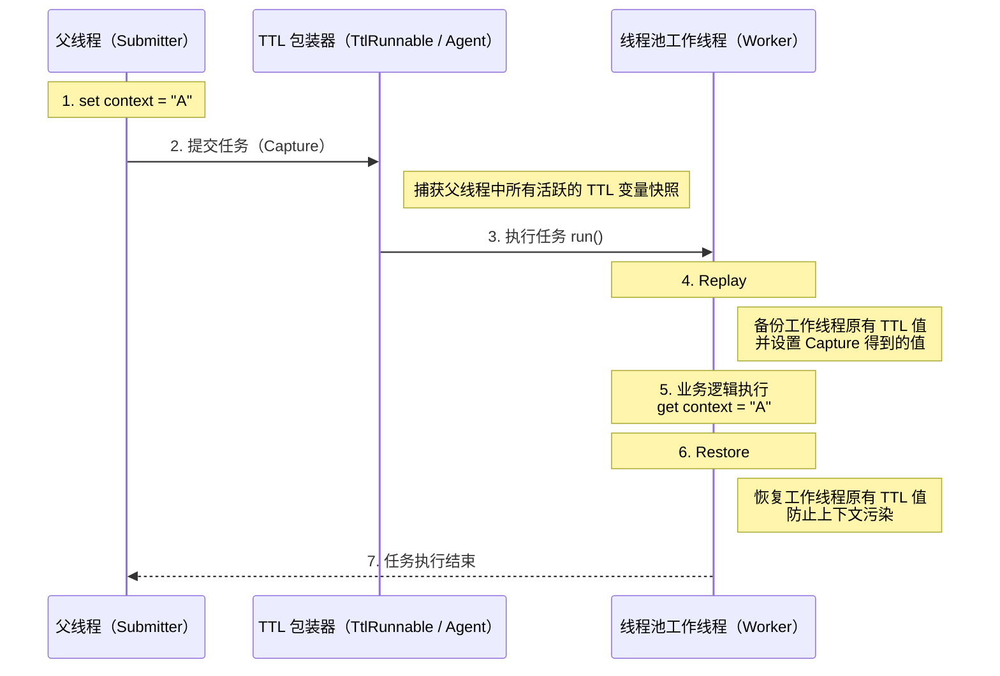

<!-- @include: @article-header.snippet.md -->

## ThreadLocal

### ThreadLocal 有什么用？

通常情况下，我们创建的 Variable 可以被任何一个 Thread 访问和修改。这在 Multithreading 环境中可能导致数据竞争和 Thread-safe 问题。那么，**如果想让每个 Thread 都有自己的专属本地 Variable，该如何实现呢？**

JDK 中提供的 `ThreadLocal` Class 正是为了解决这个问题。**`ThreadLocal` Class 允许每个 Thread 绑定自己的值**，可以将其形象地比喻为一个“存放数据的盒子”。每个 Thread 都有自己独立的盒子，用于存储私有数据，确保不同 Thread 之间的数据互不干扰。

当你创建一个 `ThreadLocal` Variable 时，每个访问该 Variable 的 Thread 都会拥有一个独立的副本。这也是 `ThreadLocal` 名称的由来。 Thread 可以通过 `get()` Method 获取自己 Thread 的本地副本，或通过 `set()` Method 修改该副本的值，从而避免了 Thread-safe 问题。

举个简单的例子：假设有两个人去宝屋收集宝物。如果他们共用一个袋子，必然会产生争执；但如果每个人都有一个独立的袋子，就不会有这个问题。如果将这两个人比作 Thread，那么 `ThreadLocal` 就是用来避免这两个 Thread 竞争同一个资源的方法。

```java
public class ThreadLocalExample {
    private static ThreadLocal<Integer> threadLocal = ThreadLocal.withInitial(() -> 0);

    public static void main(String[] args) {
        Runnable task = () -> {
            int value = threadLocal.get();
            value += 1;
            threadLocal.set(value);
            System.out.println(Thread.currentThread().getName() + " Value: " + threadLocal.get());
        };

        Thread thread1 = new Thread(task, "Thread-1");
        Thread thread2 = new Thread(task, "Thread-2");

        thread1.start(); // 输出: Thread-1 Value: 1
        thread2.start(); // 输出: Thread-2 Value: 1
    }
}
```

### ⭐️ ThreadLocal 原理了解吗？

从 `Thread` Class 源代码入手。

```java
public class Thread implements Runnable {
    //......
    //与此线程有关的ThreadLocal值。由ThreadLocal类维护
    ThreadLocal.ThreadLocalMap threadLocals = null;

    //与此线程有关的InheritableThreadLocal值。由InheritableThreadLocal类维护
    ThreadLocal.ThreadLocalMap inheritableThreadLocals = null;
    //......
}
```

从上面 `Thread` Class 源代码可以看出 `Thread` Class 中有一个 `threadLocals` 和 一个 `inheritableThreadLocals` Variable，它们都是 `ThreadLocalMap` Type 的 Variable，我们可以把 `ThreadLocalMap` 理解为 `ThreadLocal` Class 实现的定制化的 `HashMap`。默认情况下这两个 Variable 都是 null，只有 Current Thread 调用 `ThreadLocal` Class 的 `set` 或 `get` Method 时才创建它们，实际上调用这两个 Method 的时候，我们调用的是 `ThreadLocalMap` Class 对应的 `get()`、`set()` Method。

`ThreadLocal` Class 的 `set()` Method

```java
public void set(T value) {
    //获取当前请求的线程
    Thread t = Thread.currentThread();
    //取出 Thread 类内部的 threadLocals 变量(哈希表结构)
    ThreadLocalMap map = getMap(t);
    if (map != null)
        // 将需要存储的值放入到这个哈希表中
        map.set(this, value);
    else
        createMap(t, value);
}
ThreadLocalMap getMap(Thread t) {
    return t.threadLocals;
}
```

通过上面这些内容，我们足以通过猜测得出结论：**最终的 Variable 是放在了 Current Thread 的 `ThreadLocalMap` 中，并不是存在 `ThreadLocal` 上，`ThreadLocal` 可以理解为只是 `ThreadLocalMap` 的 Encapsulation，传递了 Variable 值。** `ThrealLocal` Class 中可以通过 `Thread.currentThread()` 获取到 Current Thread Object 后，直接通过 `getMap(Thread t)` 可以访问到该 Thread 的 `ThreadLocalMap` Object。

**每个 `Thread` 中都具备一个 `ThreadLocalMap`，而 `ThreadLocalMap` 可以存储以 `ThreadLocal` 为 key，Object 为 value 的键值对。**

```java
ThreadLocalMap(ThreadLocal<?> firstKey, Object firstValue) {
    //......
}
```

比如我们在同一个 Thread 中声明了两个 `ThreadLocal` Object 的话， `Thread` 内部都是使用仅有的那个 `ThreadLocalMap` 存放数据的，`ThreadLocalMap` 的 key 就是 `ThreadLocal` Object，value 就是 `ThreadLocal` Object 调用 `set` Method 设置的值。

`ThreadLocal` Data Structure 如下图所示：


`ThreadLocalMap` 是 `ThreadLocal` 的 Static Nested Class。


### ⭐️ ThreadLocal 内存泄露问题是怎么导致的？

`ThreadLocal` Memory Leak 的根本原因在于其内部实现机制。

通过上面的内容我们已经知道：每个 Thread 维护一个名为 `ThreadLocalMap` 的 map。 当你使用 `ThreadLocal` 存储值时，实际上是将值存储在 Current Thread 的 `ThreadLocalMap` 中，其中 `ThreadLocal` Instance 本身作为 key，而你要存储的值作为 value。

`ThreadLocal` 的 `set()` Method 源码如下：

```java
public void set(T value) {
    Thread t = Thread.currentThread(); // 获取当前线程
    ThreadLocalMap map = getMap(t);   // 获取当前线程的 ThreadLocalMap
    if (map != null) {
        map.set(this, value);         // 设置值
    } else {
        createMap(t, value);          // 创建新的 ThreadLocalMap
    }
}
```

`ThreadLocalMap` 的 `set()` 和 `createMap()` Method 中，并没有直接存储 `ThreadLocal` Object 本身，而是使用 `ThreadLocal` 的哈希值计算 Array Index，最终存储于 Type 为 `static class Entry extends WeakReference<ThreadLocal<?>>` 的 Array 中。

```java
int i = key.threadLocalHashCode & (len-1);
```

`ThreadLocalMap` 的 `Entry` 定义如下：

```java
static class Entry extends WeakReference<ThreadLocal<?>> {
    Object value;

    Entry(ThreadLocal<?> k, Object v) {
        super(k);
        value = v;
    }
}
```

`ThreadLocalMap` 的 `key` 和 `value` Reference 机制：

- **key 是 Weak Reference**：`ThreadLocalMap` 中的 key 是 `ThreadLocal` 的 Weak Reference (`WeakReference<ThreadLocal<?>>`)。 这意味着，如果 `ThreadLocal` Instance 不再被任何 Strong Reference 指向，Garbage Collector 会在下次 Garbage Collection (GC) 时回收该 Instance，导致 `ThreadLocalMap` 中对应的 key 变为 `null`。
- **value 是 Strong Reference**：即使 `key` 被 GC 回收，`value` 仍然被 `ThreadLocalMap.Entry` Strong Reference 存在，无法被 GC 回收。

当 `ThreadLocal` Instance 失去 Strong Reference 后，其对应的 value 仍然存在于 `ThreadLocalMap` 中，因为 `Entry` Object Strong Reference 了它。如果 Thread 持续存活（例如 Thread Pool 中的 Thread），`ThreadLocalMap` 也会一直存在，导致 key 为 `null` 的 entry 无法被 GC，即会造成 Memory Leak。

也就是说，Memory Leak 的发生需要同时满足两个条件：

1. `ThreadLocal` Instance 不再被 Strong Reference；
2. Thread 持续存活，导致 `ThreadLocalMap` 长期存在。

虽然 `ThreadLocalMap` 在 `get()`, `set()` 和 `remove()` 操作时会尝试清理 key 为 null 的 entry，但这种清理机制是被动的，并不完全可靠。

**如何避免 Memory Leak 的发生？**

1. 在使用完 `ThreadLocal` 后，务必调用 `remove()` Method。 这是最安全和最推荐的做法。 `remove()` Method 会从 `ThreadLocalMap` 中显式地移除对应的 entry，彻底解决 Memory Leak 的风险。 即使将 `ThreadLocal` 定义为 `static final`，也强烈建议在每次使用后调用 `remove()`。
2. 在 Thread Pool 等 Thread Reuse 的场景下，使用 `try-finally` 块可以确保即使发生 Exception，`remove()` Method 也一定会被执行。

#### 为什么 Entry 的 key 要设计为 Weak Reference？

这是一个经典的面试追问。很多同学知道 `ThreadLocalMap` 的 key 是 Weak Reference，但不清楚**为什么要这样设计**，以及如果换成 Strong Reference 会怎样。

我们先来看完整的 Reference Chain 路。当一个 Thread 使用 `ThreadLocal` 时，涉及以下 Reference 关系：

```
强引用（栈/静态变量）──→ ThreadLocal 实例
                              ↑
Thread ──→ ThreadLocalMap ──→ Entry ─── key（WeakReference）──┘
                              │
                              └─── value（强引用）──→ 实际存储的对象
```

理解了这条 Reference Chain 路，我们来对比两种设计方案：

**假设 key 使用 Strong Reference（实际没有采用）：**

当业务代码中的 `ThreadLocal` Reference 被置为 `null`（例如 Method 执行结束、Object 被回收），此时虽然业务代码已经不再需要这个 `ThreadLocal`，但由于 `ThreadLocalMap` 的 Entry 对 key 持有**Strong Reference**，`ThreadLocal` Instance 仍然无法被 GC 回收。只要 Thread 不终止，这个 `ThreadLocal` 和它对应的 value 都会一直存在于内存中，造成 key 和 value **都无法回收**的 Memory Leak。

**key 使用 Weak Reference（实际采用的方案）：**

当业务代码中的 `ThreadLocal` Reference 被置为 `null` 后，由于 Entry 的 key 是 Weak Reference，`ThreadLocal` Instance 在下次 GC 时会被回收，key 变为 `null`。此时虽然 value 仍然存在（Strong Reference），但 `ThreadLocalMap` 在执行 `get()`、`set()`、`remove()` 等操作时，会主动探测并清理这些 key 为 `null` 的 "stale entry"（过期条目），从而释放 value Object。

也就是说，**Weak Reference 的设计是一种“兜底”防御机制**——即便开发者忘记调用 `remove()`，Java Virtual Machine (JVM) 的 GC 配合 `ThreadLocalMap` 的自清理逻辑，仍然有机会回收泄漏的数据。而如果使用 Strong Reference，一旦忘记 `remove()`，就完全没有任何补救机会了。

> 需要注意的是，这种自清理机制是**被动触发**的（只在 `get`/`set`/`remove` 操作时顺便清理），并不能保证所有过期条目都被及时清理。因此，**Weak Reference 只是降低了 Memory Leak 的风险，并没有彻底消除它**，手动调用 `remove()` 仍然是必须的。

#### Thread Pool 场景下的特殊风险

上面提到 Memory Leak 的条件之一是“Thread 持续存活”。在使用 `new Thread()` 创建 Thread 的场景下，Thread 执行完毕后会被销毁，其持有的 `ThreadLocalMap` 也会随之被 GC 回收，泄漏的影响相对有限。

但在**Thread Pool**场景下，问题会被严重放大。 Thread Pool 中的 Core Thread 默认不会被销毁，它们会被反复复用来执行不同的 Task。这意味着：

1. **Memory Leak 可能累积**：如果 Task 不断创建新的临时 `ThreadLocal`，或使用多个 `ThreadLocal` 却没有清理，失去 Strong Reference 的 key 被回收后，对应 value 仍可能残留在复用 Thread 的 `ThreadLocalMap` 中。对同一个仍 Reachable 的 `ThreadLocal` 反复调用 `set()` 通常会替换旧 value，但最新 value 仍会一直保留到被覆盖、移除、清理或 Thread 终止。
2. **数据污染（脏数据）**：上一个 Task 设置的 `ThreadLocal` 值，如果没有被清理，下一个被分配到同一 Thread 的 Task 就能读取到这个残留值。这可能导致严重的业务逻辑错误，比如用户 A 的请求读取到了用户 B 的身份信息。

**美团技术团队的真实事故案例：**

美团技术团队在[《Java Thread Pool 实现原理及其在美团业务中的实践》](https://tech.meituan.com/2020/04/02/java-pooling-pratice-in-meituan.html)一文中就记录了一次因 `ThreadLocal` 使用不当引发的线上事故：在一个依赖 `ThreadLocal` 传递用户 Context 的 Web 应用中，由于使用了 Thread Pool 处理请求，且没有在请求结束后清理 `ThreadLocal`，导致**后续请求复用了同一 Thread 时，读取到了前一个请求遗留的用户信息**，造成了用户数据串号的严重问题。

#### 阿里巴巴 Java 开发手册的强制规约

正因为 Thread Pool + `ThreadLocal` 的组合如此容易踩坑，《阿里巴巴 Java 开发手册》在“Concurrency 处理”章节中对此做出了**强制**级别的要求：

> **【强制】** 必须回收自定义的 `ThreadLocal` Variable 记录的 Current Thread 的值，尤其在 Thread Pool 场景下，Thread 经常会被复用，如果不清理自定义的 `ThreadLocal` Variable，可能会影响后续业务逻辑和造成内存泄露等问题。尽量在代理中使用 `try-finally` 块进行回收。

正确的使用模式如下：

```java
// 定义为 static final，避免重复创建 ThreadLocal 实例
private static final ThreadLocal<UserContext> userContextHolder = new ThreadLocal<>();

public void processRequest(HttpServletRequest request) {
    try {
        // 在 try 块中设置值
        UserContext context = buildUserContext(request);
        userContextHolder.set(context);

        // 执行业务逻辑
        doBusinessLogic();
    } finally {
        // 在 finally 块中必须清理，确保无论是否发生异常都会执行
        userContextHolder.remove();
    }
}
```

这里有三个关键要点：

1. **`ThreadLocal` 声明为 `static final`**：确保该 Field 对应的 `ThreadLocal` Instance 不会在每次调用时重复创建，避免旧 Instance 失去 Strong Reference 后留下过期条目；这并不意味着整个应用只能有一个 `ThreadLocal` Instance。
2. **`try-finally` 保证 `remove()` 一定被执行**：即使业务逻辑抛出 Exception，`finally` 块也能确保 `ThreadLocal` 被清理。
3. **在使用完毕后立即清理，而不是依赖下次使用前覆盖**：对同一个 `ThreadLocal` 调用 `set()` 会替换旧 value，但在下一次 Task 到来前，旧值仍会被 Thread 持有；如果代码改为使用其他 `ThreadLocal`，过期条目还可能长期残留。用完后在 `finally` 中调用 `remove()`，可以及时避免内存占用和数据污染。

### ⭐️ 如何跨 Thread 传递 ThreadLocal 的值？

**为什么 ThreadLocal 在 Asynchronous 场景下会失效？**

`ThreadLocal` 的值不在 `ThreadLocal` Object 中，而是存储在 `Thread` 里：

```java
Thread → ThreadLocalMap → Entry(ThreadLocal, value)
```

`ThreadLocal` Data Structure 如下图所示：


Asynchronous 执行往往意味着 Task 会从 Current Thread 切换到另一个 Thread（例如 Thread Pool 中的 Worker Thread）执行。由于不同 Thread 各自维护独立的 `ThreadLocalMap`，默认情况下 `ThreadLocal` 的 Context 无法在 Asynchronous 执行中自动传递。

**如何跨 Thread 传递 ThreadLocal 的值？**

为了解决这个问题，业界有两套主流的解决方案，一套是 JDK 原生的，另一套是阿里巴巴开源的。

1. `InheritableThreadLocal`：JDK1.2 提供的一个 Class，Inheritance 自 `ThreadLocal`。使用 `InheritableThreadLocal` 时，会在创建 Child Thread 时，令 Child Thread Inheritance Parent Thread 中的 `ThreadLocal` 值，但是无法支持 Thread Pool 场景下的 `ThreadLocal` 值传递。
2. `TransmittableThreadLocal`： `TransmittableThreadLocal`（简称 TTL） 是阿里巴巴开源的 Utility Class，Inheritance 并加强了 `InheritableThreadLocal` Class，可以在 Thread Pool 的场景下支持 `ThreadLocal` 值传递。项目 Address：<https://github.com/alibaba/transmittable-thread-local>。

#### InheritableThreadLocal 原理

`InheritableThreadLocal` 实现了创建 Asynchronous Thread 时，Inheritance Parent Thread `ThreadLocal` 值的功能。该 Class 是 JDK 团队提供的，通过改造 JDK 源码 Package 中的 `Thread` Class 来实现创建 Thread 时，`ThreadLocal` 值的传递。

**`InheritableThreadLocal` 的值存储在哪里？**

在 `Thread` Class 中添加了一个新的 `ThreadLocalMap`，命名为 `inheritableThreadLocals`，该 Variable 用于存储需要跨 Thread 传递的 `ThreadLocal` 值。如下：

```JAVA
class Thread implements Runnable {
    ThreadLocal.ThreadLocalMap threadLocals = null;
    ThreadLocal.ThreadLocalMap inheritableThreadLocals = null;
}
```

**如何完成 `ThreadLocal` 值的传递？**

通过改造 `Thread` Class 的 Constructor 来实现，在创建 `Thread` Thread 时，拿到 Parent Thread 的 `inheritableThreadLocals` Variable 赋值给 Child Thread 即可。相关代码如下：

```JAVA
// Thread 的构造方法会调用 init() 方法
private void init(/* ... */) {
	// 1、获取父线程
    Thread parent = currentThread();
    // 2、将父线程的 inheritableThreadLocals 赋值给子线程
    if (inheritThreadLocals && parent.inheritableThreadLocals != null)
        this.inheritableThreadLocals =
        	ThreadLocal.createInheritedMap(parent.inheritableThreadLocals);
}
```

**`InheritableThreadLocal` 的方案有什么问题？**

这个方案的缺陷在于它的**一次性**，也就是它只在 Thread 创建时发生一次复制。然而，现在的开发中，我们会大量使用 Thread Pool，但 Thread Pool 里的 Thread 是被复用的。

想象一下，Task A 在 Thread 1 中执行，把它的 `ThreadLocal` 值传给了 Thread Pool 里的 Child Thread 2。 Task A 结束后，Thread 1 去休息了。接着，Task B 来了，它在 Thread 3 中执行，Thread Pool 又复用了刚才那个 Child Thread 2 来执行 Task B 的一部分。此时，Child Thread 2 的 `ThreadLocal` 里还残留着 Task A 传给它的脏数据，而 Task B（在 Thread 3 里）的 Context 却完全没有传递过来。这就导致了数据污染和 Context 丢失。

#### TransmittableThreadLocal 原理

JDK 默认没有支持 Thread Pool 场景下 `ThreadLocal` 值传递的功能，因此阿里巴巴开源了一套工具 `TransmittableThreadLocal` 来实现该功能。

由于阿里巴巴无法改动 JDK 源码，TTL 巧妙地利用了**装饰器模式**对 Task（`Runnable`/`Callable`）或 Thread Pool（`Executor`）进行增强，将 Context 的传递时机从“Thread 创建时”延迟到了“Task 提交与执行时”。

TTL 的核心逻辑可以概括为三个阶段（CRR）：

- **Capture（捕获）**：在提交 Task（如调用 `execute`）的一瞬间，`TtlRunnable` 会调用 `TransmittableThreadLocal.Transmitter.capture()`。它通过内部维护的 `holder` Collection，抓取当前 Parent Thread 中所有活跃的 TTL Variable 并存入 Snapshot。
- **Replay（回放）**：在 Thread Pool 的 Worker Thread 执行 `run()` Method 前，调用 `replay()`。它将 Snapshot 中的值 `set` 到当前 Worker Thread 中，并备份该 Thread 原有的旧值。
- **Restore（恢复）**：Task 执行结束后，调用 `restore()`。它根据备份将 Worker Thread 恢复到执行前的状态，防止 Context 污染或 Memory Leak。

这张图是 TTL 官方提供的 CRR 整个过程的时序图：


不太好理解吧？可以看下我绘制的这张 CRR 时序图，更清晰直观一些：



也就是说，TTL 的本质是在 Task 提交时 Capture Context，在 Task 执行前 Replay Context，在 Task 结束后 Restore Thread State，从而安全地支持 Thread Pool 中的 `ThreadLocal` 传递。

TTL 提供了两种主要的接入方式，可根据侵入性要求和改造成本进行选择。

**1. 显式包装（手动接入）**

使用 `TtlRunnable.get(Runnable)` 或 `TtlCallable.get(Callable)` 对 Task 进行包装，使用 `TtlExecutors.getTtlExecutor(Executor)`、`getTtlExecutorService(...)` 对 Thread Pool 进行包装。这种接入方式清晰可控，但需要业务代码配合，存在一定侵入性。

下面这段代码展示了 TTL 通过 CRR，在支持 Thread Pool 复用和 Rejection Policy 的前提下，安全地传递并隔离 `ThreadLocal` Context。

```java
public class TtlContextHolder {
    private static final Logger log = LoggerFactory.getLogger(TtlContextHolder.class);

    // 1. 使用 static final 确保 TTL 实例不被重复创建，防止内存泄漏
    // 重写 copy 方法（可选）：如果是引用类型，建议实现深拷贝
    private static final TransmittableThreadLocal<String> CONTEXT = new TransmittableThreadLocal<String>() {
        @Override
        public String copy(String parentValue) {
            // 默认是直接返回引用，如果是可变对象（如 Map），请在这里 new 新对象
            return parentValue;
        }
    };

    // 2. 线程池初始化：确保只被 TtlExecutors 包装一次
    private static final ExecutorService TTL_EXECUTOR_SERVICE;

    static {
        ExecutorService rawExecutor = new ThreadPoolExecutor(
                2, 4, 60L, TimeUnit.SECONDS,
                new LinkedBlockingQueue<>(1000), (Runnable r) -> new Thread(r, "ttl-worker-" + r.hashCode()),
                new ThreadPoolExecutor.CallerRunsPolicy() // 关键：TTL 完美支持此拒绝策略
        );
        // 包装原始线程池
        TTL_EXECUTOR_SERVICE = TtlExecutors.getTtlExecutorService(rawExecutor);
    }

    public static void main(String[] args) throws Exception {
        try {
            // 3. 在父线程中设置上下文
            CONTEXT.set("value-set-in-parent");
            log.info("父线程上下文: {}", CONTEXT.get());

            // 4. 使用 Lambda 简化任务提交
            TTL_EXECUTOR_SERVICE.execute(() -> {
                log.info("异步任务(Runnable)读取上下文: {}", CONTEXT.get());
                // 模拟业务逻辑
                // 注意：子线程修改是否影响父线程，取决于 copy() 是否做了深拷贝
                CONTEXT.set("value-modified-in-child");
            });

            Future<String> future = TTL_EXECUTOR_SERVICE.submit(() -> {
                log.info("异步任务(Callable)读取上下文: {}", CONTEXT.get());
                return "Success";
            });

            future.get();

            // 5. 验证父线程上下文是否被污染
            log.info("父线程最终上下文: {}", CONTEXT.get());

        } finally {
            // 6. 清理当前线程（父线程）的上下文，子线程的上下文由 TTL 的 Restore 机制自动恢复
            CONTEXT.remove();
        }
    }
}
```

输出：

```ba
09:06:31.438 INFO  [main] TtlContextHolder - 父线程上下文: value-set-in-parent
09:06:31.452 INFO  [ttl-worker-1663166483] TtlContextHolder - 异步任务(Runnable)读取上下文: value-set-in-parent
09:06:31.453 INFO  [ttl-worker-841283083] TtlContextHolder - 异步任务(Callable)读取上下文: value-set-in-parent
09:06:31.453 INFO  [main] TtlContextHolder - 父线程最终上下文: value-set-in-parent
```

如果你想要测试这段代码，记得引入 TTL 的 Maven 依赖；

```XML
<dependency>
    <groupId>com.alibaba</groupId>
    <artifactId>transmittable-thread-local</artifactId>
    <version>2.14.4</version>
</dependency>
```

**2. 无侵入接入（Java Agent）**

通过 Java Agent 在 Class Loading 对 Thread Pool 相关 Class 进行 Bytecode 增强，自动织入 TTL 的 Context 传递逻辑，实现业务代码零改造的 Context 透传。这种方式业务代码无需感知 TTL 的存在，但实现复杂度相对较高。

TTL Agent 默认修饰了以下 JDK 执行器组件：

1. **标准 Thread Pool**：`java.util.concurrent.ThreadPoolExecutor` 和 `java.util.concurrent.ScheduledThreadPoolExecutor`。
2. **ForkJoin 体系**：`java.util.concurrent.ForkJoinTask`（从而透明支持了 `CompletableFuture` 和 Java 8 Parallelism 流 `Stream`）。
3. **遗留组件**：`java.util.TimerTask`（自 v2.7.0 起支持，v2.11.2 起默认开启）。

在 Java 启动 Parameter 中加入 `-javaagent` 配置：

```bash
# 基础配置
java -javaagent:path/to/transmittable-thread-local-2.x.y.jar \
     -cp classes \
     com.your.app.Main
```

#### 应用场景

1. **压测流量标记**： 在压测场景中，使用 `ThreadLocal` 存储压测标记，用于区分压测流量和真实流量。如果标记丢失，可能导致压测流量被错误地当成线上流量处理。
2. **Context 传递**：在分布式系统中，传递链路追踪信息（如 Trace ID）或用户 Context 信息。

#### 总结

`ThreadLocal` 的值默认是无法跨 Thread 传递的，因为它的值是存在**每个 `Thread` Object 自己**的 `ThreadLocalMap` 里的，父 Child Thread 是两个不同的 Object。

为了解决这个问题，主要有两种方案：

1. **JDK 的 InheritableThreadLocal**：它会在**创建 Child Thread**的时候，把 Parent Thread 的值**复制**一份给 Child Thread。但它的问题是，在**Thread Pool**场景下会失效。因为 Thread Pool 会**复用**Thread，这会导致 Thread 拿到的可能是上一个 Task 传下来的**脏数据**。
2. **阿里的 TransmittableThreadLocal (TTL)**：这是我们项目里用的方案，它专门解决 Thread Pool 的问题。它的原理是，在**提交 Task**到 Thread Pool 时，它会把 Parent Thread 的 `ThreadLocal` 值**捕获**下来，和 Task**绑定**在一起。等 Thread Pool 里的某个 Thread 要执行这个 Task 时，它再把捕获的值**设置**到这个 Thread 上，Task 执行完再**清理**掉。

简单说，**InheritableThreadLocal 是跟 Thread 绑定的，只在创建时有效；而 TTL 是跟 Task 绑定的，完美支持 Thread Pool。**

## Thread Pool

### 什么是 Thread Pool？

顾名思义，Thread Pool 就是管理一系列 Thread 的资源池。当有 Task 要处理时，直接从 Thread Pool 中获取 Thread 来处理，处理完之后 Thread 并不会立即被销毁，而是等待下一个 Task。

### ⭐️ 为什么要用 Thread Pool？

池化技术想必大家已经屡见不鲜了，Thread Pool、Database Connection Pool、HTTP Connection Pool 等等都是对这个思想的应用。池化技术的思想主要是为了减少每次获取资源的消耗，提高对资源的利用率。

Thread Pool 提供了一种限制和管理资源（包括执行一个 Task）的方式。 每个 Thread Pool 还维护一些基本统计信息，例如已完成 Task 的数量。使用 Thread Pool 主要带来以下几个好处：

1. **降低资源消耗**：Thread Pool 里的 Thread 是可以重复利用的。一旦 Thread 完成了某个 Task，它不会立即销毁，而是回到池子里等待下一个 Task。这就避免了频繁创建和销毁 Thread 带来的 Overhead。
2. **提高响应速度**：因为 Thread Pool 里通常会维护一定数量的 Core Thread（或者说“常驻工人”），Task 来了之后，可以直接交给这些已经存在的、空闲的 Thread 去执行，省去了创建 Thread 的时间，Task 能够更快地得到处理。
3. **提高 Thread 的可管理性**：Thread Pool 允许我们统一管理池中的 Thread。我们可以配置 Thread Pool 的大小（Core Pool Size、Maximum Pool Size）、Task Queue 的 Type 和大小、Rejection Policy 等。这样就能控制 Concurrency Thread 的总量，防止资源耗尽，保证系统的稳定性。同时，Thread Pool 通常也提供了 Monitoring Interface，方便我们了解 Thread Pool 的运行状态（比如有多少 Active Thread、多少 Task 在排队等），便于调优。

### 如何创建 Thread Pool？

在 Java 中，创建 Thread Pool 主要有两种方式：

**方式一：通过 `ThreadPoolExecutor` Constructor 直接创建（推荐）**


图中的“Default Thread Factory”和“Default Rejection Policy”，指的是当前 Constructor 没有显式传入对应 Parameter 时，`ThreadPoolExecutor` 会使用默认实现，并不是 Method 和说明错位。

这是最推荐的方式，因为它允许开发者明确指定 Thread Pool 的核心 Parameter，对 Thread Pool 的运行行为有更精细的控制，从而避免资源耗尽的风险。

**方式二：通过 `Executors` Utility Class 创建（不推荐用于生产环境）**

`Executors` Utility Class 提供的创建 Thread Pool 的 Method 如下图所示：


可以看出，通过 `Executors` Utility Class 可以创建多种 Type 的 Thread Pool，包括：

- `FixedThreadPool`：正常运行时最多使用固定数量的 Worker Thread。 Thread 可以因 Exception 终止后被替换，Thread Pool 关闭时也会退出，因此并非在整个 Lifecycle 中数量始终不变。当有一个新的 Task 提交时，Thread Pool 中若有 Idle Thread，则立即执行。若没有，则新的 Task 会被暂存在一个 Task Queue 中，待有 Thread 空闲时，便处理在 Task Queue 中的 Task。
- `SingleThreadExecutor`： 只有一个 Thread 的 Thread Pool。若多余一个 Task 被提交到该 Thread Pool，Task 会被保存在一个 Task Queue 中，待 Thread 空闲，按先入先出的顺序执行 Queue 中的 Task。
- `CachedThreadPool`： 可根据实际情况调整 Thread Count 的 Thread Pool。 Thread Pool 的 Thread Count 不确定，但若有 Idle Thread 可以复用，则会优先使用可复用的 Thread。若所有 Thread 均在工作，又有新的 Task 提交，则会创建新的 Thread 处理 Task。所有 Thread 在当前 Task 执行完毕后，将返回 Thread Pool 进行复用。
- `ScheduledThreadPool`：给定的延迟后运行 Task 或者定期执行 Task 的 Thread Pool。

### ⭐️ 为什么不推荐使用内置 Thread Pool？

在《阿里巴巴 Java 开发手册》“Concurrency 处理”这一章节，明确指出 Thread 资源必须通过 Thread Pool 提供，不允许在应用中自行显式创建 Thread。

**为什么呢？**

> 使用 Thread Pool 的好处是减少在创建和销毁 Thread 上所消耗的时间以及系统资源 Overhead，解决资源不足的问题。如果不使用 Thread Pool，有可能会造成系统创建大量同类 Thread 而导致消耗完内存或者“过度切换”的问题。

另外，《阿里巴巴 Java 开发手册》中强制 Thread Pool 不允许使用 `Executors` 去创建，而是通过 `ThreadPoolExecutor` Constructor 的方式，这样的处理方式让写的同学更加明确 Thread Pool 的运行规则，规避资源耗尽的风险

`Executors` 返回 Thread Pool Object 的弊端如下（后文会详细介绍到）：

- `FixedThreadPool` 和 `SingleThreadExecutor`:使用的是 Blocking Queue `LinkedBlockingQueue`，Task Queue 最大 Length 为 `Integer.MAX_VALUE`，可以看作是无界的，可能堆积大量的请求，从而导致 Out of Memory (OOM)。
- `CachedThreadPool`:使用的是 Synchronous Queue `SynchronousQueue`, 允许创建的 Thread Count 为 `Integer.MAX_VALUE`，如果 Task 数量过多且执行速度较慢，可能会创建大量的 Thread，从而导致 OOM。
- `ScheduledThreadPool` 和 `SingleThreadScheduledExecutor`:使用的无界的延迟 Blocking Queue `DelayedWorkQueue`，Task Queue 最大 Length 为 `Integer.MAX_VALUE`,可能堆积大量的请求，从而导致 OOM。

```java
public static ExecutorService newFixedThreadPool(int nThreads) {
    // LinkedBlockingQueue 的默认长度为 Integer.MAX_VALUE，可以看作是无界的
    return new ThreadPoolExecutor(nThreads, nThreads,0L, TimeUnit.MILLISECONDS,new LinkedBlockingQueue<Runnable>());

}

public static ExecutorService newSingleThreadExecutor() {
    // LinkedBlockingQueue 的默认长度为 Integer.MAX_VALUE，可以看作是无界的
    return new FinalizableDelegatedExecutorService (new ThreadPoolExecutor(1, 1,0L, TimeUnit.MILLISECONDS,new LinkedBlockingQueue<Runnable>()));

}

// 同步队列 SynchronousQueue，没有容量，最大线程数是 Integer.MAX_VALUE`
public static ExecutorService newCachedThreadPool() {

    return new ThreadPoolExecutor(0, Integer.MAX_VALUE,60L, TimeUnit.SECONDS,new SynchronousQueue<Runnable>());

}

// DelayedWorkQueue（延迟阻塞队列）
public static ScheduledExecutorService newScheduledThreadPool(int corePoolSize) {
    return new ScheduledThreadPoolExecutor(corePoolSize);
}
public ScheduledThreadPoolExecutor(int corePoolSize) {
    super(corePoolSize, Integer.MAX_VALUE, 0, NANOSECONDS,
          new DelayedWorkQueue());
}
```

### ⭐️ Thread Pool 常见 Parameter 有哪些？如何解释？

```java
    /**
     * 用给定的初始参数创建一个新的ThreadPoolExecutor。
     */
    public ThreadPoolExecutor(int corePoolSize,//线程池的核心线程数量
                              int maximumPoolSize,//线程池的最大线程数
                              long keepAliveTime,//当线程数大于核心线程数时，多余的空闲线程存活的最长时间
                              TimeUnit unit,//时间单位
                              BlockingQueue<Runnable> workQueue,//任务队列，用来储存等待执行任务的队列
                              ThreadFactory threadFactory,//线程工厂，用来创建线程，一般默认即可
                              RejectedExecutionHandler handler//拒绝策略，当提交的任务过多而不能及时处理时，我们可以定制策略来处理任务
                               ) {
        if (corePoolSize < 0 ||
            maximumPoolSize <= 0 ||
            maximumPoolSize < corePoolSize ||
            keepAliveTime < 0)
            throw new IllegalArgumentException();
        if (workQueue == null || threadFactory == null || handler == null)
            throw new NullPointerException();
        this.corePoolSize = corePoolSize;
        this.maximumPoolSize = maximumPoolSize;
        this.workQueue = workQueue;
        this.keepAliveTime = unit.toNanos(keepAliveTime);
        this.threadFactory = threadFactory;
        this.handler = handler;
    }
```

`ThreadPoolExecutor` 3 个最重要的 Parameter：

- `corePoolSize`：默认情况下，即使空闲也会保留在 Thread Pool 中的 Thread Count；未启用 Core Thread Timeout 且 Worker Thread 少于该值时，新 Task 会优先触发创建 Thread。
- `maximumPoolSize`：Thread Pool 允许存在的最大 Worker Thread 数。
- `workQueue`：当 Worker Thread 数达到 `corePoolSize` 后，新 Task 会先尝试进入 Queue；只有 Enqueue 失败且 Worker Thread 数小于 `maximumPoolSize` 时，Thread Pool 才会继续创建 Thread。

`ThreadPoolExecutor` 其他常见 Parameter :

- `keepAliveTime`:当 Thread Pool 中的 Thread Count 大于 `corePoolSize`，即有 Non-core Thread（Thread Pool 中 Core Thread 以外的 Thread）时，这些 Non-core Thread 空闲后不会立即销毁，而是会等待，直到等待的时间超过了 `keepAliveTime` 才会被回收销毁。
- `unit` : `keepAliveTime` Parameter 的时间单位。
- `threadFactory` :executor 创建新 Thread 的时候会用到。
- `handler` :Rejection Policy（后面会单独详细介绍一下）。

下面这张图可以加深你对 Thread Pool 中各个 Parameter 的相互关系的理解（图片来源：《Java Performance Tuning 实战》）：


### Thread Pool 的 Core Thread 会被回收吗？

`ThreadPoolExecutor` 默认不会回收 Core Thread，即使它们已经空闲了。这是为了减少创建 Thread 的 Overhead，因为 Core Thread 通常是要长期保持活跃的。但是，如果 Thread Pool 是被用于周期性使用的场景，且频率不高（周期之间有明显的空闲时间），可以考虑将 `allowCoreThreadTimeOut(boolean value)` Method 的 Parameter 设置为 `true`，这样就会回收空闲（时间间隔由 `keepAliveTime` 指定）的 Core Thread 了。

```java
public void allowCoreThreadTimeOut(boolean value) {
    // 核心线程的 keepAliveTime 必须大于 0 才能启用超时机制
    if (value && keepAliveTime <= 0) {
        throw new IllegalArgumentException("Core threads must have nonzero keep alive times");
    }
    // 设置 allowCoreThreadTimeOut 的值
    if (value != allowCoreThreadTimeOut) {
        allowCoreThreadTimeOut = value;
        // 如果启用了超时机制，清理所有空闲的线程，包括核心线程
        if (value) {
            interruptIdleWorkers();
        }
    }
}
```

### Core Thread 空闲时处于什么状态？

Core Thread 空闲时，其状态分为以下两种情况：

- **设置了 Core Thread 的存活时间**：Core Thread 在空闲时，会处于 `WAITING` 状态，等待获取 Task。如果 Blocking 等待的时间超过了 Core Thread 存活时间，则该 Thread 会退出工作，将该 Thread 从 Thread Pool 的 Worker Thread Collection 中移除，Thread State 变为 `TERMINATED` 状态。
- **没有设置 Core Thread 的存活时间**：Core Thread 在空闲时，会一直处于 `WAITING` 状态，等待获取 Task，Core Thread 会一直存活在 Thread Pool 中。

当 Queue 中有可用 Task 时，会唤醒被 Blocking 的 Thread，Thread 的状态会由 `WAITING` 状态变为 `RUNNABLE` 状态，之后去执行对应 Task。

接下来通过相关源码，了解一下 Thread Pool 内部是如何做的。

Thread 在 Thread Pool 内部被抽象为了 `Worker`，当 `Worker` 被启动之后，会不断去 Task Queue 中获取 Task。

在获取 Task 的时候，会根据 `timed` 值来决定从 Task Queue（`BlockingQueue`）获取 Task 的行为。

如果「设置了 Core Thread 的存活时间」或者「Thread Count 超过了 Core Pool Size 量」，则将 `timed` 标记为 `true`，表明获取 Task 时需要使用 `poll()` 指定 Timeout 时间。

- `timed == true`：使用 `poll(timeout, unit)` 来获取 Task。使用 `poll(timeout, unit)` Method 获取 Task Timeout 的话，则 Current Thread 会退出执行（`TERMINATED`），该 Thread 从 Thread Pool 中被移除。
- `timed == false`：使用 `take()` 来获取 Task。使用 `take()` Method 获取 Task 会让 Current Thread 一直 Blocking 等待（`WAITING`）。

源码如下：

```JAVA
// ThreadPoolExecutor
private Runnable getTask() {
    boolean timedOut = false;
    for (;;) {
        // ...

        // 1、如果「设置了核心线程的存活时间」或者是「线程数量超过了核心线程数量」，则 timed 为 true。
        boolean timed = allowCoreThreadTimeOut || wc > corePoolSize;
        // 2、扣减线程数量。
        // wc > maximuimPoolSize：线程池中的线程数量超过最大线程数量。其中 wc 为线程池中的线程数量。
        // timed && timeOut：timeOut 表示获取任务超时。
        // 分为两种情况：核心线程设置了存活时间 && 获取任务超时，则扣减线程数量；线程数量超过了核心线程数量 && 获取任务超时，则扣减线程数量。
        if ((wc > maximumPoolSize || (timed && timedOut))
            && (wc > 1 || workQueue.isEmpty())) {
            if (compareAndDecrementWorkerCount(c))
                return null;
            continue;
        }
        try {
            // 3、如果 timed 为 true，则使用 poll() 获取任务；否则，使用 take() 获取任务。
            Runnable r = timed ?
                workQueue.poll(keepAliveTime, TimeUnit.NANOSECONDS) :
                workQueue.take();
            // 4、获取任务之后返回。
            if (r != null)
                return r;
            timedOut = true;
        } catch (InterruptedException retry) {
            timedOut = false;
        }
    }
}
```

### ⭐️ Thread Pool 的 Rejection Policy 有哪些？

如果当前同时运行的 Thread Count 达到 Maximum Pool Size 量并且 Queue 也已经被放满了 Task 时，`ThreadPoolExecutor` 定义一些策略:

- `ThreadPoolExecutor.AbortPolicy`：抛出 `RejectedExecutionException` 来拒绝新 Task 的处理。
- `ThreadPoolExecutor.CallerRunsPolicy`：调用执行者自己的 Thread 运行 Task，也就是直接在调用 `execute` Method 的 Thread 中运行(`run`)被拒绝的 Task，如果执行程序已关闭，则会丢弃该 Task。因此这种策略会降低对于新 Task 提交速度，影响程序的整体 Performance。如果你的应用程序可以承受此延迟并且你要求任何一个 Task 请求都要被执行的话，你可以选择这个策略。
- `ThreadPoolExecutor.DiscardPolicy`：不处理新 Task，直接丢弃掉。
- `ThreadPoolExecutor.DiscardOldestPolicy`：此策略将丢弃最早的未处理的 Task 请求。

举个例子：Spring 通过 `ThreadPoolTaskExecutor` 或者我们直接通过 `ThreadPoolExecutor` 的 Constructor 创建 Thread Pool 的时候，当我们不指定 `RejectedExecutionHandler` Rejection Policy 来配置 Thread Pool 的时候，默认使用的是 `AbortPolicy`。在这种 Rejection Policy 下，如果 Queue 满了，`ThreadPoolExecutor` 将抛出 `RejectedExecutionException` Exception 来拒绝新来的 Task，这代表你将丢失对这个 Task 的处理。如果希望在 Thread Pool 仍处于运行状态时避免直接丢弃 Task，可以使用 `CallerRunsPolicy`，把 Task 回退给调用 `execute()` 的 Thread 执行；如果 Thread Pool 已经关闭，该策略仍会丢弃 Task。

```java
public static class CallerRunsPolicy implements RejectedExecutionHandler {

        public CallerRunsPolicy() { }

        public void rejectedExecution(Runnable r, ThreadPoolExecutor e) {
            if (!e.isShutdown()) {
                // 直接主线程执行，而不是线程池中的线程执行
                r.run();
            }
        }
    }
```

### 如果希望饱和时尽量不丢弃 Task，应该选择哪个 Rejection Policy？

对于 Thread Pool 仍在运行、并且调用 Thread 可以接受同步执行 Task 的场景，可以考虑 `CallerRunsPolicy`。它不能提供“任何情况下都不丢 Task”的保证：Thread Pool 关闭后 Task 会被丢弃，Process 崩溃也无法靠内存中的 Rejection Policy 恢复 Task；需要强保证时应配合持久化或 Message Queue。

这里我们再来结合 `CallerRunsPolicy` 的源码来看看：

```java
public static class CallerRunsPolicy implements RejectedExecutionHandler {

        public CallerRunsPolicy() { }


        public void rejectedExecution(Runnable r, ThreadPoolExecutor e) {
            //只要当前程序没有关闭，就用执行execute方法的线程执行该任务
            if (!e.isShutdown()) {

                r.run();
            }
        }
    }
```

从源码可以看出，只要当前程序不关闭就会使用执行 `execute` Method 的 Thread 执行该 Task。

### CallerRunsPolicy Rejection Policy 有什么风险？如何解决？

我们上面也提到了：如果希望在 Thread Pool 饱和时通过调用 Thread 施加 Backpressure、尽量避免直接丢弃 Task，`CallerRunsPolicy` 是一种可选方案。

不过，如果走到 `CallerRunsPolicy` 的 Task 是个非常耗时的 Task，且处理提交 Task 的 Thread 是 Main Thread，可能会导致 Main Thread Blocking，影响程序的正常运行。

这里简单举一个例子，该 Thread Pool 限定了 Maximum Pool Size 为 2，Blocking Queue 大小为 1（这意味着第 4 个 Task 就会走到 Rejection Policy），`ThreadUtil` 为 Hutool 提供的 Utility Class：

```java
public class ThreadPoolTest {

    private static final Logger log = LoggerFactory.getLogger(ThreadPoolTest.class);

    public static void main(String[] args) {
        // 创建一个线程池，核心线程数为1，最大线程数为2
        // 当线程数大于核心线程数时，多余的空闲线程存活的最长时间为60秒，
        // 任务队列为容量为1的ArrayBlockingQueue，饱和策略为CallerRunsPolicy。
        ThreadPoolExecutor threadPoolExecutor = new ThreadPoolExecutor(1,
                2,
                60,
                TimeUnit.SECONDS,
                new ArrayBlockingQueue<>(1),
                new ThreadPoolExecutor.CallerRunsPolicy());

        // 提交第一个任务，由核心线程执行
        threadPoolExecutor.execute(() -> {
            log.info("核心线程执行第一个任务");
            ThreadUtil.sleep(1, TimeUnit.MINUTES);
        });

        // 提交第二个任务，由于核心线程被占用，任务将进入队列等待
        threadPoolExecutor.execute(() -> {
            log.info("非核心线程处理入队的第二个任务");
            ThreadUtil.sleep(1, TimeUnit.MINUTES);
        });

        // 提交第三个任务，由于核心线程被占用且队列已满，创建非核心线程处理
        threadPoolExecutor.execute(() -> {
            log.info("非核心线程处理第三个任务");
            ThreadUtil.sleep(1, TimeUnit.MINUTES);
        });

        // 提交第四个任务，由于核心线程和非核心线程都被占用，队列也满了，根据CallerRunsPolicy策略，任务将由提交任务的线程（即主线程）来执行
        threadPoolExecutor.execute(() -> {
            log.info("主线程处理第四个任务");
            ThreadUtil.sleep(2, TimeUnit.MINUTES);
        });

        // 提交第五个任务，主线程被第四个任务卡住，该任务必须等到主线程执行完才能提交
        threadPoolExecutor.execute(() -> {
            log.info("核心线程执行第五个任务");
        });

        // 关闭线程池
        threadPoolExecutor.shutdown();
    }
}

```

输出：

```bash
18:19:48.203 INFO  [pool-1-thread-1] c.j.concurrent.ThreadPoolTest - 核心线程执行第一个任务
18:19:48.203 INFO  [pool-1-thread-2] c.j.concurrent.ThreadPoolTest - 非核心线程处理第三个任务
18:19:48.203 INFO  [main] c.j.concurrent.ThreadPoolTest - 主线程处理第四个任务
18:20:48.212 INFO  [pool-1-thread-2] c.j.concurrent.ThreadPoolTest - 非核心线程处理入队的第二个任务
18:21:48.219 INFO  [pool-1-thread-2] c.j.concurrent.ThreadPoolTest - 核心线程执行第五个任务
```

从输出结果可以看出，因为 `CallerRunsPolicy` 这个 Rejection Policy，导致耗时的 Task 用了 Main Thread 执行，导致 Thread Pool Blocking，进而导致后续 Task 无法及时执行，严重的情况下很可能导致 OOM。

我们从问题的本质入手，调用者采用 `CallerRunsPolicy` 是希望所有的 Task 都能够被执行，暂时无法处理的 Task 又被保存在 Blocking Queue `BlockingQueue` 中。这样的话，在内存允许的情况下，我们可以增加 Blocking Queue `BlockingQueue` 的大小并调整 Heap Memory 以容纳更多的 Task，确保 Task 能够被准确执行。

为了充分利用 CPU，我们还可以调整 Thread Pool 的 `maximumPoolSize`（Maximum Pool Size）Parameter，这样可以提高 Task 处理速度，避免累计在 `BlockingQueue` 的 Task 过多导致内存用完。


如果服务器资源已达到可利用的极限，这就意味我们要在设计策略上改变 Thread Pool 的调度了，我们都知道，导致 Main Thread 卡死的本质就是因为我们不希望任何一个 Task 被丢弃。换个思路，有没有办法既能保证 Task 不被丢弃且在服务器有余力时及时处理呢？

这里提供的一种**Task 持久化**的思路，这里所谓的 Task 持久化，包括但不限于:

1. 设计一张 Task 表将 Task 存储到 MySQL Database 中。
2. Redis 缓存 Task。
3. 将 Task 提交到 Message Queue 中。

这里以方案一为例，简单介绍一下实现逻辑：

1. 实现 `RejectedExecutionHandler` Interface 自定义 Rejection Policy，自定义 Rejection Policy 负责将 Thread Pool 暂时无法处理（此时 Blocking Queue 已满）的 Task 入库（保存到 MySQL 中）。注意：Thread Pool 暂时无法处理的 Task 会先被放在 Blocking Queue 中，Blocking Queue 满了才会触发 Rejection Policy。
2. Inheritance `BlockingQueue` 实现一个混合式 Blocking Queue，该 Queue 包含 JDK 自带的 `ArrayBlockingQueue`。另外，该混合式 Blocking Queue 需要修改取 Task 处理的逻辑，也就是 Override `take()` Method，取 Task 时优先从 Database 中读取最早的 Task，Database 中无 Task 时再从 `ArrayBlockingQueue` 中去取 Task。


整个实现逻辑还是比较简单的，核心在于自定义 Rejection Policy 和 Blocking Queue。如此一来，一旦我们的 Thread Pool 中 Thread 达到满载时，我们就可以通过 Rejection Policy 将最新 Task 持久化到 MySQL Database 中，等到 Thread Pool 有了有余力处理所有 Task 时，让其优先处理 Database 中的 Task 以避免“Starvation”问题。

当然，对于这个问题，我们也可以参考其他主流框架的做法，以 Netty 为例，它的 Rejection Policy 则是直接创建一个 Thread Pool 以外的 Thread 处理这些 Task，为了保证 Task 的实时处理，这种做法可能需要良好的硬件设备且临时创建的 Thread 无法做到准确的 Monitoring：

```java
private static final class NewThreadRunsPolicy implements RejectedExecutionHandler {
    NewThreadRunsPolicy() {
        super();
    }
    public void rejectedExecution(Runnable r, ThreadPoolExecutor executor) {
        try {
            //创建一个临时线程处理任务
            final Thread t = new Thread(r, "Temporary task executor");
            t.start();
        } catch (Throwable e) {
            throw new RejectedExecutionException(
                    "Failed to start a new thread", e);
        }
    }
}
```

ActiveMQ 则是尝试在指定的时效内尽可能的争取将 Task Enqueue，以保证最大交付：

```java
new RejectedExecutionHandler() {
                @Override
                public void rejectedExecution(final Runnable r, final ThreadPoolExecutor executor) {
                    try {
                        //限时阻塞等待，实现尽可能交付
                        executor.getQueue().offer(r, 60, TimeUnit.SECONDS);
                    } catch (InterruptedException e) {
                        throw new RejectedExecutionException("Interrupted waiting for BrokerService.worker");
                    }
                    throw new RejectedExecutionException("Timed Out while attempting to enqueue Task.");
                }
            });
```

### Thread Pool 常用的 Blocking Queue 有哪些？

新 Task 来的时候会先判断当前运行的 Thread Count 是否达到 Core Pool Size，如果达到的话，新 Task 就会被存放在 Queue 中。

不同的 Thread Pool 会选用不同的 Blocking Queue，我们可以结合内置 Thread Pool 来分析。

- Capacity 为 `Integer.MAX_VALUE` 的 `LinkedBlockingQueue`（无界 Blocking Queue）：`FixedThreadPool` 和 `SingleThreadExecutor`。`FixedThreadPool` 最多只能创建 Core Pool Size 的 Thread（Core Pool Size 和 Maximum Pool Size 相等），`SingleThreadExecutor` 只能创建一个 Thread（Core Pool Size 和 Maximum Pool Size 都是 1），二者的 Task Queue 永远不会被放满。
- `SynchronousQueue`（Synchronous Queue）：`CachedThreadPool`。`SynchronousQueue` 没有 Capacity，不存储元素，目的是保证对于提交的 Task，如果有 Idle Thread，则使用 Idle Thread 来处理；否则新建一个 Thread 来处理 Task。也就是说，`CachedThreadPool` 的 Maximum Pool Size 是 `Integer.MAX_VALUE`，可以理解为 Thread Count 是可以无限扩展的，可能会创建大量 Thread，从而导致 OOM。
- `DelayedWorkQueue`（Delay Queue）：`ScheduledThreadPool` 和 `SingleThreadScheduledExecutor`。`DelayedWorkQueue` 的内部元素并不是按照放入的时间排序，而是会按照延迟的时间长短对 Task 进行排序，内部采用的是“Heap”的 Data Structure，可以保证每次 Dequeue 的 Task 都是当前 Queue 中执行时间最靠前的。`DelayedWorkQueue` 是一个无界 Queue。其底层虽然是 Array，但当 Array Capacity 不足时，它会自动进行 Resize，因此 Queue 永远不会被填满。当 Task 不断提交时，它们会全部被添加到 Queue 中。这意味着 Thread Pool 的 Thread Count 永远不会超过其 Core Pool Size，Maximum Pool Size Parameter 对于使用该 Queue 的 Thread Pool 来说是无效的。
- `ArrayBlockingQueue`（有界 Blocking Queue）：底层由 Array 实现，Capacity 一旦创建，就不能修改。

### ⭐️ Thread Pool 处理 Task 的流程了解吗？


1. 如果当前运行的 Thread Count 小于 Core Pool Size，那么就会新建一个 Thread 来执行 Task。
2. 如果当前运行的 Thread Count 等于或大于 Core Pool Size，但是小于 Maximum Pool Size，那么就把该 Task 放入到 Task Queue 里等待执行。
3. 如果向 Task Queue 投放 Task 失败（Task Queue 已经满了），但是当前运行的 Thread Count 是小于 Maximum Pool Size 的，就新建一个 Thread 来执行 Task。
4. 如果当前运行的 Thread Count 已经等同于 Maximum Pool Size 了，新建 Thread 将会使当前运行的 Thread 超出 Maximum Pool Size，那么当前 Task 会被拒绝，Rejection Policy 会调用 `RejectedExecutionHandler.rejectedExecution()` Method。

再提一个有意思的小问题：**Thread Pool 在提交 Task 前，可以提前创建 Thread 吗？**

答案是可以的！`ThreadPoolExecutor` 提供了两个 Method 帮助我们在提交 Task 之前，完成 Core Thread 的创建，从而实现 Thread Pool 预热的效果：

- `prestartCoreThread()`:启动一个 Thread，等待 Task，如果已达到 Core Pool Size，这个 Method 返回 false，否则返回 true；
- `prestartAllCoreThreads()`:启动所有的 Core Thread，并返回启动成功的 Core Pool Size。

### ⭐️ Thread Pool 中 Thread Exception 后，销毁还是复用？

直接说结论，需要分两种情况：

- **使用 `execute()` 提交 Task**：当 Task 通过 `execute()` 提交到 Thread Pool 并在执行过程中抛出 Exception 时，如果这个 Exception 没有在 Task 内被捕获，那么该 Exception 会导致 Current Thread 终止，并且 Exception 会被打印到控制台或 Log 文件中。 Thread Pool 会检测到这种 Thread 终止，并创建一个新 Thread 来替换它，从而保持配置的 Thread Count 不变。
- **使用 `submit()` 提交 Task**：对于通过 `submit()` 提交的 Task，如果在 Task 执行中发生 Exception，这个 Exception 不会直接打印出来。相反，Exception 会被 Encapsulate 在由 `submit()` 返回的 `Future` Object 中。当调用 `Future.get()` Method 时，可以捕获到一个 `ExecutionException`。在这种情况下，Thread 不会因为 Exception 而终止，它会继续存在于 Thread Pool 中，准备执行后续的 Task。

简单来说：使用 `execute()` 时，未捕获 Exception 导致 Thread 终止，Thread Pool 创建新 Thread 替代；使用 `submit()` 时，Exception 被 Encapsulate 在 `Future` 中，Thread 继续复用。

这种设计允许 `submit()` 提供更灵活的错误处理机制，因为它允许调用者决定如何处理 Exception，而 `execute()` 则适用于那些不需要关注执行结果的场景。

具体的源码分析可以参考这篇：[Thread Pool 中 Thread Exception 后：销毁还是复用？ - 京东技术](https://mp.weixin.qq.com/s/9ODjdUU-EwQFF5PrnzOGfw)。

### ⭐️ 如何给 Thread Pool 命名？

Initialization Thread Pool 的时候需要显示命名（设置 Thread Pool 名称前缀），有利于定位问题。

默认情况下创建的 Thread 名字类似 `pool-1-thread-n` 这样的，没有业务含义，不利于我们定位问题。

给 Thread Pool 里的 Thread 命名通常有下面两种方式：

**1、利用 guava 的 `ThreadFactoryBuilder`**

```java
ThreadFactory threadFactory = new ThreadFactoryBuilder()
                        .setNameFormat(threadNamePrefix + "-%d")
                        .setDaemon(true).build();
ExecutorService threadPool = new ThreadPoolExecutor(corePoolSize, maximumPoolSize, keepAliveTime, TimeUnit.MINUTES, workQueue, threadFactory);
```

**2、自己实现 `ThreadFactory`。**

```java
import java.util.concurrent.ThreadFactory;
import java.util.concurrent.atomic.AtomicInteger;

/**
 * 线程工厂，它设置线程名称，有利于我们定位问题。
 */
public final class NamingThreadFactory implements ThreadFactory {

    private final AtomicInteger threadNum = new AtomicInteger();
    private final String name;

    /**
     * 创建一个带名字的线程池生产工厂
     */
    public NamingThreadFactory(String name) {
        this.name = name;
    }

    @Override
    public Thread newThread(Runnable r) {
        Thread t = new Thread(r);
        t.setName(name + " [#" + threadNum.incrementAndGet() + "]");
        return t;
    }
}
```

### 如何设定 Thread Pool 的大小？

很多人甚至可能都会觉得把 Thread Pool 配置过大一点比较好！我觉得这明显是有问题的。就拿我们生活中非常常见的一例子来说：**并不是人多就能把事情做好，增加了沟通交流成本。你本来一件事情只需要 3 个人做，你硬是拉来了 6 个人，会提升做事效率嘛？我想并不会。** Thread Count 过多的影响也是和我们分配多少人做事情一样，对于 Multithreading 这个场景来说主要是增加了**Context Switch**成本。不清楚什么是 Context Switch 的话，可以看我下面的介绍。

> Context Switch：
>
> Multithreaded Programming 中一般 Thread 的个数都大于 CPU 核心的个数，而一个 CPU 核心在任意时刻只能被一个 Thread 使用，为了让这些 Thread 都能得到有效执行，CPU 采取的策略是为每个 Thread 分配 Time Slice 并轮转的形式。当一个 Thread 的 Time Slice 用完的时候就会重新处于就绪状态让给其他 Thread 使用，这个过程就属于一次 Context Switch。概括来说就是：当前 Task 在执行完 CPU Time Slice 切换到另一个 Task 之前会先保存自己的状态，以便下次再切换回这个 Task 时，可以再加载这个 Task 的状态。**Task 从保存到再加载的过程就是一次 Context Switch**。
>
> Context Switch 通常是计算密集型的。也就是说，它需要相当可观的处理器时间，在每秒几十上百次的切换中，每次切换都需要纳秒量级的时间。所以，Context Switch 对系统来说意味着消耗大量的 CPU 时间，事实上，可能是 Operating System 中时间消耗最大的操作。
>
> Linux 相比与其他 Operating System（包括其他 Class Unix 系统）有很多的优点，其中有一项就是，其 Context Switch 和模式切换的时间消耗非常少。

类比于现实世界中的人 Class 通过合作做某件事情，我们可以肯定的一点是 Thread Pool 大小设置过大或者过小都会有问题，合适的才是最好。

- 如果我们设置的 Thread Pool 数量太小的话，如果同一时间有大量 Task/请求需要处理，可能会导致大量的请求/Task 在 Task Queue 中排队等待执行，甚至会出现 Task Queue 满了之后 Task/请求无法处理的情况，或者大量 Task 堆积在 Task Queue 导致 OOM。这样很明显是有问题的，CPU 根本没有得到充分利用。
- 如果我们设置 Thread Count 太大，大量 Thread 可能会同时在争取 CPU 资源，这样会导致大量的 Context Switch，从而增加 Thread 的执行时间，影响了整体执行效率。

有一个简单并且适用面比较广的公式：

- **CPU 密集型 Task(N+1)：** 这种 Task 消耗的主要是 CPU 资源，可以将 Thread Count 设置为 N（CPU 核心数）+1。比 CPU 核心数多出来的一个 Thread 是为了防止 Thread 偶发的缺页 Interrupt，或者其它原因导致的 Task 暂停而带来的影响。一旦 Task 暂停，CPU 就会处于空闲状态，而在这种情况下多出来的一个 Thread 就可以充分利用 CPU 的空闲时间。
- **I/O 密集型 Task(2N)：** 这种 Task 应用起来，系统会用大部分的时间来处理 I/O 交互，而 Thread 在处理 I/O 的时间段内不会占用 CPU 来处理，这时就可以将 CPU 交出给其它 Thread 使用。因此在 I/O 密集型 Task 的应用中，我们可以多配置一些 Thread，具体的计算方法是 2N。

**如何判断是 CPU 密集 Task 还是 IO 密集 Task？**

CPU 密集型简单理解就是利用 CPU 计算能力的 Task 比如你在内存中对大量数据进行排序。但凡涉及到网络读取，文件读取这类都是 IO 密集型，这类 Task 的特点是 CPU 计算耗费时间相比于等待 IO 操作完成的时间来说很少，大部分时间都花在了等待 IO 操作完成上。

> 🌈 拓展一下（参见：[issue#1737](https://github.com/Snailclimb/JavaGuide/issues/1737)）：
>
> Thread Count 更严谨的计算的方法应该是：`最佳线程数 = N（CPU 核心数）∗（1+WT（线程等待时间）/ST（线程计算时间））`，其中 `WT（线程等待时间）=线程运行总时间 - ST（线程计算时间）`。
>
> Thread 等待时间所占比例越高，需要越 Multithreading。 Thread 计算时间所占比例越高，需要越少 Thread。
>
> 我们可以通过 JDK 自带的工具 VisualVM 来查看 `WT/ST` 比例。
>
> CPU 密集型 Task 的 `WT/ST` 接近或者等于 0，因此， Thread Count 可以设置为 N（CPU 核心数）∗（1+0）= N，和我们上面说的 N（CPU 核心数）+1 差不多。
>
> IO 密集型 Task 下，几乎全是 Thread 等待时间，从理论上来说，你就可以将 Thread Count 设置为 2N（按道理来说，WT/ST 的结果应该比较大，这里选择 2N 的原因应该是为了避免创建过 Multithreading 吧）。

公式也只是参考，具体还是要根据项目实际线上运行情况来动态调整。我在后面介绍的美团的 Thread Pool Parameter 动态配置这种方案就非常不错，很实用！

### ⭐️ 如何动态修改 Thread Pool 的 Parameter？

美团技术团队在[《Java Thread Pool 实现原理及其在美团业务中的实践》](https://tech.meituan.com/2020/04/02/java-pooling-pratice-in-meituan.html)这篇文章中介绍到对 Thread Pool Parameter 实现可自定义配置的思路和 Method。

美团技术团队的思路是主要对 Thread Pool 的核心 Parameter 实现自定义可配置。这三个核心 Parameter 是：

- **`corePoolSize`：** 默认情况下，即使空闲也会保留在 Thread Pool 中的 Thread Count；Worker Thread 少于该值时，新 Task 会优先触发创建 Thread。
- **`maximumPoolSize`：** Thread Pool 允许存在的最大 Worker Thread 数。
- **`workQueue`：** Worker Thread 数达到 `corePoolSize` 后，新 Task 会先尝试进入 Queue；Enqueue 失败时才会在不超过 `maximumPoolSize` 的前提下继续创建 Thread。

**为什么是这三个 Parameter？**

我在[Java Thread Pool 详解](https://javaguide.cn/java/concurrent/java-thread-pool-summary.html) 这篇文章中就说过这三个 Parameter 是 `ThreadPoolExecutor` 最重要的 Parameter，它们基本决定了 Thread Pool 对于 Task 的处理策略。

**如何支持 Parameter 动态配置？** 且看 `ThreadPoolExecutor` 提供的下面这些 Method。


格外需要注意的是 `corePoolSize`。运行期间调小该 Parameter 后，超过新 Core Pool Size 的现有 Thread 会在下一次空闲时终止；调大时，如果 Queue 中已有 Task，Thread Pool 会按需启动新 Thread 处理。

另外，你也看到了上面并没有动态指定 Queue Length 的 Method，美团的方式是自定义了一个叫做 `ResizableCapacityLinkedBlockingQueue` 的 Queue（主要就是把 `LinkedBlockingQueue` 的 capacity Field 的 final Keyword 修饰给去掉了，让它变为可变的）。

最终实现的可动态修改 Thread Pool Parameter 效果如下。👏👏👏


还没看够？我在[《后端面试高频系统设计&场景题》](https://javaguide.cn/zhuanlan/back-end-interview-high-frequency-system-design-and-scenario-questions.html)中详细介绍了如何设计一个动态 Thread Pool，这也是面试中常问的一道系统设计题。


如果我们的项目也想要实现这种效果的话，可以借助现成的开源项目：

- **[Hippo4j](https://github.com/opengoofy/hippo4j)**：Asynchronous Thread Pool 框架，支持 Thread Pool 动态变更&Monitoring&报警，无需修改代码轻松引入。支持多种使用模式，轻松引入，致力于提高系统运行保障能力。
- **[Dynamic TP](https://github.com/dromara/dynamic-tp)**：轻量级动态 Thread Pool，内置 Monitoring Alert 功能，集成三方中间件 Thread Pool 管理，基于主流配置中心（已支持 Nacos、Apollo，Zookeeper、Consul、Etcd，可通过 SPI 自定义实现）。

### ⭐️ 如何设计一个能够根据 Task 的优先级来执行的 Thread Pool？

这是一个常见的面试问题，本质其实还是在考察求职者对于 Thread Pool 以及 Blocking Queue 的掌握。

我们上面也提到了，不同的 Thread Pool 会选用不同的 Blocking Queue 作为 Task Queue。`FixedThreadPool` 使用默认 Capacity 为 `Integer.MAX_VALUE` 的 `LinkedBlockingQueue`，通常将其视为无界 Queue；实际应用几乎无法填满，因此 `FixedThreadPool` 通常只会创建 `corePoolSize` 个 Worker Thread。

假如我们需要实现一个优先级 Task Thread Pool 的话，那可以考虑使用 `PriorityBlockingQueue`（优先级 Blocking Queue）作为 Task Queue（`ThreadPoolExecutor` 的 Constructor 有一个 `workQueue` Parameter 可以传入 Task Queue）。


`PriorityBlockingQueue` 是一个支持优先级的无界 Blocking Queue，可以看作是 Thread-safe 的 `PriorityQueue`，两者底层都是使用小顶 Heap 形式的二叉 Heap，即值最小的元素优先 Dequeue。不过，`PriorityQueue` 不支持 Blocking Operation。

要想让 `PriorityBlockingQueue` 实现对 Task 的排序，传入其中的 Task 必须是具备排序能力的，方式有两种：

1. 提交到 Thread Pool 的 Task 实现 `Comparable` Interface，并 Override `compareTo` Method 来指定 Task 之间的优先级比较规则。
2. 创建 `PriorityBlockingQueue` 时传入一个 `Comparator` Object 来指定 Task 之间的排序规则（推荐）。

不过，这存在一些风险和问题，比如：

- `PriorityBlockingQueue` 是无界的，可能堆积大量的请求，从而导致 OOM。
- 可能会导致 Starvation 问题，即低优先级的 Task 长时间得不到执行。
- 由于需要对 Queue 中的元素进行排序操作以及保证 Thread-safe（Concurrency 控制采用的是 Reentrant Lock `ReentrantLock`），因此会降低 Performance。

对于 OOM 这个问题的解决比较简单粗暴，就是 Inheritance `PriorityBlockingQueue` 并 Override 一下 `offer` Method（Enqueue）的逻辑，当插入的元素数量超过指定值就返回 false。

Starvation 问题这个可以通过优化设计来解决（比较麻烦），比如等待时间过长的 Task 会被移除并重新添加到 Queue 中，但是优先级会被提升。

对于 Performance 方面的影响，是没办法避免的，毕竟需要对 Task 进行排序操作。并且，对于大部分业务场景来说，这点 Performance 影响是可以接受的。

## Future

重点是要掌握 `CompletableFuture` 的使用以及常见面试题。

除了下面的面试题之外，还推荐你看看我写的这篇文章： [CompletableFuture 详解](https://javaguide.cn/java/concurrent/completablefuture-intro.html)。

### Future Interface 有什么用？

`Future` Interface 是 Asynchronous 思想的典型运用，主要用在一些需要执行耗时 Task 的场景，避免程序一直原地等待耗时 Task 执行完成，执行效率太低。具体来说是这样的：当我们执行某一耗时的 Task 时，可以将这个耗时 Task 交给一个 Child Thread 去 Asynchronous 执行，同时我们可以干点其他事情，不用傻傻等待耗时 Task 执行完成。等我们的事情干完后，我们再通过 `Future` 获取到耗时 Task 的执行结果。这样一来，程序的执行效率就明显提高了。

这其实就是 Multithreading 中经典的 **Future 模式**，你可以将其看作是一种 Design Pattern，核心思想是 Asynchronous 调用，主要用在 Multithreading 领域，并非 Java 语言独有。

在 Java 中，`Future` 是一个 Generics Interface，位于 `java.util.concurrent` Package 下。它有 5 个经典 Abstract Method，主要包括下面 4 Class 功能；JDK 19 起又增加了 `resultNow()`、`exceptionNow()` 和 `state()` 三个默认查询 Method。

- 取消 Task；
- 判断 Task 是否被取消;
- 判断 Task 是否已经执行完成;
- 获取 Task 执行结果。

```java
// V 代表了Future执行的任务返回值的类型
public interface Future<V> {
    // 取消任务执行
    // 成功取消返回 true，否则返回 false
    boolean cancel(boolean mayInterruptIfRunning);
    // 判断任务是否被取消
    boolean isCancelled();
    // 判断任务是否已经执行完成
    boolean isDone();
    // 获取任务执行结果
    V get() throws InterruptedException, ExecutionException;
    // 指定时间内没有返回计算结果就抛出 TimeOutException 异常
    V get(long timeout, TimeUnit unit)

        throws InterruptedException, ExecutionException, TimeoutExceptio

}
```

简单理解就是：我有一个 Task，提交给了 `Future` 来处理。 Task 执行期间我自己可以去做任何想做的事情。并且，在这期间我还可以取消 Task 以及获取 Task 的执行状态。一段时间之后，我就可以 `Future` 那里直接取出 Task 执行结果。

### Callable 和 Future 有什么关系？

我们可以通过 `FutureTask` 来理解 `Callable` 和 `Future` 之间的关系。

`FutureTask` 提供了 `Future` Interface 的基本实现，常用来 Encapsulation `Callable` 和 `Runnable`，具有取消 Task、查看 Task 是否执行完成以及获取 Task 执行结果的 Method。`ExecutorService.submit()` Method 返回的其实就是 `Future` 的 Implementation Class `FutureTask`。

```java
<T> Future<T> submit(Callable<T> task);
Future<?> submit(Runnable task);
```

`FutureTask` 不光实现了 `Future` Interface，还实现了 `Runnable` Interface，因此可以作为 Task 直接被 Thread 执行。


`FutureTask` 有两个 Constructor，可传入 `Callable` 或者 `Runnable` Object。实际上，传入 `Runnable` Object 也会在 Method 内部转换为 `Callable` Object。

```java
public FutureTask(Callable<V> callable) {
    if (callable == null)
        throw new NullPointerException();
    this.callable = callable;
    this.state = NEW;
}
public FutureTask(Runnable runnable, V result) {
    // 通过适配器RunnableAdapter来将Runnable对象runnable转换成Callable对象
    this.callable = Executors.callable(runnable, result);
    this.state = NEW;
}
```

`FutureTask` 相当于对 `Callable` 进行了 Encapsulation，管理着 Task 执行的情况，存储了 `Callable` 的 `call` Method 的 Task 执行结果。

关于更多 `Future` 的源码细节，可以肝这篇万字解析，写的很清楚：[Java 是如何实现 Future 模式的？万字详解！](https://juejin.cn/post/6844904199625375757)。

### CompletableFuture Class 有什么用？

`Future` 在实际使用过程中存在一些局限性，比如不支持 Asynchronous Task 的编排组合、获取计算结果的 `get()` Method 为 Blocking 调用。

Java 8 才被引入 `CompletableFuture` Class 可以解决 `Future` 的这些缺陷。`CompletableFuture` 除了提供了更为好用和强大的 `Future` 特性之外，还提供了 Functional Programming、Asynchronous Task 编排组合（可以将多个 Asynchronous Task 串联起来，组成一个完整的链式调用）等能力。

下面我们来简单看看 `CompletableFuture` Class 的定义。

```java
public class CompletableFuture<T> implements Future<T>, CompletionStage<T> {
}
```

可以看到，`CompletableFuture` 同时实现了 `Future` 和 `CompletionStage` Interface。


`CompletionStage` Interface 描述了一个 Asynchronous 计算的阶段。很多计算可以分成多个阶段或步骤，此时可以通过它将所有步骤组合起来，形成 Asynchronous 计算的流水线。

`CompletionStage` Interface 中的 Method 比较多，`CompletableFuture` 的 Function 式能力就是这个 Interface 赋予的。从这个 Interface 的 Method Parameter 你就可以发现其大量使用了 Java8 引入的 Functional Programming。


### ⭐️ 一个 Task 需要依赖另外两个 Task 执行完之后再执行，怎么设计？

这种 Task 编排场景非常适合通过 `CompletableFuture` 实现。这里假设要实现 T3 在 T2 和 T1 执行完后执行。

代码如下（这里为了简化代码，用到了 Hutool 的 Thread Utility Class `ThreadUtil` 和日期时间 Utility Class `DateUtil`）：

```java
// T1
CompletableFuture<Void> futureT1 = CompletableFuture.runAsync(() -> {
    System.out.println("T1 is executing. Current time：" + DateUtil.now());
    // 模拟耗时操作
    ThreadUtil.sleep(1000);
});
// T2
CompletableFuture<Void> futureT2 = CompletableFuture.runAsync(() -> {
    System.out.println("T2 is executing. Current time：" + DateUtil.now());
    ThreadUtil.sleep(1000);
});

// 使用allOf()方法合并T1和T2的CompletableFuture，等待它们都完成
CompletableFuture<Void> bothCompleted = CompletableFuture.allOf(futureT1, futureT2);
// 当T1和T2都完成后，执行T3
bothCompleted.thenRunAsync(() -> System.out.println("T3 is executing after T1 and T2 have completed.Current time：" + DateUtil.now()));
// 等待所有任务完成，验证效果
ThreadUtil.sleep(3000);
```

`T1` 和 `T2` 在前面通过 `runAsync()` 启动，`allOf()` 只组合它们的完成状态：当二者都完成后，再执行 T3。是否 Parallelism 取决于 Task 的创建方式和执行器，而不是 `allOf()` 本身。

### ⭐️ 使用 CompletableFuture，有一个 Task 失败，如何处理 Exception？

使用 `CompletableFuture` 的时候一定要以正确的方式进行 Exception Handling，避免 Exception 丢失或者出现不可控问题。

下面是一些建议：

- `whenComplete` 会在阶段正常或 Exception 完成时执行 Callback，适合观察结果和记录 Exception；它默认保留原阶段的结果或 Exception。
- `exceptionally` 只在阶段 Exception 完成时执行，并用 Callback 的 Return Value 恢复为正常结果；如果需要继续传播 Exception，可以在 Callback 中显式抛出 Exception。
- `handle` 无论阶段正常还是 Exception 完成都会执行，并根据结果和 Exception 生成一个新的结果。
- `CompletableFuture.allOf` 可以等待多个阶段全部完成；只要其中一个阶段 Exception 完成，返回的 `CompletableFuture` 也会 Exception 完成，但仍需分别检查各阶段才能获得每个 Task 的结果或 Exception。
- ……

### ⭐️ 在使用 CompletableFuture 的时候为什么要自定义 Thread Pool？

在 `CompletableFuture` 的默认实现中，没有显式传入 `Executor` 的 Asynchronous Method 通常使用全局 Shared 的 `ForkJoinPool.commonPool()`；Subclass 可以通过 Override `defaultExecutor()` 改变非静态 Asynchronous Method 的默认执行器。这意味着使用默认实现的应用程序和库通常会 Shared 同一个 Thread Pool。

虽然 `ForkJoinPool` 效率很高，但当同时提交大量 Task 时，可能会导致资源竞争和 Thread Starvation，进而影响系统 Performance。

为避免这些问题，建议为 `CompletableFuture` 提供自定义 Thread Pool，带来以下优势：

- 隔离性：为不同 Task 分配独立的 Thread Pool，避免全局 Thread Pool 资源争夺。
- 资源控制：根据 Task 特性调整 Thread Pool 大小和 Queue Type，优化 Performance 表现。
- Exception Handling：通过自定义 `ThreadFactory` 更好地处理 Thread 中的异常情况。

```java
private ThreadPoolExecutor executor = new ThreadPoolExecutor(10, 10,
        0L, TimeUnit.MILLISECONDS,
        new LinkedBlockingQueue<Runnable>());

CompletableFuture.runAsync(() -> {
     //...
}, executor);
```

## AbstractQueuedSynchronizer (AQS)

关于 AQS 源码的详细分析，可以看看这一篇文章：[AQS 详解](https://javaguide.cn/java/concurrent/aqs.html)。

### AQS 是什么？

AQS（`AbstractQueuedSynchronizer`，抽象 Queue Synchronizer）是从 JDK1.5 开始提供的 Java Concurrency 核心组件。

AQS 解决了开发者在实现 Synchronizer 时的复杂性问题。它提供了一个通用框架，用于实现各种 Synchronizer，例如 **Reentrant Lock**（`ReentrantLock`）、**信号量**（`Semaphore`）和 **CountDownLatch**（`CountDownLatch`）。通过 Encapsulation 底层的 Thread Synchronization 机制，AQS 将复杂的 Thread 管理逻辑隐藏起来，使开发者只需专注于具体的同步逻辑。

简单来说，AQS 是一个 Abstract Class，为 Synchronizer 提供了通用的 **执行框架**。它定义了 **资源获取和释放的通用流程**，而具体的资源获取逻辑则由具体 Synchronizer 通过 Override Template Method 来实现。 因此，可以将 AQS 看作是 Synchronizer 的 **基础“底座”**，而 Synchronizer 则是基于 AQS 实现的 **具体“应用”**。

### ⭐️ AQS 的原理是什么？

> 说明：下面展示的 `waitStatus`、`Unsafe.compareAndSwapInt()` 等内部结构和源码片段基于 JDK 8。AQS 的内部实现后来持续演进：JDK 11 中仍保留了本文涉及的主要结构，JDK 17 及当前版本的 Node Field 和 Enqueue、等待实现则已有较大变化，但 Synchronization State、Wait Queue 和 Template Method 这些核心思想仍然适用。

AQS 核心思想是，如果被请求的 Shared Resource 空闲，则将当前请求资源的 Thread 设置为有效的 Worker Thread，并且将 Shared Resource 设置为 Lock 状态。如果被请求的 Shared Resource 被占用，那么就需要一套 Thread Blocking 等待以及被唤醒时 Lock 分配的机制，这个机制 AQS 是基于 **CLH Lock**（Craig, Landin, and Hagersten locks） 进一步优化实现的。

**CLH Lock** 对 Spin Lock 进行了改进，是基于单 Linked List 的 Spin Lock。在 Multithreading 场景下，会将请求 Acquire Lock 的 Thread Group 织成一个单向 Queue，每个等待的 Thread 会通过 Spin 访问前一个 Thread Node 的状态，前一个 Node Release Lock 之后，当前 Node 才可以 Acquire Lock。**CLH Lock** 的 Queue 结构如下图所示。


AQS 中使用的 **Wait Queue** 是 CLH Lock Queue 的变体（接下来简称为 CLH Variant Queue）。

AQS 的 CLH Variant Queue 是一个双向 Queue，会暂时获取不到 Lock 的 Thread 将被加入到该 Queue 中，CLH Variant Queue 和原本的 CLH Lock Queue 的区别主要有两点：

- 由 **Spin** 优化为 **Spin + Blocking**：Spin 操作的 Performance 很高，但大量的 Spin 操作比较占用 CPU 资源，因此在 CLH Variant Queue 中会先通过 Spin Try Acquire，如果失败再进行 Blocking 等待。
- 由 **单向 Queue** 优化为 **双向 Queue**：在 CLH Variant Queue 中，会对等待的 Thread 进行 Blocking Operation，当 Queue 前边的 Thread Release Lock 之后，需要对后边的 Thread 进行唤醒，因此增加了 `next` Pointer，成为了双向 Queue。

AQS 将每条请求 Shared Resource 的 Thread Encapsulate 成一个 CLH Variant Queue 的一个结点（Node）来实现 Lock 的分配。在 CLH Variant Queue 中，一个 Node 表示一个 Thread，它保存着 Thread 的 Reference（thread）、 当前 Node 在 Queue 中的状态（waitStatus）、Predecessor（prev）、Successor（next）。

AQS 中的 CLH Variant Queue 结构如下图所示：


AQS(`AbstractQueuedSynchronizer`)的核心原理图：


AQS 使用 **int Instance Variable `state` 表示 Synchronization State**，通过内置的 **Thread Wait Queue** 来完成获取资源 Thread 的排队工作。

`state` Variable 由 `volatile` 修饰，用于展示当前临界资源的获 Lock 情况。

```java
// 共享变量，使用volatile修饰保证线程可见性
private volatile int state;
```

另外，状态信息 `state` 可以通过 `protected` Type 的 `getState()`、`setState()` 和 `compareAndSetState()` 进行操作。并且，这几个 Method 都是 `final` 修饰的，在 Subclass 中无法被 Override。

```java
//返回同步状态的当前值
protected final int getState() {
     return state;
}
 // 设置同步状态的值
protected final void setState(int newState) {
     state = newState;
}
//原子地（CAS操作）将同步状态值设置为给定值update如果当前同步状态的值等于expect（期望值）
protected final boolean compareAndSetState(int expect, int update) {
      return unsafe.compareAndSwapInt(this, stateOffset, expect, update);
}
```

以 `ReentrantLock` 为例，`state` 初始值为 0，表示未 Lock 状态。A Thread `lock()` 时，会调用 `tryAcquire()` Exclusive 该 Lock 并将 `state+1`。此后，其他 Thread 再 `tryAcquire()` 时就会失败，直到 A Thread `unlock()` 到 `state=`0（即 Release Lock）为止，其它 Thread 才有机会获取该 Lock。当然，Release Lock 之前，A Thread 自己是可以重复获取此 Lock 的（`state` 会累加），这就是 Reentrant 的概念。但要注意，获取多少次就要释放多少次，这样才能保证 state 是能回到零态的。

再以 `CountDownLatch` 为例，`state` Initialization 为 N，表示需要等待 N 次 `countDown()` 调用。N 表示事件数或计数次数，不要求与 Thread Count 一致；同一个 Thread 可以调用多次，也可以由多个 Thread 分别调用。当 `state` 变为 0 时，Wait Queue 中因调用 `await()` 而 Blocking 的 Thread 会被唤醒并继续执行。

### Semaphore 有什么用？

`synchronized` 和 `ReentrantLock` 都是一次只允许一个 Thread 访问某个资源，而 `Semaphore`（信号量）可以用来控制同时访问特定资源的 Thread Count。

Semaphore 的使用简单，我们这里假设有 N(N>5) 个 Thread 来获取 `Semaphore` 中的 Shared Resource，下面的代码表示同一时刻 N 个 Thread 中只有 5 个 Thread 能获取到 Shared Resource，其他 Thread 都会 Blocking，只有获取到 Shared Resource 的 Thread 才能执行。等到有 Thread 释放了 Shared Resource，其他 Blocking 的 Thread 才能获取到。

```java
// 初始共享资源数量
final Semaphore semaphore = new Semaphore(5);
// 获取1个许可
semaphore.acquire();
// 释放1个许可
semaphore.release();
```

当 Permit 数量为 1 时，`Semaphore` 可以把 Concurrency 访问数限制为 1，但它不同于 Mutex：信号量没有所有权约束，获取 Permit 的 Thread 和释放 Permit 的 Thread 可以不是同一个 Thread。

`Semaphore` 有两种模式：。

- **Fair 模式：** 存在竞争时，Blocking 式 `acquire` Method 会在内部排队点按 FIFO 选择 Thread；无参的 `tryAcquire()` 不遵守 Fair 设置，仍可能插队成功；
- **Nonfair 模式：** 抢占式的。

`Semaphore` 对应的两个 Constructor 如下：

```java
public Semaphore(int permits) {
    sync = new NonfairSync(permits);
}

public Semaphore(int permits, boolean fair) {
    sync = fair ? new FairSync(permits) : new NonfairSync(permits);
}
```

**这两个 Constructor，都必须提供许可的数量，第二个 Constructor 可以指定是 Fair 模式还是 Nonfair 模式，默认 Nonfair 模式。**

`Semaphore` 通常用于那些资源有明确访问数量限制的场景比如 Rate Limiting（仅限于单机模式，实际项目中推荐使用 Redis +Lua 来做 Rate Limiting）。

### Semaphore 的原理是什么？

`Semaphore` 是 Shared Lock 的一种实现，它默认构造 AQS 的 `state` 值为 `permits`，你可以将 `permits` 的值理解为 Permit 的数量，只有拿到 Permit 的 Thread 才能执行。

调用 `semaphore.acquire()`，Thread 尝试获取 Permit，如果 `state >= 0` 的话，则表示可以获取成功。如果获取成功的话，使用 Compare-And-Swap (CAS) 操作去修改 `state` 的值 `state=state-1`。如果 `state<0` 的话，则表示 Permit 数量不足。此时会创建一个 Node Node 加入 Blocking Queue，挂起 Current Thread。

```java
/**
 *  获取1个许可证
 */
public void acquire() throws InterruptedException {
    sync.acquireSharedInterruptibly(1);
}
/**
 * 共享模式下获取许可证，获取成功则返回，失败则加入阻塞队列，挂起线程
 */
public final void acquireSharedInterruptibly(int arg)
    throws InterruptedException {
    if (Thread.interrupted())
      throw new InterruptedException();
        // 尝试获取许可证，arg为获取许可证个数，当可用许可证数减当前获取的许可证数结果小于0,则创建一个节点加入阻塞队列，挂起当前线程。
    if (tryAcquireShared(arg) < 0)
      doAcquireSharedInterruptibly(arg);
}
```

调用 `semaphore.release();`，Thread 尝试释放 Permit，并使用 CAS 操作去修改 `state` 的值 `state=state+1`。释放 Permit 成功之后，同时会唤醒 Sync Queue 中的一个 Thread。被唤醒的 Thread 会重新尝试去修改 `state` 的值 `state=state-1`，如果 `state>=0` 则获取令牌成功，否则重新进入 Blocking Queue，挂起 Thread。

```java
// 释放一个许可证
public void release() {
    sync.releaseShared(1);
}

// 释放共享锁，同时会唤醒同步队列中的一个线程。
public final boolean releaseShared(int arg) {
    //释放共享锁
    if (tryReleaseShared(arg)) {
      //唤醒同步队列中的一个线程
      doReleaseShared();
      return true;
    }
    return false;
}
```

### CountDownLatch 有什么用？

`CountDownLatch` 允许任意数量的 Thread 在 `await()` 处等待，直至发生 `count` 次 `countDown()` 调用。这个计数表示事件或操作次数，不一定对应 `count` 个不同 Thread。

`CountDownLatch` 是一次性的，Counter 的值只能在 Constructor 中 Initialization 一次，之后没有任何机制再次对其设置值，当 `CountDownLatch` 使用完毕后，它不能再次被使用。

### CountDownLatch 的原理是什么？

`CountDownLatch` 是 Shared Mode Synchronizer 的一种实现，它构造时将 AQS 的 `state` 设置为 `count`。每次调用 `countDown()` 都会通过 `tryReleaseShared` 将 `state` 减 1，直至为 0。调用 `await()` 时，如果 `state` 不为 0，Current Thread 就会等待：计数归零时，无参 `await()` 正常返回，带 Timeout 版本返回 `true`；等待期间被 Interrupt 时会抛出 `InterruptedException`；带 Timeout 版本到期时返回 `false`。调用 `countDown()` 的次数与 Thread Count 没有必然关系。

### 用过 CountDownLatch 么？什么场景下用的？

`CountDownLatch` 的作用就是允许任意数量的 Thread 在一个地方等待，直至发生 `count` 次 `countDown()` 调用。之前在项目中，有一个使用 Multithreading 读取多个文件处理的场景，我用到了 `CountDownLatch`。具体场景是下面这样的：

我们要读取处理 6 个文件，这 6 个 Task 都是没有执行顺序依赖的 Task，但是我们需要返回给用户的时候将这几个文件的处理的结果进行统计整理。

为此我们定义了一个 Thread Pool 和 count 为 6 的 `CountDownLatch` Object。使用 Thread Pool 处理读取 Task，每一个 Thread 处理完之后就将 count-1，调用 `CountDownLatch` Object 的 `countDown()` Method，直到所有文件读取完之后，才会接着执行后面的逻辑。

伪代码是下面这样的：

```java
public class CountDownLatchExample1 {
    // 处理文件的数量
    private static final int threadCount = 6;

    public static void main(String[] args) throws InterruptedException {
        // 创建一个具有固定线程数量的线程池对象（推荐使用构造方法创建）
        ExecutorService threadPool = Executors.newFixedThreadPool(10);
        final CountDownLatch countDownLatch = new CountDownLatch(threadCount);
        for (int i = 0; i < threadCount; i++) {
            final int threadnum = i;
            threadPool.execute(() -> {
                try {
                    //处理文件的业务操作
                    //......
                } catch (InterruptedException e) {
                    e.printStackTrace();
                } finally {
                    //表示一个文件已经被完成
                    countDownLatch.countDown();
                }

            });
        }
        countDownLatch.await();
        threadPool.shutdown();
        System.out.println("finish");
    }
}
```

**有没有可以改进的地方呢？**

可以使用 `CompletableFuture` Class 来改进！Java8 的 `CompletableFuture` 提供了很多对 Multithreading 友好的 Method，使用它可以很方便地为我们编写 Multithreading 程序，什么 Asynchronous、Serial、Parallelism 或者等待所有 Thread 执行完 Task 什么的都非常方便。

```java
CompletableFuture<Void> task1 =
    CompletableFuture.supplyAsync(()->{
        //自定义业务操作
    });
......
CompletableFuture<Void> task6 =
    CompletableFuture.supplyAsync(()->{
    //自定义业务操作
    });
......
CompletableFuture<Void> headerFuture=CompletableFuture.allOf(task1,.....,task6);

try {
    headerFuture.join();
} catch (Exception ex) {
    //......
}
System.out.println("all done. ");
```

上面的代码还可以继续优化，当 Task 过多的时候，把每一个 task 都列出来不太现实，可以考虑通过 Loop 来添加 Task。

```java
//文件夹位置
List<String> filePaths = Arrays.asList(...)
// 异步处理所有文件
List<CompletableFuture<String>> fileFutures = filePaths.stream()
    .map(filePath -> doSomeThing(filePath))
    .collect(Collectors.toList());
// 将他们合并起来
CompletableFuture<Void> allFutures = CompletableFuture.allOf(
    fileFutures.toArray(new CompletableFuture[fileFutures.size()])
);
```

### CyclicBarrier 有什么用？

`CyclicBarrier` 和 `CountDownLatch` 非常类似，它也可以实现 Thread 间的技术等待，但是它的功能比 `CountDownLatch` 更加复杂和强大。主要应用场景和 `CountDownLatch` 类似。

> `CountDownLatch` 的实现是基于 AQS 的，而 `CyclicBarrier` 是基于 `ReentrantLock`(`ReentrantLock` 也属于 AQS Synchronizer)和 `Condition` 的。

`CyclicBarrier` 的字面意思是可 Loop 使用（Cyclic）的屏障（Barrier）。它要做的事情是：让一组 Thread 到达一个屏障（也可以叫同步点）时被 Blocking，直到最后一个 Thread 到达屏障时，屏障才会开门，所有被屏障拦截的 Thread 才会继续干活。

### CyclicBarrier 的原理是什么？

`CyclicBarrier` 内部通过一个 `count` Variable 作为 Counter，`count` 的初始值为 `parties` 属性的 Initialization 值，每当一个 Thread 到了 Barrier 这里了，那么就将 Counter 减 1。如果 count 值为 0 了，表示这是这一代最后一个 Thread 到达 Barrier，就尝试执行我们 Constructor 中输入的 Task。

```java
//每次拦截的线程数
private final int parties;
//计数器
private int count;
```

下面我们结合源码来简单看看。

1、`CyclicBarrier` 默认的 Constructor 是 `CyclicBarrier(int parties)`，其 Parameter 表示屏障拦截的 Thread Count，每个 Thread 调用 `await()` Method 告诉 `CyclicBarrier` 我已经到达了屏障，然后 Current Thread 被 Blocking。

```java
public CyclicBarrier(int parties) {
    this(parties, null);
}

public CyclicBarrier(int parties, Runnable barrierAction) {
    if (parties <= 0) throw new IllegalArgumentException();
    this.parties = parties;
    this.count = parties;
    this.barrierCommand = barrierAction;
}
```

其中，`parties` 就代表了有拦截的 Thread 的数量，当拦截的 Thread Count 达到这个值的时候就打开 Barrier，让所有 Thread 通过。

2、当调用 `CyclicBarrier` Object 调用 `await()` Method 时，实际上调用的是 `dowait(false, 0L)` Method。 `await()` Method 就像树立起一个 Barrier 的行为一样，将 Thread 挡住了，当拦住的 Thread Count 达到 `parties` 的值时，Barrier 才会打开，Thread 才得以通过执行。

```java
public int await() throws InterruptedException, BrokenBarrierException {
  try {
      return dowait(false, 0L);
  } catch (TimeoutException toe) {
      throw new Error(toe); // cannot happen
  }
}
```

`dowait(false, 0L)` Method 源码分析如下：

```java
    // 当线程数量或者请求数量达到 count 时 await 之后的方法才会被执行。上面的示例中 count 的值就为 5。
    private int count;
    /**
     * Main barrier code, covering the various policies.
     */
    private int dowait(boolean timed, long nanos)
        throws InterruptedException, BrokenBarrierException,
               TimeoutException {
        final ReentrantLock lock = this.lock;
        // 锁住
        lock.lock();
        try {
            final Generation g = generation;

            if (g.broken)
                throw new BrokenBarrierException();

            // 如果线程中断了，抛出异常
            if (Thread.interrupted()) {
                breakBarrier();
                throw new InterruptedException();
            }
            // cout减1
            int index = --count;
            // 当 count 数量减为 0 之后说明最后一个线程已经到达栅栏了，也就是达到了可以执行await 方法之后的条件
            if (index == 0) {  // tripped
                boolean ranAction = false;
                try {
                    final Runnable command = barrierCommand;
                    if (command != null)
                        command.run();
                    ranAction = true;
                    // 将 count 重置为 parties 属性的初始化值
                    // 唤醒之前等待的线程
                    // 下一波执行开始
                    nextGeneration();
                    return 0;
                } finally {
                    if (!ranAction)
                        breakBarrier();
                }
            }

            // loop until tripped, broken, interrupted, or timed out
            for (;;) {
                try {
                    if (!timed)
                        trip.await();
                    else if (nanos > 0L)
                        nanos = trip.awaitNanos(nanos);
                } catch (InterruptedException ie) {
                    if (g == generation && ! g.broken) {
                        breakBarrier();
                        throw ie;
                    } else {
                        // We're about to finish waiting even if we had not
                        // been interrupted, so this interrupt is deemed to
                        // "belong" to subsequent execution.
                        Thread.currentThread().interrupt();
                    }
                }

                if (g.broken)
                    throw new BrokenBarrierException();

                if (g != generation)
                    return index;

                if (timed && nanos <= 0L) {
                    breakBarrier();
                    throw new TimeoutException();
                }
            }
        } finally {
            lock.unlock();
        }
    }
```

## Virtual Thread

Virtual Thread 在 Java 21 正式发布，这是一项重量级的更新。虽然目前面试中问的不多，但还是建议大家去简单了解一下。我写了一篇文章来总结 Virtual Thread 常见的问题：[Virtual Thread 常见问题总结](https://javaguide.cn/java/concurrent/virtual-thread.html)，包含下面这些问题：

1. 什么是 Virtual Thread？
2. Virtual Thread 和 Platform Thread 有什么关系？
3. Virtual Thread 有什么优点和缺点？
4. 如何创建 Virtual Thread？
5. Virtual Thread 的底层原理是什么？

## 参考

- 《深入理解 Java Virtual Machine》
- 《实战 Java High Concurrency 程序设计》
- Java Thread Pool 的实现原理及其在业务中的最佳实践：阿里云开发者：<https://mp.weixin.qq.com/s/icrrxEsbABBvEU0Gym7D5Q>
- 带你了解下 SynchronousQueue（Concurrency Queue 专题）：<https://juejin.cn/post/7031196740128768037>
- Blocking Queue — DelayedWorkQueue 源码分析：<https://zhuanlan.zhihu.com/p/310621485>
- Java Multithreading（三）——FutureTask/CompletableFuture：<https://www.cnblogs.com/iwehdio/p/14285282.html>
- Java Concurrency 之 AQS 详解：<https://www.cnblogs.com/waterystone/p/4920797.html>
- Java Concurrency 包基石-AQS 详解：<https://www.cnblogs.com/chengxiao/archive/2017/07/24/7141160.html>

<!-- @include: @article-footer.snippet.md -->
