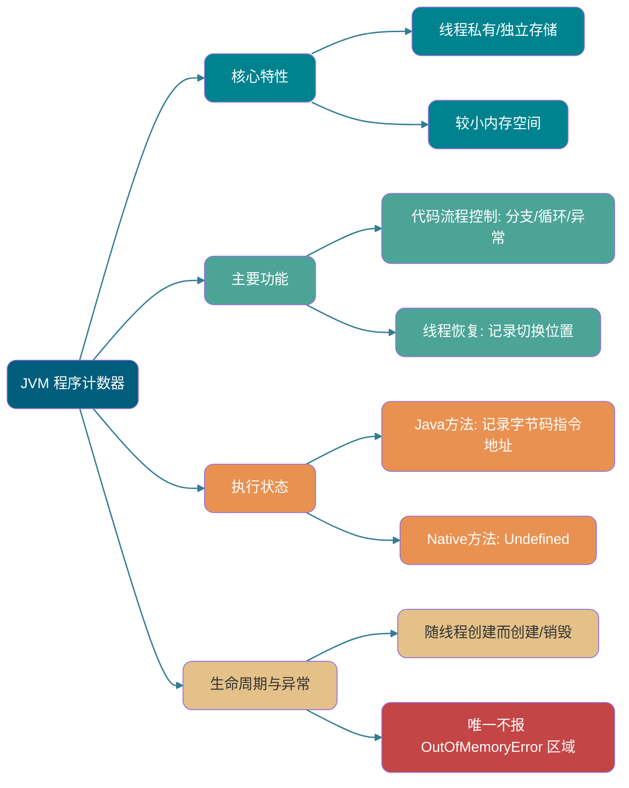
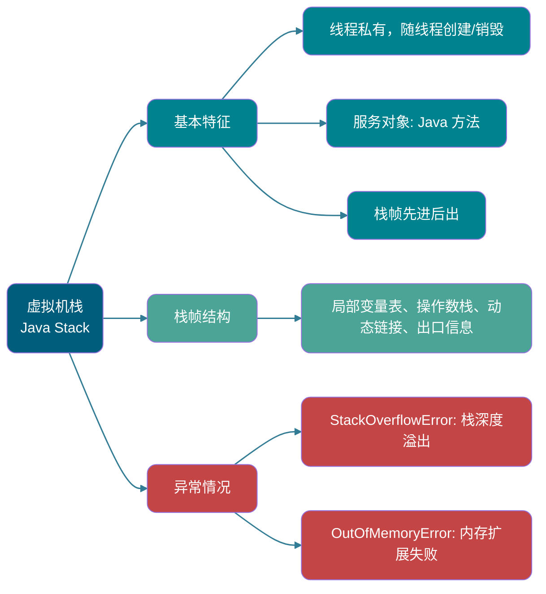
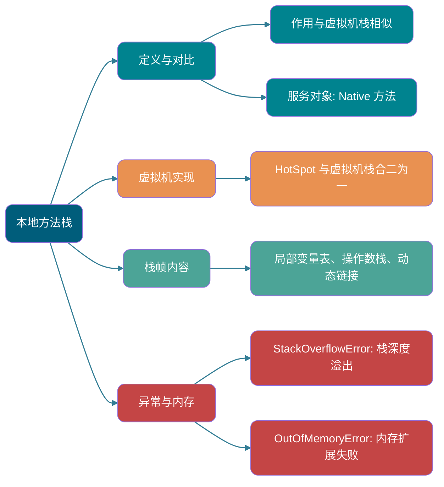
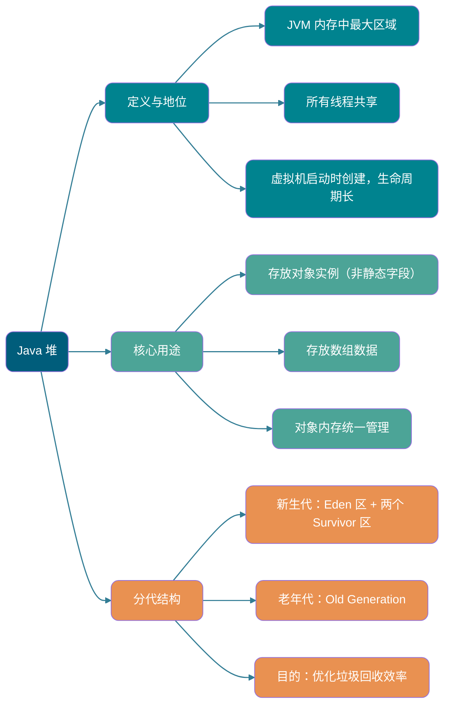
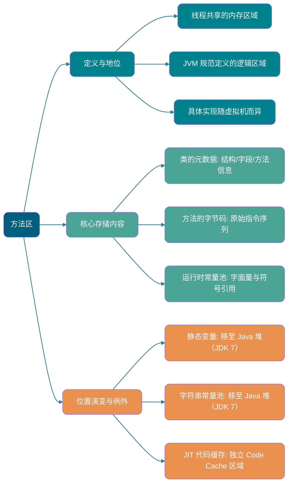
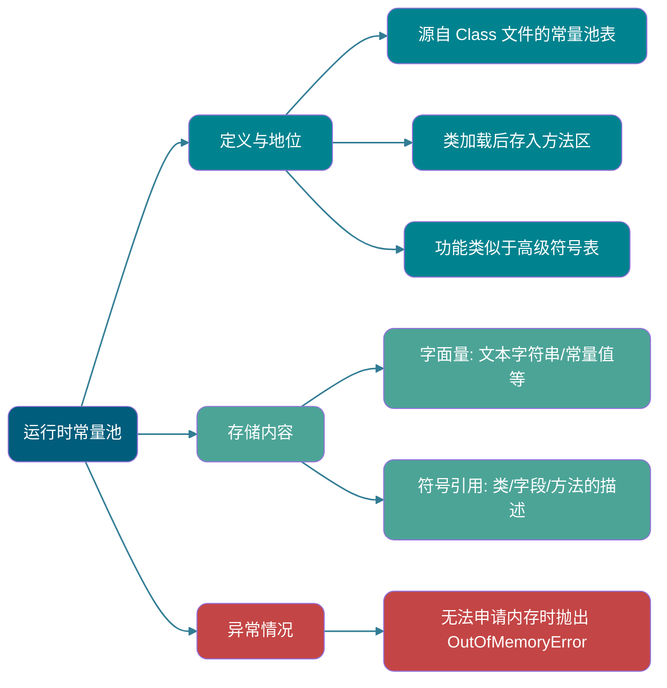
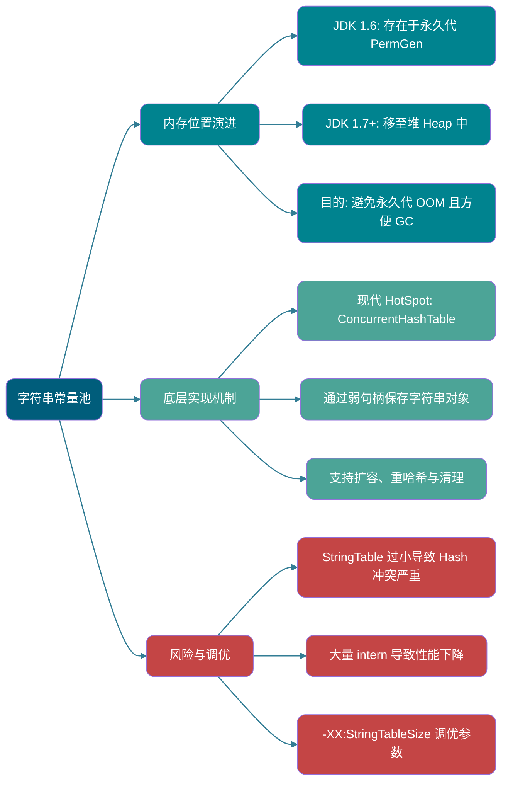
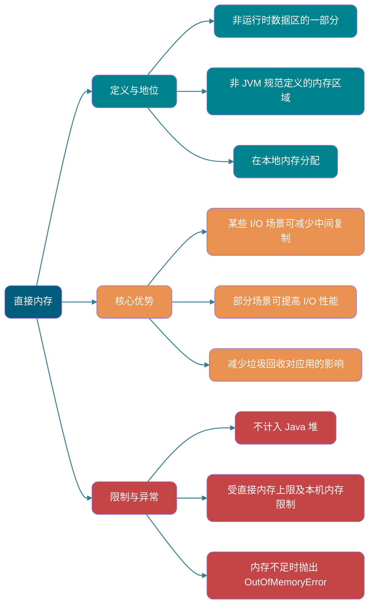
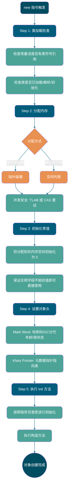

> 如果没有特殊说明，都是针对的是 HotSpot 虚拟机。
>
> 本文基于《深入理解 Java Virtual Machine：JVM 高级特性与最佳实践》进行总结补充。
>
> 常见面试题：
>
> - 介绍下 Java Memory Area（Runtime Data Area）
> - Java Object 的创建过程（五步，建议能默写出来并且要知道每一步虚拟机做了什么）
> - Object 的访问定位的两种方式（Handle 和 Direct Pointer 两种方式）

## 前言

对于 Java 程序员来说，在虚拟机自动内存管理机制下，不再需要像 C/C++程序开发程序员这样为每一个 new 操作去写对应的 delete/free 操作，不容易出现 Memory Leak 和 Out of Memory (OOM) 问题。正是因为 Java 程序员把内存控制权利交给 Java Virtual Machine，一旦出现 Memory Leak 和溢出方面的问题，如果不了解虚拟机是怎样使用内存的，那么排查错误将会是一个非常艰巨的 Task。

## Runtime Data Area

Java Virtual Machine 在执行 Java 程序的过程中会把它管理的内存划分成若干个不同的数据区域。

JDK 1.8 和之前的版本略有不同，我们这里以 JDK 1.7 和 JDK 1.8 这两个版本为例介绍。

**JDK 1.7**：


**JDK 1.8**：


**Thread 私有的：**

- Program Counter
- JVM Stack
- Native Method Stack

**Thread Shared 的：**

- Heap
- Method Area

Direct Memory 经常与这些区域一起讨论，但它不是《Java Virtual Machine 规范》定义的 Runtime Data Area，也不应被当作规范中的“Thread Shared Runtime Data Area”。

Java Virtual Machine 规范对于 Runtime Data Area 的规定是相当宽松的。以 Heap 为例：Heap 可以是连续空间，也可以不连续。 Heap 的大小可以固定，也可以在运行时按需扩展。虚拟机实现者可以使用任何 Garbage Collection (GC) Algorithm 管理 Heap，甚至完全不进行 GC 也是可以的。

### Program Counter



Program Counter 是一块较小的内存空间，可以看作是 Current Thread 所执行的 Bytecode 的行号指示器。 Bytecode Interpreter 工作时通过改变这个 Counter 的值来选取下一条需要执行的 Bytecode Instruction，分支、Loop、跳转、Exception Handling、Thread 恢复等功能都需要依赖这个 Counter 来完成。

另外，为了 Thread 切换后能恢复到正确的执行位置，每条 Thread 都需要有一个独立的 Program Counter，各 Thread 之间 Counter 互不影响，独立存储，我们称这类 Memory Area 为“Thread 私有”的内存。

从上面的介绍中我们知道了 Program Counter 主要有两个作用：

- Bytecode Interpreter 通过改变 Program Counter 来依次读取 Instruction，从而实现代码的流程控制，如：顺序执行、选择、Loop、Exception Handling。
- 在 Multithreading 的情况下，Program Counter 用于记录 Current Thread 执行的位置，从而当 Thread 被切换回来的时候能够知道该 Thread 上次运行到哪儿了。

Program Counter 的 Lifecycle 与 Thread 完全同步：

- **创建**：随着 Thread 的创建而创建。
- **销毁**：随着 Thread 的结束而销毁。

在执行 **Java Method**（非 native）时，Program Counter 记录的是 **当前正在执行的 JVM Bytecode Instruction 的 Address**。当 Thread 执行的是一个 **native Method**（Native Method）时，Program Counter 的值为 **Undefined（未定义）**，因为此时执行的不是 JVM Bytecode Instruction。

⚠️ 注意：Program Counter 是 JVM 规范中唯一没有规定任何 `OutOfMemoryError` 情况的 Memory Area。规范只规定了这一结论，并未要求所有实现都采用某种固定大小的具体表示。

### JVM Stack



与 Program Counter 一样，JVM Stack（后文简称 Stack）也是 Thread 私有的，它的 Lifecycle 和 Thread 相同，随着 Thread 的创建而创建，随着 Thread 的死亡而死亡。

Stack 绝对算的上是 JVM Runtime Data Area 的一个核心，除了一些 Native Method Invocation 是通过 Native Method Stack 实现的（后面会提到），其他所有的 Java Method Invocation 都是通过 Stack 来实现的（也需要和其他 Runtime Data Area 比如 Program Counter 配合）。

Method Invocation 的数据需要通过 Stack 进行传递，每一次 Method Invocation 都会有一个对应的 Stack Frame 被压 Push 中，每一个 Method Invocation 结束后，都会有一个 Stack Frame 被弹出。

Stack 由一个个 Stack Frame 组成，而每个 Stack Frame 中都拥有：Local Variable Table、Operand Stack、Dynamic Linking、Method Return Address。和 Data Structure 上的 Stack 类似，两者都是先进后出的 Data Structure，只支持 Pop 和 Push 两种操作。


**Local Variable Table** 主要存放了 Compile-time 可知的各种 Data Type（boolean、byte、char、short、int、float、long、double）、Object Reference（reference Type，它不同于 Object 本身，可能是一个指向 Object 起始 Address 的 Reference Pointer，也可能是指向一个代表 Object 的 Handle 或其他与此 Object 相关的位置）。


**Operand Stack** 主要作为 Method Invocation 的中转站使用，用于存放 Method 执行过程中产生的中间计算结果。另外，计算过程中产生的 Temporary Variable 也会放在 Operand Stack 中。

**Dynamic Linking**是 Stack Frame 的一项功能。每个 Stack Frame 都持有指向当前 Method 所属 Type 的 Runtime Constant Pool 的 Reference，用于把 Method 代码中的 Method Symbolic Reference 转换为具体的 Method Reference，并把 Variable 访问转换为对应运行时存储结构中的 Offset；解析尚未确定的符号时还可能触发 Class Loading。需要根据接收者实际 Type 选择虚 Method 实现的过程属于 Method Invocation Instruction 的动态分派，不能简单等同于这里的 Dynamic Linking。


Stack Space 虽然不是无限的，但一般正常调用的情况下是不会出现问题的。不过，如果 Function 调用陷入无限 Recursion 的话，就会导致 Stack 中被压入太多 Stack Frame 而占用太多空间，导致 Stack Space 过深。那么当 Thread 请求 Stack 的深度超过当前 JVM Stack 的最大深度的时候，就抛出 `StackOverflowError` 错误。

**Java Method 有两种返回方式**：

- **正常返回**：执行 return 语句，Return Value 传递给调用者。
- **Exception 返回**：Method 执行过程中抛出 Exception 且未被捕获。

不管哪种返回方式，都会导致 Stack Frame 被弹出。也就是说， **Stack Frame 随着 Method Invocation 而创建，随着 Method 结束而销毁。无论 Method 正常完成还是 Exception 完成都算作 Method 结束。**

除了 `StackOverflowError` 错误之外，Stack 还可能会出现 `OutOfMemoryError` 错误，这是因为如果 Stack 的内存大小可以动态扩展， 那么当虚拟机在动态扩展 Stack 时无法申请到足够的内存空间，则抛出 `OutOfMemoryError` Exception。

简单总结一下程序运行中 Stack 可能会出现两种错误：

- **`StackOverflowError`：** 当 Thread 执行所需的 Stack Space 超过 JVM 允许的大小时，抛出 `StackOverflowError` 错误。
- **`OutOfMemoryError`：** 如果 Stack 的内存大小可以动态扩展， 那么当虚拟机在动态扩展 Stack 时无法申请到足够的内存空间，则抛出 `OutOfMemoryError` Exception。


### Native Method Stack



和 JVM Stack 所发挥的作用非常相似，区别是：**JVM Stack 为虚拟机执行 Java Method（也就是 Bytecode）服务，而 Native Method Stack 则为虚拟机使用到的 Native Method 服务。** 在 HotSpot 虚拟机中和 JVM Stack 合二为一。

执行 Native Method 时，虚拟机实现可以使用传统的本地 Stack（通常称为 C Stack）。《Java Virtual Machine 规范》没有规定 Native Method Stack 必须采用与 JVM Stack Frame 相同的 Local Variable Table、Operand Stack 和 Dynamic Linking 结构。

Native Method 执行完毕后，相应的实现相关 Stack 数据会被释放。 Native Method Stack 也可能出现 `StackOverflowError` 和 `OutOfMemoryError` 两种错误。

### Heap



Java Virtual Machine 所管理的内存中最大的一块，Java Heap 是所有 Thread Shared 的一块 Memory Area，在虚拟机启动时创建。**此 Memory Area 的唯一目的就是存放 Object Instance，几乎所有的 Object Instance 以及 Array 都在这里分配内存。**

Java 世界中“几乎”所有的 Object 都在 Heap 中分配。不过，Just-In-Time Compilation (JIT) Compiler 可以基于 Escape Analysis 进行 Scalar Replacement，从而消除部分 Object 的实际分配。HotSpot 的这类优化不能简单表述为“Object 直接在 JVM Stack 上分配”。

Java Heap 是 Garbage Collector 管理的主要区域，因此也被称作 **GC Heap（Garbage Collected Heap）**。从 GC 的角度，由于现在收集器基本都采用 Generational GC Algorithm，所以 Java Heap 还可以细分为：Young Generation 和 Old Generation；再细致一点有：Eden、Survivor、Old 等空间。进一步划分的目的是更好地回收内存，或者更快地分配内存。

在 JDK 7 及更早版本的 HotSpot 中，GC 通常按下面三部分介绍，其中 Permanent Generation (PermGen) 是 Method Area 的实现，并不属于 Java Heap：

1. Young Generation 内存(Young Generation)
2. 老生代(Old Generation)
3. PermGen(Permanent Generation)

下图所示的 Eden 区、两个 Survivor 区 S0 和 S1 都属于 Young Generation，中间一层属于 Old Generation，最下面一层属于 PermGen。


**JDK 8 版本之后 PermGen 已被 Metaspace 取代，Metaspace 使用的是 Native Memory。**（我会在 Method Area 这部分内容详细介绍到）。

大部分情况，Object 都会首先在 Eden 区域分配，在一次 Young Generation GC 后，如果 Object 还存活，则会进入 S0 或者 S1，并且 Object 的年龄还会加 1（Eden 区->Survivor 区后 Object 的初始年龄变为 1）。 Object 达到 Promotion 年龄 Threshold 后会进入 Old Generation，该 Threshold 受收集器、自适应策略和 `-XX:MaxTenuringThreshold` Parameter 共同影响，并非所有收集器的默认值都是 15。对于采用 4 位年龄 Field 的经典 Generational Collection 器，该 Parameter 的上限是 15。

```bash
MaxTenuringThreshold of 20 is invalid; must be between 0 and 15
```

**为什么年龄只能是 0-15?**

因为记录年龄的区域在 Object Header 中，这个区域的大小通常是 4 位。这 4 位可以表示的最大二进制数字是 1111，即十进制的 15。因此，Object 的年龄被限制为 0 到 15。

这里我们简单结合 Object 布局来详细介绍一下。

在 HotSpot 虚拟机中，Object 在内存中存储的布局可以分为 3 块区域：Object Header（Header）、Instance Data 和 Alignment Padding（Padding）。其中，Object Header 包括两部分：Mark Word 和 Klass Pointer（Klass Word）。关于 Object 内存布局的详细介绍，后文会介绍到，这里就不重复提了。

这个年龄信息就是在 Mark Word 中存放的（Mark Word 还存放了 Object 自身的其他信息比如 Hash Code、Lock 状态信息等等）。下面旧版 HotSpot 源码中的 `markOop.hpp` 展示了当时标记字（Mark Word）的结构；现代 JDK 的对应实现和 Object Header 布局已经发生变化：


可以看到 Object 年龄占用的大小确实是 4 位。

> **🐛 修正（参见：[issue552](https://github.com/Snailclimb/JavaGuide/issues/552)）**：“Hotspot Traversal 所有 Object 时，按照年龄从小到大对其所占用的大小进行累加，当累加到某个年龄时，所累加的大小超过了 Survivor 区的一半，则取这个年龄和 `MaxTenuringThreshold` 中更小的一个值，作为新的 Promotion 年龄 Threshold”。
>
> **动态年龄计算的代码如下**
>
> ```c++
> uint ageTable::compute_tenuring_threshold(size_t survivor_capacity) {
>  //survivor_capacity是survivor空间的大小
> size_t desired_survivor_size = (size_t)((((double) survivor_capacity)*TargetSurvivorRatio)/100);//TargetSurvivorRatio 为50
> size_t total = 0;
> uint age = 1;
> while (age < table_size) {
> total += sizes[age];//sizes数组是每个年龄段对象大小
> if (total > desired_survivor_size) break;
> age++;
> }
> uint result = age < MaxTenuringThreshold ? age : MaxTenuringThreshold;
>   ...
> }
> ```

Heap 这里最容易出现的就是 `OutOfMemoryError` 错误，并且出现这种错误之后的表现形式还会有几种，比如：

1. **`java.lang.OutOfMemoryError: GC Overhead Limit Exceeded`**：当 JVM 花太多时间执行 GC 并且只能回收很少的 Heap Space 时，就会发生此错误。
2. **`java.lang.OutOfMemoryError: Java heap space`** :假如在创建新的 Object 时, Heap Memory 中的空间不足以存放新创建的 Object, 就会引发此错误。(和配置的最大 Heap Memory 有关，且受制于物理内存大小。最大 Heap Memory 可通过 `-Xmx` Parameter 配置，若没有特别配置，将会使用默认值，详见：[Default Java 8 max heap size](https://stackoverflow.com/questions/28272923/default-xmxsize-in-java-8-max-heap-size))
3. ……

### Method Area



Method Area 属于是 JVM Runtime Data Area 的一块逻辑区域，是各个 Thread Shared 的 Memory Area。

《Java Virtual Machine 规范》只是规定了有 Method Area 这么个概念和它的作用，Method Area 到底要如何实现那就是虚拟机自己要考虑的事情了。也就是说，在不同的虚拟机实现上，Method Area 的实现是不同的。

当虚拟机加载一个 Class 时，它会从 Class 文件中解析出相应的信息，并将这些**Metadata**存入 Method Area。具体来说，Method Area 主要存储以下核心数据：

1. **Class 的 Metadata**：包括 Class 的完整结构，如 Class Name、Superclass、实现的 Interface、Access Modifier，以及 Field 和 Method 的详细信息（名称、Type、Modifier 等）。
2. **Method 的 Bytecode**：每个 Method 的原始 Instruction 序列。
3. **Runtime Constant Pool**：每个 Class 独有的，由 Class 文件中的 Constant Pool 转换而来，用于存放 Compile-time 生成的各种 Literal 和对 Type、Field、Method 的 Symbolic Reference。

需要特别注意的是，以下几 Class 数据虽然在逻辑上与 Class 相关，但在 HotSpot 虚拟机中，它们并不存储在 Method Area 内：

- **Static Variable（Static Variables）**：自 JDK 7 起，Class Static Variable 与对应的 `java.lang.Class` Object 一起存放在 Java Heap 中。
- **String Constant Pool（String Pool）**：同样自 JDK 7 起，String Constant Pool 也**移至 Java Heap 中**。
- **Just-In-Time Compiler 编译后的代码缓存（JIT Code Cache）**：JIT Compiler 将热点 Method 的 Bytecode 编译成的本地机器码，存放在一个**独立的、名为“Code Cache”的 Memory Area**，而不是 Method Area 本身。这样做是为了实现更高效的执行和内存管理。


**Method Area 和 PermGen 以及 Metaspace 是什么关系呢？** Method Area 和 PermGen 以及 Metaspace 的关系很像 Java 中 Interface 和 Class 的关系，Class 实现了 Interface，这里的 Class 就可以看作是 PermGen 和 Metaspace，Interface 可以看作是 Method Area，也就是说 PermGen 以及 Metaspace 是 HotSpot 虚拟机对虚拟机规范中 Method Area 的两种实现方式。并且，PermGen 是 JDK 1.8 之前的 Method Area 实现，JDK 1.8 及以后 Method Area 的实现变成了 Metaspace。


**为什么要将 PermGen 替换为 Metaspace 呢?**

下图来自《深入理解 Java Virtual Machine》第 3 版 2.2.5


1、PermGen 的 Capacity 受 `-XX:MaxPermSize` 上限约束，这个上限可以配置；Metaspace 改用 Native Memory，并可通过 `-XX:MaxMetaspaceSize` 限制。两者都可能溢出，实际风险取决于配置和 Class Metadata 的增长情况。

> 当 Metaspace 溢出时会得到如下错误：`java.lang.OutOfMemoryError: Metaspace`

你可以使用 `-XX:MaxMetaspaceSize` 设置最大 Metaspace 大小。若不设置，Class Metadata 空间可继续增长，直到受到可用 Native Memory 等条件限制。`-XX:MetaspaceSize` 不是 Metaspace 的初始 Capacity，而是触发 Metadata GC 的初始高水位 Threshold，之后 JVM 会动态调整该 Threshold。

2、Metaspace 里面存放的是 Class 的 Metadata，这样加载多少 Class 的 Metadata 就不由 `MaxPermSize` 控制了, 而由系统的实际可用空间来控制，这样能加载的 Class 就更多了。

3、在 JDK8，合并 HotSpot 和 JRockit 的代码时, JRockit 从来没有一个叫 PermGen 的东西, 合并之后就没有必要额外的设置这么一个 PermGen 的地方了。

4、PermGen 会为 GC 带来不必要的复杂度，并且回收效率偏低。

**Method Area 常用 Parameter 有哪些？**

JDK 1.8 之前 PermGen 还没被彻底移除的时候通常通过下面这些 Parameter 来调节 Method Area 大小。

```java
-XX:PermSize=N //方法区 (永久代) 初始大小
-XX:MaxPermSize=N //方法区 (永久代) 最大大小,超过这个值将会抛出 OutOfMemoryError 异常:java.lang.OutOfMemoryError: PermGen
```

相对而言，GC 行为在这个区域是比较少出现的，但并非数据进入 Method Area 后就“永久存在”了。

JDK 1.8 的时候，Method Area（HotSpot 的 PermGen）被彻底移除了（JDK1.7 就已经开始了），取而代之是 Metaspace，Metaspace 使用的是 Native Memory。下面是一些常用 Parameter：

```java
-XX:MetaspaceSize=N //设置触发元数据 GC 的初始高水位阈值
-XX:MaxMetaspaceSize=N //设置 Metaspace 的最大大小
```

与 PermGen 很大的不同是，如果不指定 `MaxMetaspaceSize`，Metaspace 没有由该 Parameter 设定的固定上限，持续的 Class Metadata 增长可能消耗大量 Native Memory。

### Runtime Constant Pool



Class 文件中除了有 Class 的版本、Field、Method、Interface 等描述信息外，还有用于存放 Compile-time 生成的各种 Literal 和 Symbolic Reference 的 **Constant Pool 表(Constant Pool Table)**。

Literal 是源代码中的固定值的表示法，即通过字面我们就能知道其值的含义。 Literal 包括整数、Floating-point Number 和 String Literal。常见的 Symbolic Reference 包括 Class Symbolic Reference、Field Symbolic Reference、Method Symbolic Reference、Interface Method 符号。

《深入理解 Java Virtual Machine》7.34 节第三版对 Symbolic Reference 和 Direct Reference 的解释如下：


Constant Pool 表会在 Class Loading 后存放到 Method Area 的 Runtime Constant Pool 中。

Runtime Constant Pool 的功能类似于传统编程语言的符号表，尽管它包含了比典型符号表更广泛的数据。

既然 Runtime Constant Pool 是 Method Area 的一部分，自然受到 Method Area 内存的限制，当 Constant Pool 无法再申请到内存时会抛出 `OutOfMemoryError` 错误。

### String Constant Pool



**String Constant Pool** 是 JVM 为了提升 Performance 和减少内存消耗针对 String（String Class）专门开辟的一块区域，主要目的是为了避免 String 的重复创建。

```java
// 1.在字符串常量池中查询字符串对象 "ab"，如果没有则创建"ab"并放入字符串常量池
// 2.将字符串对象 "ab" 的引用赋值给 aa
String aa = "ab";
// 直接返回字符串常量池中字符串对象 "ab"，赋值给引用 bb
String bb = "ab";
System.out.println(aa==bb); // true
```

HotSpot 虚拟机中 String Constant Pool 的实现可以在 `src/hotspot/share/classfile/stringTable.cpp` 中看到。现代 HotSpot 的本地 `StringTable` 使用 Concurrency Hash Table，并通过弱 Handle 保存 Heap 中的 String Object，支持 Resize、重哈希以及清理失效条目；`-XX:StringTableSize` 用于设置初始桶数量。因此，“固定 Length Array + Linked List”的说法只适用于部分旧版实现，不能用于概括当前 HotSpot。

JDK1.7 之前，String Constant Pool 存放在 PermGen。JDK1.7 将 String Constant Pool 和 Class Static Variable 移到了 Java Heap 中。


**JDK 1.7 为什么要将 String Constant Pool 移动到 Heap 中？**

主要是因为 PermGen（Method Area 实现）的 GC 回收效率太低，只有在整 Heap 收集 (Full GC)的时候才会被执行 GC。Java 程序中通常会有大量的被创建的 String 等待回收，将 String Constant Pool 放到 Heap 中，能够更高效及时地回收 String 内存。

相关问题：[JVM Constant Pool 中存储的是 Object 还是 Reference 呢？ - RednaxelaFX - 知乎](https://www.zhihu.com/question/57109429/answer/151717241)

最后再来分享一段周志明老师在[《深入理解 Java Virtual Machine（第 3 版）》样例代码&勘误](https://github.com/fenixsoft/jvm_book) GitHub 仓库的 [issue#112](https://github.com/fenixsoft/jvm_book/issues/112) 中说过的话：

> **Runtime Constant Pool、Method Area、String Constant Pool 这些都是不随虚拟机实现而改变的逻辑概念，是公共且抽象的，Metaspace、Heap 是与具体某种虚拟机实现相关的物理概念，是私有且具体的。**

### Direct Memory



Direct Memory 是一种特殊的内存 Buffer，并不在 Java Heap 或 Method Area 中分配，而是在 Native Memory 中分配。具体分配机制属于虚拟机实现细节，并不等同于必须通过 Java Native Interface (JNI) 分配。

Direct Memory 并不是虚拟机 Runtime Data Area 的一部分，也不是虚拟机规范中定义的 Memory Area，但是这部分内存也被频繁地使用。而且也可能导致 `OutOfMemoryError` 错误出现。

JDK1.4 中新加入的 **NIO（New I/O）**，引入了一种基于**通道（Channel）**与**Buffer**的 I/O 方式。直接 Byte Buffer 可以在 Java Heap 外分配内容，并通过 Java Heap 中的 `DirectByteBuffer` Object 进行操作。JVM 会尽力直接在这种 Buffer 上执行本地 I/O，从而在某些场景中减少中间 Buffer 的数据复制；NIO 中只有可选择通道与 Selector 等部分提供 Non-blocking I/O 能力，不能把整个 NIO 展开为 Non-Blocking I/O。

Direct Memory 不计入 Java Heap，但仍会受到本机总内存、处理器寻址空间等条件的限制。对于 NIO 直接 Buffer，还可以通过 [`-XX:MaxDirectMemorySize`](https://docs.oracle.com/en/java/javase/25/docs/specs/man/java.html#extra-options-for-java) 限制总分配量。

类似的概念还有 **Off-heap Memory**。在一些文章中将 Direct Memory 等价于 Off-heap Memory，个人觉得不是特别准确。

Off-heap Memory 是分配在 Java Heap 之外的内存的统称，底层通常使用 Operating System 提供的 Native Memory。它是否以及如何受到 JVM 或 JDK 管理，取决于具体的分配方式。例如，在 OpenJDK/HotSpot 中，`DirectByteBuffer` 对应的 Native Memory 会关联 Java Heap 中的 Buffer Object，并在 Object 变为 Unreachable 后通过 `Cleaner` 等机制参与清理。由于清理时机不由应用程序直接控制，使用 Off-heap Memory 可以减少 Java Heap 的压力，但仍然需要关注本地 Memory Leak 和 `OutOfMemoryError`。

## HotSpot 虚拟机 Object 探秘

通过上面的介绍我们大概知道了虚拟机的内存情况，下面我们来详细的了解一下 HotSpot 虚拟机在 Java Heap 中 Object 分配、布局和访问的全过程。

### Object 的创建

Java Object 的创建过程我建议最好是能默写出来，并且要掌握每一步在做什么。



#### Step1:Class Loading 检查

虚拟机遇到一条 new Instruction 时，首先将去检查这个 Instruction 的 Parameter 是否能在 Constant Pool 中定位到这个 Class 的 Symbolic Reference，并且检查这个 Symbolic Reference 代表的 Class 是否已被加载过、解析和 Initialization 过。如果没有，那必须先执行相应的 Class Loading。

#### Step2:分配内存

在**Class Loading 检查**通过后，接下来虚拟机将为新生 Object**分配内存**。 Object 所需的内存大小在 Class Loading 完成后便可确定，为 Object 分配空间的 Task 等同于把一块确定大小的内存从 Java Heap 中划分出来。**分配方式**有 **“Bump-the-Pointer”** 和 **“Free List”** 两种，**选择哪种分配方式由 Java Heap 是否规整决定，而 Java Heap 是否规整又由所采用的 Garbage Collector 是否带有压缩整理功能决定**。

**Memory Allocation 的两种方式**（补充内容，需要掌握）：

- Bump-the-Pointer：
  - 适用场合：Heap Memory 规整（即没有内存碎片）的情况下。
  - 原理：用过的内存全部整合到一边，没有用过的内存放在另一边，中间有一个分界 Pointer，只需要向着没用过的内存方向将该 Pointer 移动 Object 内存大小位置即可。
  - 使用该分配方式的 GC 收集器：Serial, ParNew
- Free List：
  - 适用场合：Heap Memory 不规整的情况下。
  - 原理：虚拟机会维护一个列表，该列表中会记录哪些内存块是可用的，在分配的时候，找一块儿足够大的内存块儿来划分给 Object Instance，最后更新列表记录。
  - 使用该分配方式的 GC 收集器：CMS

选择以上两种方式中的哪一种，取决于 Java Heap Memory 是否规整。而 Java Heap Memory 是否规整，取决于 GC 收集器的 Algorithm 是“Mark-Sweep”，还是“Mark-Compact”（也称作“标记-压缩”），值得注意的是，Copying Algorithm 内存也是规整的。

**Memory Allocation Concurrency 问题（补充内容，需要掌握）**

在创建 Object 的时候有一个很重要的问题，就是 Thread-safe，因为在实际开发过程中，创建 Object 是很频繁的事情，作为虚拟机来说，必须要保证 Thread 是安全的，通常来讲，虚拟机采用两种方式来保证 Thread-safe：

- **Compare-And-Swap (CAS)+失败 Retry：** CAS 是 Optimistic Lock 的一种实现方式。所谓 Optimistic Lock 就是，每次不 Locking 而是假设没有冲突而去完成某项操作，如果因为冲突失败就 Retry，直到成功为止。**虚拟机采用 CAS 配上失败 Retry 的方式保证更新操作的 Atomicity。**
- **Thread-Local Allocation Buffer (TLAB)：** 为每一个 Thread 预先在 Eden 区分配一块儿内存，JVM 在给 Thread 中的 Object 分配内存时，首先在 TLAB 分配，当 Object 大于 TLAB 中的剩余内存或 TLAB 的内存已用尽时，再采用上述的 CAS 进行 Memory Allocation

#### Step3:Initialization 零值

Memory Allocation 完成后，虚拟机需要将分配到的内存空间都 Initialization 为零值（不包括 Object Header），这一步操作保证了 Object 的 Instance Field 在 Java 代码中可以不赋初始值就直接使用，程序能访问到这些 Field 的 Data Type 所对应的零值。

#### Step4:设置 Object Header

Initialization 零值完成之后，**虚拟机要对 Object 进行必要的设置**，例如这个 Object 是哪个 Class 的 Instance、如何才能找到 Class 的 Metadata 信息、Object 的 Hash Code、Object 的 GC Generational 年龄等信息。 **这些信息存放在 Object Header 中。** 另外，Object Header 的具体布局与 JDK 版本和虚拟机配置有关；例如 Biased Lock 在 JDK 15 起默认禁用，相关实现后来又被移除。

#### Step5:执行 init Method

在上面工作都完成之后，从虚拟机的视角来看，一个新的 Object 已经产生了，但从 Java 程序的视角来看，Object 创建才刚开始，`<init>` Method 还没有执行，所有的 Field 都还为零。所以一般来说，执行 new Instruction 之后会接着执行 `<init>` Method，把 Object 按照程序员的意愿进行 Initialization，这样一个真正可用的 Object 才算完全产生出来。

### Object 的内存布局

在 Hotspot 虚拟机中，Object 在内存中的布局可以分为 3 块区域：**Object Header（Header）**、**Instance Data**和**Alignment Padding（Padding）**。

Object Header 包括两部分信息：

1. Mark Word：用于存储 Object 自身的运行时数据，如 Hash Code（HashCode）、GC Generational 年龄、Lock 状态等；偏向 Thread ID、偏向 Timestamp 只适用于仍实现并启用 Biased Lock 的旧版 HotSpot。
2. Klass Pointer：Object 指向它的 Class Metadata 的 Pointer，虚拟机通过这个 Pointer 来确定这个 Object 是哪个 Class 的 Instance。

**Instance Data 部分是 Object 真正存储的有效信息**，也是在程序中所定义的各种 Type 的 Field 内容。

**Alignment Padding 部分不是必然存在的，也没有什么特别的含义，仅仅起占位作用。** HotSpot 会按 Object 对齐边界分配 Object，默认对齐通常是 8 Byte，也可受 `-XX:ObjectAlignmentInBytes` 等配置影响。因此 Object 总大小需要补齐到对齐边界；Object Header 本身并不保证总是 8 Byte 的整数倍，例如启用压缩 Class Pointer 时常见的 Object Header 大小是 12 Byte。

### Object 的访问定位

建立 Object 就是为了使用 Object，我们的 Java 程序通过 Stack 上的 reference 数据来操作 Heap 上的具体 Object。 Object 的访问方式由虚拟机实现而定，目前主流的访问方式有：**使用 Handle**、**Direct Pointer**。

#### Handle

如果使用 Handle 的话，那么 Java Heap 中将会划分出一块内存来作为 Handle 池，reference 中存储的就是 Object 的 Handle Address，而 Handle 中包含了 Object Instance Data 与 Object Type 数据各自的具体 Address 信息。


#### Direct Pointer

如果使用 Direct Pointer 访问，reference 中存储的直接就是 Object 的 Address。


这两种 Object 访问方式各有优势。使用 Handle 来访问的最大好处是 reference 中存储的是稳定的 Handle Address，在 Object 被移动时只会改变 Handle 中的 Instance Data Pointer，而 reference 本身不需要修改。使用 Direct Pointer 访问方式最大的好处就是速度快，它节省了一次 Pointer 定位的时间 Overhead。

HotSpot 虚拟机主要使用的就是这种方式来进行 Object 访问。

## 参考

- 《深入理解 Java Virtual Machine：JVM 高级特性与最佳实践（第二版》
- 《自己动手写 Java Virtual Machine》
- Chapter 2. The Structure of the Java Virtual Machine：<https://docs.oracle.com/javase/specs/jvms/se8/html/jvms-2.html>
- JVM Stack Frame 内部结构-Dynamic Linking：<https://chenxitag.com/archives/368>
- Java 中 new String（“Literal”） 中 “Literal” 是何时进入 String Constant Pool 的？ - 木女孩的回答 - 知乎：<https://www.zhihu.com/question/55994121/answer/147296098>
- JVM Constant Pool 中存储的是 Object 还是 Reference 呢？ - RednaxelaFX 的回答 - 知乎：<https://www.zhihu.com/question/57109429/answer/151717241>
- <http://www.pointsoftware.ch/en/under-the-hood-runtime-data-areas-javas-memory-model/>
- <https://dzone.com/articles/jvm-permgen-%E2%80%93-where-art-thou>
- <https://stackoverflow.com/questions/9095748/method-area-and-permgen>

<!-- @include: @article-footer.snippet.md -->
